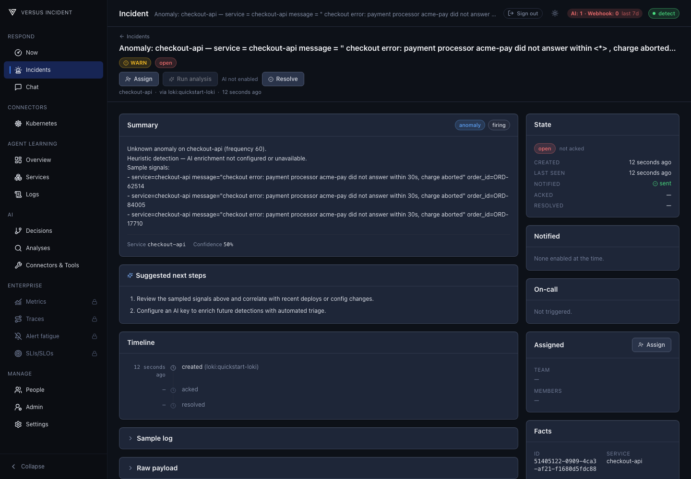
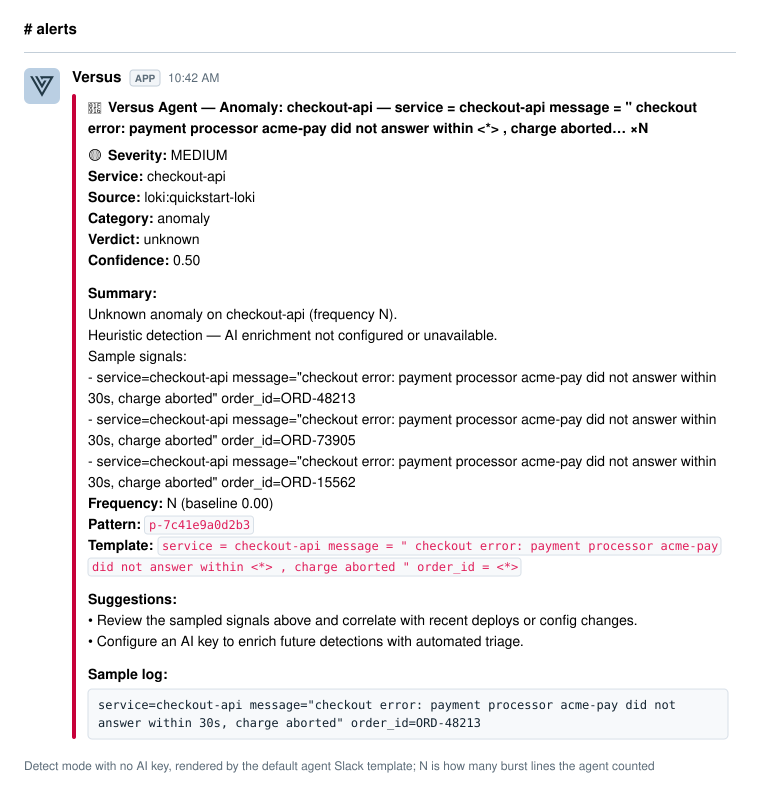

# AI Detect Mode

## Concept

Detect is the **go-live** mode. The agent judges every pattern the same way it
does in [shadow](./shadow-mode.md), but now a new pattern or a
[spike](./spike.md) becomes a **real incident**. Incidents go to your channels
(Slack, Teams, Telegram, email, and others); high and critical ones also go to
on-call when it is enabled.

Each incident explains itself: a title, the service, a severity, a short
summary, sample lines with secrets masked, and suggested next steps.

**An AI key is optional.** Detection itself does not use AI.

| | Without an AI key | With an AI key |
|---|---|---|
| Is the incident raised? | Yes | Yes |
| Summary | A templated summary marked `Heuristic detection — AI enrichment not configured or unavailable.` | Written by the AI from the pattern, its history and the sample lines. |
| Severity | Medium for a new pattern. A large spike, or a severity field on the log lines that reads high or critical, can raise it. | Set by the AI. |
| Next steps | Generic checks. | Specific suggestions from the AI. |

If the AI is over its hourly limit or returns an error, the agent still sends
the templated incident. A real problem is never dropped because the AI is
unavailable.


## Example

`checkout-api` has been in shadow for a week and the list holds only real
problems, so you switch to detect. That evening a dependency slows down and
the service logs 60 lines of:

```text
checkout error: payment processor acme-pay did not answer within 30s
```

The agent has never seen this pattern. Within one poll it raises one incident:

- **Title:** `Anomaly: checkout-api — …`
- **Summary:** the unknown pattern, how often it fired, three sample lines.
- **With an AI key:** a summary such as "checkout-api cannot reach the acme-pay
  payment processor; payments are timing out", plus next steps such as
  "check acme-pay status and recent network changes".

The error keeps coming for ten more minutes. Those repeats are added to the
same open incident instead of opening new ones; if the problem gets more
severe, Versus sends an update. Once you resolve the incident, the next
occurrence opens a new one. If the error stops for 10 minutes, its next
occurrence also opens a new incident, even when the old one is still open.

## What you see in the UI

The incident is on the **Incidents** page, on the **AI Detected** tab.



Every decision the agent made is listed in **AI → Decisions**, on the
**Detect** tab: when it fired, the service, the verdict (`unknown` or `spike`),
the severity, the pattern and its frequency. The **Outcome** column tells you
whether the incident was sent, reused a recent AI finding, fell back to the
templated summary, or failed to send. Open a row to see the full finding and,
with an AI key, the prompt and the model's response.


In Slack the incident looks like this:



*An illustration of the Slack message.* Set up channels in
[Notification Channels](./channels.md).

## Turn it on

Switch the mode and restart. Learned patterns are kept.

```yaml
agent:
  enable: true
  mode: detect
```

Or set `AGENT_MODE=detect`. _Enterprise_ admins can also switch from
**Admin → Runtime mode** in the UI.

To add AI summaries, set a key:

```yaml
agent:
  ai:
    enable: true
    provider: openai          # openai | deepseek | qwen | ollama | claude | gemini
    api_key: ${AGENT_AI_API_KEY}
    model: gpt-4o-mini
```

Or with environment variables: `AGENT_AI_ENABLE=true`, `AGENT_AI_API_KEY`,
and optionally `AGENT_AI_MODEL` and `AGENT_AI_PROVIDER`.

| Setting | Default | What it does |
|---|---|---|
| `agent.ai.max_calls_per_hour` | `60` | Cap on AI calls. Past the cap, incidents use the templated summary. |
| `agent.ai.cache_ttl` | `1h` | The same pattern firing again within this time reuses the last AI finding. |
| `agent.new_service_grace` | `24h` (`30m` in the Helm chart) | A service seen for the first time is learned quietly for this long before it can raise incidents. |

To see detect end to end on your machine, follow the
[AIOps SRE Quickstart](./quickstart.md).

## Tips

- **One harmless pattern keeps raising incidents?** Mark it **known** on the
  **Agent Learning → Logs** page. A known pattern only comes back if it
  [spikes](./spike.md).
- **Incidents carry a vague rule name?** Add a named [Regex](./regex.md) rule
  for that kind of line.
- **Want to see what detect would raise before it sends anything?** Stay in [Shadow Mode](./shadow-mode.md).

## Reference

- [Configuration](./configuration.md): every `agent.ai` key, providers and custom
  endpoints.
- [Notification Channels](./channels.md): where incidents are sent.
- [AI Analyze](./ai-analyze-mode.md): a deeper investigation of one incident.
