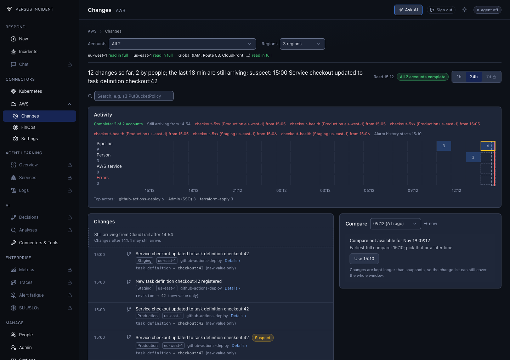
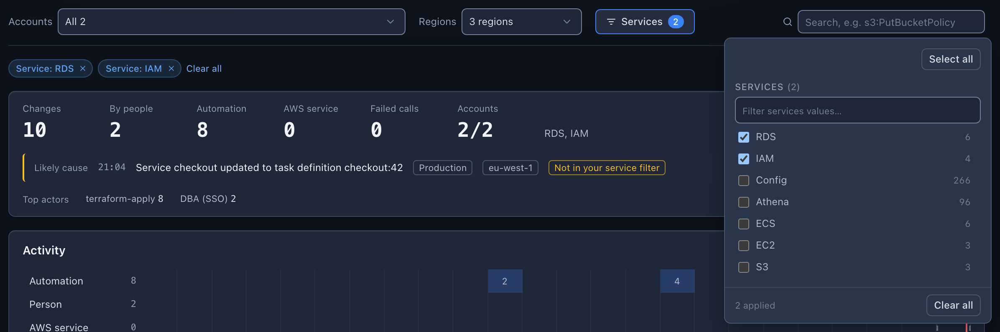
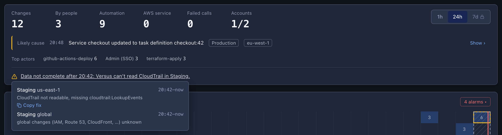

# AWS Changes

**See who changed what in your AWS accounts, which change most likely started
an alarm, and how your resources differ from an earlier time.** Open
**AWS > Changes**. The page reads CloudTrail and only reads: nothing on it acts
on AWS.

**Try it quickly:** [AWS Quickstart](/agent/aws/quickstart)

**Full setup and every setting:** [Changes setup](/agent/aws/configuration#changes-setup)

## Read the page in 30 seconds

| Part | What it tells you | What you do |
| --- | --- | --- |
| Scope bar | Which accounts, Regions, services and time you are looking at | Narrow to the account, Region or service you care about |
| Summary card | How many changes, by whom, and the likely cause of an alarm | Click **Show ›** on the likely cause |
| Warning line | Only shown when some data in the window is missing | Open it to see each gap and its fix |
| Activity grid | When changes happened, per actor type, with alarms marked | Look for a burst next to a red alarm line |
| Changes list | One plain sentence per change, newest first | Open **Details ›** to see the API call and fields |
| Compare | What differs between two times | Pick a *from* and a *to* time |

## Scope bar

The bar at the top sets what every card below answers.

| Control | What it does |
| --- | --- |
| **Accounts** | **All N**, or one account. Each option names its state: `complete`, `as of 16:19`, `gap 02:10–03:40`, or the reason it is not read. |
| **Regions** | **N regions**, or one Region. Each option names its state: `complete`, `partly unknown` or `not enabled`. **Global (IAM, …)** holds changes to global services. |
| **Services** | A checkbox list of every service with changes in the window, with its count. See [Services filter](#services-filter). |
| Search | Matches change sentences and raw API names, for example `s3:PutBucketPolicy`. Press Enter to search. |
| **1h · 24h · 7d** | The time window, at the right of the summary card. **7d** shows a lock in OSS. |

When you follow a link to an exact span, a chip shows it, for example
`14:00 – 16:00`. Click **×** on the chip to go back to the window.

### Services filter

- **Default:** RDS and IAM are checked. A busy account writes thousands of
  routine changes (AWS Config, Athena, Auto Scaling); the default keeps the
  page on what usually matters.
- **Saved per user.** Your choice comes back on your next visit and in other
  browsers. Other users keep their own.
- **Unchecked services stay listed** with their counts, so you can see what is
  hidden.
- **Search**, **Select all** and **Clear** sit in the panel. Clear means all
  services. Each checked service also shows as a removable chip under the bar.
- The filter narrows the summary numbers, top actors, the grid, the list and
  Compare. It never hides the warning line or the likely cause.
- The summary card names the filter next to the numbers: `RDS, IAM`,
  `5 services` or `All services`.

A shared link that carries a service filter shows the sender's services for
that view. Your saved choice changes only when you use the panel or its chips.

## Summary card

### The numbers

| Number | What it counts |
| --- | --- |
| **Changes** | Every change in the window and filter |
| **By people** | Changes from console sessions or the AWS CLI |
| **Automation** | Pipelines, web-identity roles, roles a service acts through, and SDK callers |
| **AWS service** | Changes AWS made on your behalf |
| **Unknown actor** | Shown only when a change has no principal name |
| **Failed calls** | Change attempts that AWS refused; red when above 0 |
| **Accounts** | `n/m`: accounts in scope read in full, out of all in scope |

A number shows `—` while the first read runs or while a new filter loads.

**Top actors** lists up to five actors with their change counts.

### Likely cause

When an alarm is in scope, the card names the change that most likely started
it: time, sentence, account and Region.

- Click **Show ›**. The list scrolls to the row and the grid outlines its cell.
- **Not in your service filter** means the change is in a service you have
  unchecked. **Show ›** adds that service for this view only.
- When no change can be named, the row says why, after the alarm name:

| Text | Meaning |
| --- | --- |
| no change matches this alarm | Nothing in the searched span fits the alarm |
| can't tell which resource this alarm watches | The alarm's resource is not known |
| not enough data to tell | Data is missing where the cause would be |
| start time unknown, so not enough data to tell | The alarm has no start time |

Hover the row to see where Versus looked.

### The warning line

The line appears at the foot of the card **only when some data in the window
is missing**. If there is no line, the numbers are full counts.

> ⚠ Data not complete after 20:42: Versus can't read CloudTrail in Staging.

With several causes it names the first and adds `, and N more`. Click the line
to open **Missing data**:

- each gap: account, Region, span, reason and any missing permission;
- **Copy fix** on a permission gap, which copies the IAM statement;
- **Reconnect ›** on a disconnected account, which opens AWS Settings;
- Regions that are `not enabled`;
- `N malformed events skipped`, and
  `The collector hit its cap, so more changes exist`.

While Versus reads an account for the first time, the line reads
**Reading the last 24 h…** and has no popover.

### "No changes"

The card says **No changes in the last 24 h** only when there is no warning
line. With a filter it names the services, for example
**No RDS or IAM changes in the last 24 h**. Below it,
`Last change before this window: 3 d ago` tells you how quiet it has been.

## Gaps and their reasons

A gap is a stretch of time Versus could not read. It shows in the warning
popover, as a hatched band on the grid, and in the Accounts and Regions
options.

| Reason on the page | Fix |
| --- | --- |
| CloudTrail not readable | Add the missing permission to the reader role. **Copy fix** gives the statement. See [IAM permissions](#iam-permissions). |
| CloudTrail throttled the collector | Usually nothing: later reads fill the gap. If it keeps happening, find the other caller of `LookupEvents` in that account. |
| too many events to fetch in time | Raise `changes.page_budget` (up to 1000). The popover shows the event rate. |
| the collector was not running | Check that Versus was running and `collect.enable` is on. |
| not checked yet | Wait. The first read of an account takes about 5 minutes. |
| before the account was connected | Nothing to fix. Versus has no history before the connect. |
| older than the kept change history | Pick a later time, or keep history longer (`history.change_retention`). |
| Region not enabled in AWS | Opt in to the Region in the AWS console, or remove it from `regions`. |
| credentials not valid | Fix the credentials, then **Reconnect ›** in AWS Settings. |
| account disconnected | **Reconnect ›** in AWS Settings. Rows after the disconnect carry an `as of` chip. |
| could not assume the reader role | Check the role ARN and its trust policy, then reconnect. |
| the credentials belong to another account | Point the account entry at credentials for that account, then reconnect. |
| global changes (IAM, Route 53, CloudFront, …) unknown | Global changes are read from `us-east-1`. Fix the read there. |

The newest few minutes are drawn with a dashed outline on the grid. CloudTrail
delivers events late, so those minutes settle on a later read. They never
raise the warning line.

## Activity grid

- **Rows:** Automation, Person, AWS service, Unknown (only when present) and
  Errors. Each row label shows its total.
- **Columns:** 5 minutes on 1h, one hour on 24h, and 6 hours on 7d. On 7d,
  day labels such as `Nov 18` mark each midnight.
- **Shading:** 1–99, 100–999, 1,000 or more. Counts of 1,000 or more read
  short, such as `3.8k`; hover a cell for the exact count.
- **Hatched band:** a gap. Hover it for the account, Region, span and reason.
- **Lighter hatch behind a count:** part of the scope is unknown for that
  hour. Hover it to see which account.
- **Red vertical line:** an alarm start. Hover it for the alarm name.
- **Alarms chip**, for example `4 alarms ▾`: lists each alarm with its account,
  Region and start. `Alarm history starts …` shows there when alarm history
  begins inside the window.
- **Outlined cell:** the likely cause.
- **Busiest hour** (or **Busiest span** on 7d) shows under the grid when an
  hour holds 100 changes or more.

## Changes list

Each row is one plain sentence, newest first, with its time, actor icon and
actor name. Account and Region chips appear when you look at more than one.

| On a row | Meaning |
| --- | --- |
| **Likely cause** tag | The change the summary card names |
| **Equally likely** tag | Another change that fits the alarm just as well |
| `after the alarm` | The change happened after the alarm started |
| *value hidden* | A field value Versus never shows: a secret-shaped field, or a tag value |
| `as of 16:19` chip | The row is after its account's read coverage ends |
| `Error burst from …` | Failed attempts by one principal, code and service, close in time |
| `N changes` | A group, such as one pipeline run on one stack |

- **Details ›** shows the API call, where it happened and the resources.
  **Expand ›** opens a burst or group; **Show more in this group** pages it.
- **Field lines** show `before → after`. When there is no earlier snapshot the
  line reads `(new value only)`, and names the permission when one is missing.
- **Load more** at the end of the list loads the next page. There are no page
  numbers: late events can land mid-list.
- If the list moves past your page, you see
  `The list moved on; showing the latest changes.`

### What counts as a change

- **Dropped:** sign-ins, tokens and other auth calls (`signin`, `sts`, `sso`,
  Cognito sign-in calls), and read-shaped calls (`Describe*`, `List*`,
  `Get*` and similar), even when CloudTrail marks them as writes. They are not
  stored or counted.
- **Routine, hidden by default:** agent and scheduler updates such as
  `ssm:UpdateInstanceInformation` and `config:PutEvaluations` (AWS Config
  evaluations). They are counted, not listed. Click
  **Show N routine agent updates** to list them.

## Compare

Compare shows how your resources at one time differ from another, from saved
snapshots.

1. Pick **from**: 1, 3, 6, 12 or 24 h ago. The default is 6 h ago.
2. Pick **to**: **Now**, or a whole hour between *from* and now.
3. Read the counts: **added**, **removed**, **changed**.

- Each changed resource lists its fields as `before → after`, or
  *value hidden*. **Show N more ›** lists the rest.
- **Nothing differs between 14:00 and now** with **Both snapshots complete.**
  means a full, empty compare.
- **N groups not compared ▾** lists each group left out and why:
  `not readable (permission)`, `not on this support plan`,
  `not offered in this Region`, `no history yet`, or
  `not available before 14:00`. **Use 14:00 for a full compare** moves *from*
  to the earliest full time.
- **Changes between 14:00 and now (N)** lists the change rows in the span;
  **and N more ›** opens them in the list.
- **Compare not available for 14:00** means no snapshot covers that time.
  Click **Use …** to jump to the earliest full compare.

## Tiers

| | OSS | Enterprise |
| --- | --- | --- |
| Window | 1h and 24h | Adds 7d |
| Compare *from* | Up to 24 h back | Adds 2, 3, 7, 14 and 30 days back, as far as snapshot history is kept (`history.max_age`, default 7 d) |

In OSS, **7d** shows a lock. A link to a longer window shows the last 24 h
with a note and **About Enterprise**.

## IAM permissions

| Who | Needs | Why |
| --- | --- | --- |
| The AWS reader role, in each account | `cloudtrail:LookupEvents` | Reads CloudTrail event history. No trail is required. |
| The Versus user | `infrastructure:view` | Opens the page. Without it the page says **You don't have access to AWS Changes**. |

`cloudtrail:LookupEvents` is already in the read-only policy and in
`versus-reader`. Global changes are read through `us-east-1`, so the role must
work there too. Before values in field lines come from inventory snapshots; a
line names the read it needs when one is missing.

## Settings

Keys live under `connectors.aws.collect`. Each has an environment variable
`VERSUS_CONNECTORS_AWS_COLLECT_CHANGES_<KEY>`, for example
`VERSUS_CONNECTORS_AWS_COLLECT_CHANGES_OVERLAP`. The read interval is
`VERSUS_CONNECTORS_AWS_COLLECT_CHANGES_INTERVAL`.

| Key | Default | Range | What it does |
| --- | --- | --- | --- |
| `intervals.changes` | `5m` | 30s–24h | How often CloudTrail is read |
| `changes.lookback` | `24h` | 1h–336h | How far back the first read goes |
| `changes.overlap` | `15m` | 5m–2h | Re-read on every poll, for late events |
| `changes.page_budget` | `0` (automatic) | 0–1000 | CloudTrail pages per poll |
| `changes.routine_events` | 5 events | up to 32 | `service:Action` names counted, not listed |
| `changes.burst_window` | `10m` | 1m–1h | Time span that groups failed attempts |
| `changes.burst_min` | `5` | 2–1000 | Failed attempts that make a burst |
| `changes.failure_keep` | `20` | 5–1000 | Failed attempts kept as rows per principal, code, call and hour |
| `changes.read_cap` | `20000` | 1000–200000 | Rows one change list answer reads |

The default routine events are `ssm:UpdateInstanceInformation`,
`ecs:SubmitTaskStateChange`, `ecs:SubmitContainerStateChange`,
`logs:CreateLogStream` and `config:PutEvaluations`.

## Troubleshooting

| What you see | Fix |
| --- | --- |
| **Reading the last 24 h…** for a long time | The first read takes about 5 minutes on a busy account. If an account fails, the line names it instead. |
| **Data not complete** | Open the line and fix each reason. See [Gaps and their reasons](#gaps-and-their-reasons). |
| Only RDS and IAM changes | That is the default filter. Open **Services** and check more, or **Clear** for all. |
| The likely cause is in a service you unchecked | It still shows, marked **Not in your service filter**. Click **Show ›**. |
| `N late events caught; raise connectors.aws.collect.changes.overlap if this keeps growing` | Raise `changes.overlap`. |
| `This server's clock is N s off AWS time` | Sync the server clock (NTP). |
| `The collector hit its cap, so more changes exist` | Narrow the window or filter, or raise `changes.read_cap`. |
| **7d** is locked | The 7-day window is part of Enterprise. |
| **Compare beyond the last 24 h is part of Enterprise** | Pick a time inside the last 24 h. |
| **You don't have access to AWS Changes** | Ask an owner or admin for a role with `infrastructure:view`. |

## Ask AI

Click **Ask AI** at the top of the page to ask the agent about changes in
plain words, for example "What changed in Production before the checkout
alarm?" The agent's `get_aws_changes` tool reads the same stored history,
gaps and likely cause. It never calls AWS and does not use your saved service
filter, so it sees every service.
