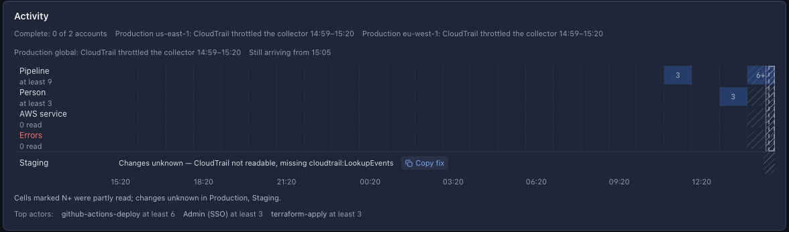
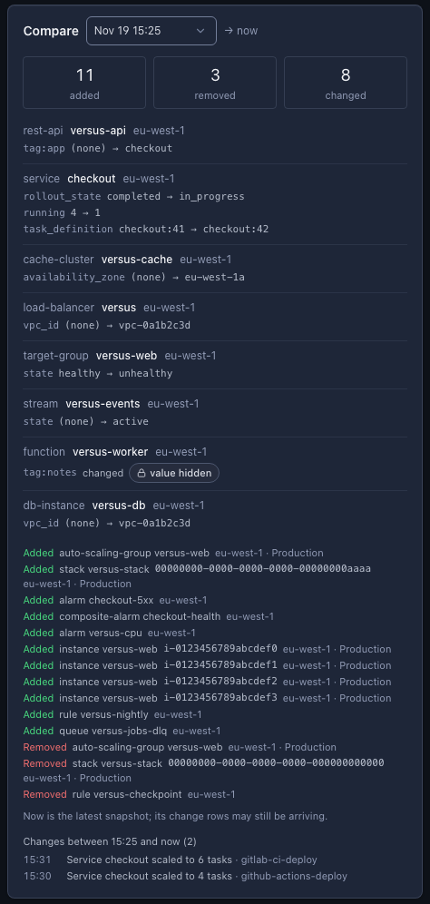

# AWS Changes

**AWS > Changes** answers one question during an incident: *what changed
before this alarm?* It lists who changed what in your AWS accounts, points at
the change that most likely started an alarm, and compares your resources now
with an earlier time.

Changes are read from CloudTrail. Versus only reads: nothing on this page acts
on AWS. To connect an account first, see the [Quickstart](/agent/aws/quickstart)
or [AWS Configuration](/agent/aws/configuration).


## What the page answers

| Question | Where to look |
| --- | --- |
| What changed, and who did it? | The answer line, the **Activity** grid and the **Changes** list |
| Which change probably started the alarm? | The **Suspect** tag in the list and the outlined cell on the grid |
| How does now differ from an earlier time? | The **Compare** panel |

The page never says "no changes" when it cannot know. If part of the window
was not read, it says which account and time are unknown, and counts become
"at least N".

## Pick the window

| Control | What it does |
| --- | --- |
| **1h** / **24h** | The window, ending now. `24h` is the default. |
| **7d** (locked) | Part of Enterprise. See [Limits](#limits). |
| **Accounts** | One account, or all. Each entry shows its state: `complete`, `gap 02:10–03:40`, or `as of 14:06`. When the whole window is unknown, the entry shows the reason instead, for example `Staging (444455556666) — CloudTrail not readable`. |
| **Regions** | One Region, or all. **Global (IAM, …)** holds changes to global services. |
| **Search, e.g. s3:PutBucketPolicy** | Free text. Matches the change sentence and the raw API call, either as `service:Action` (`s3:PutBucketPolicy`) or as the bare action (`PutBucketPolicy`). |

With one account, the bar shows its name instead of a filter. Global changes
are always read, so an account with one Region still gets a **Regions**
filter with two entries: that Region and **Global (IAM, …)**.
Below the filters, every Region in scope is listed with **read in full**,
**changes unknown for part of the window**, or **not enabled in AWS, not
read**. A Region that is not enabled is never shown as quiet.

With several accounts, a pill shows **All 3 accounts complete** or
**2 of 3 accounts**.

### The page refreshes itself

While the page is open, it reads again every 30 seconds, and every 10 seconds
while the first read runs or the newest minutes are still arriving. It pauses
while the browser tab is hidden. Your scroll position and open rows stay as
they are. **Read 14:52** next to the answer line shows when the page last
read; hover it to see **Refreshes every 30 s (every 10 s while reading)**. You don't need to reload to see new changes.

## Read the answer line

The line at the top sums up the window in one sentence: what changed, what is
unknown, then the suspect.

| You see | It means |
| --- | --- |
| `37 changes, 3 by people` | Every account and Region was read for the window. |
| `37 changes so far, 3 by people; the last 12 min are still arriving` | Everything settled was read. The newest minutes may still get events. |
| `At least 31 changes, at least 2 by people; Payments changes unknown` | Part of the window was not read, so the count is a minimum. |
| `No changes in the last 24 h (last 12 min still arriving)` | Every account and Region was read, and nothing changed. |
| `No changes in the last 24 h (last 16 min still arriving); 36 failed calls` | Every account and Region was read. No change succeeded, but failed calls were made. |
| `No changes by people or pipelines; 14 by AWS services` | Only AWS itself made changes (scaling, rotation, and so on). |
| `Changes unknown for part of the last 24 h` | Nothing was found, but part of the window was not read. |
| `Changes unknown for the whole last 24 h` | No account was read for any of the window. |
| `Changes unknown for part of the last 24 h; at least 36 failed calls` | No successful change was found, but failed calls were. |
| `Reading the last 24 h…` | The first read of a new account or Region is still running. |
| `…; the read hit its cap, so more exist` | The window held more rows than `read_cap`. See [Settings](#settings). |

Unknown stretches are named in the line, each account once, for example
`Payments changes between 02:10 and 03:40 unknown` or
`Payments global changes unknown`. An account with gaps over different spans,
for example in two Regions, reads
`Payments changes partly unknown between 02:10 and 05:30`. A disconnected
account reads `Payments as of 14:06`.

## Read the activity grid



The grid has one column per time step and one row per kind of actor:

| Row | Who |
| --- | --- |
| **Pipeline** | CI/CD and automation roles, for example a GitHub Actions deploy role |
| **Person** | People, including SSO users |
| **AWS service** | AWS acting on its own, for example Auto Scaling |
| **Unknown** | An actor Versus cannot classify. Shown only when there is one. |
| **Errors** | Failed write calls |

The total under each row label becomes "at least N" when the window has a gap,
or **0 read** when nothing was found in what was read.
A **24h** window has 24 one-hour columns; **1h** has 12 five-minute columns.
Times show in your browser's local time, with no `UTC` suffix. Times from an
earlier day carry the date, for example `Nov 18 14:21`.

| On the grid | Meaning |
| --- | --- |
| Shaded cell with a number | Changes in that step. Darker means more: 1–99, 100–999, 1,000+. |
| Number with a `+` and light hatching, for example `12+` | Partly read: some accounts or Regions in that step were read and some were not. The number counts what was read, so it is a minimum. A line under the grid names the accounts: **Cells marked N+ were partly read; changes unknown in Payments.** The suspect cell can be a partly read one. |
| Hatched cell or band, no number | Nothing in that step was read. The label above names the account, Region, reason and time, for example `Payments eu-west-1: CloudTrail throttled the collector 02:10–03:40`. |
| Dashed tail at the right | **Still arriving from 14:47**: CloudTrail delivers events late. See [The still-arriving tail](#the-still-arriving-tail). |
| An extra row under the grid, named after an account | That whole account is unknown, for example **Changes unknown — CloudTrail not readable, missing cloudtrail:LookupEvents**. The other accounts' counts stay in the grid, shown as `N+`. |
| Red vertical line | An alarm start, labelled `checkout-5xx from 14:05` above the grid. When two alarms share a name, the label adds the account and Region: `checkout-5xx (Production eu-west-1) from 14:05`. |
| Outlined cell | The step that holds the suspect change. |

Above the grid, **Complete: 2 of 3 accounts** counts the accounts read in
full. When the alarm record is shorter than the window, **Alarm history starts
09:30** shows where it begins.

Under the grid:

- **Busiest hour 09:00: 1,240 changes**, shown when one fully read step has 100 or more.
- **Top actors:** the five busiest actors and their counts.

### Gaps and their reasons

A gap is a stretch Versus could not read. It is never counted as zero. Each
gap has one reason:

| Reason on the page | Shown as |
| --- | --- |
| CloudTrail not readable | Account row, with the missing permission and **Copy fix** |
| credentials not valid | Account row |
| account disconnected | Account row: **Disconnected 14:21; as of 14:06**, with **Reconnect ›** to **AWS > Settings**. On a phone, the link sits on its own line under the grid: `Staging disconnected` **Reconnect ›** |
| could not assume the reader role | Account row |
| the credentials belong to another account | Account row |
| not read yet | Account row |
| CloudTrail throttled the collector | Hatched band |
| too many events to read in time | Hatched band, with `~12,000 events/hour, above the read budget` |
| the collector was not running | Hatched band |
| before the account was connected | Hatched band |
| older than the kept change history | Hatched band |
| Region not enabled in AWS | Listed under the filters as **Not enabled in AWS** |
| global changes (IAM, Route 53, CloudFront, …) unknown | A note above the grid |

Once **AWS > Settings** marks an account disconnected, every gap from the
account's as-of time onward reads **account disconnected**. Earlier gaps keep
their own reason, for example **CloudTrail throttled the collector**. The as-of
time is where the account was last fully read, the earliest across its
Regions, so it can be earlier than the disconnect time.

The change list repeats each gap as a hatched row, for example
`Changes unknown in Payments eu-west-1 from 02:10 to 03:40: CloudTrail throttled the collector`.
To fix one, see [Troubleshooting](#troubleshooting).

### The still-arriving tail

CloudTrail delivers events up to about 15 minutes late. Versus re-reads the
newest stretch on every poll and does not count it as settled until a later
poll. The grid outlines it with a dashed border, and the list starts with:

> Still arriving from CloudTrail after 14:47
> Changes after 14:47 may still arrive.

14:47 is the settled point: everything before it has been read.

The tail is normal and is not a gap. A complete window with no changes still
reads **No changes in the last 24 h (last 12 min still arriving)**. Cells in
the tail show the count so far.

The tail is the `overlap` setting (15 minutes) plus the time since the last
poll, so with the defaults it is 15 to 20 minutes long. The page refreshes
itself, so changes fill in without a reload.

## Read the change list

Each row is one plain sentence, newest first, for example
`Updated checkout-api task definition :41 → :42`. A row shows the time, the
actor, with several accounts an account chip, and with more than one Region
in scope the Region. **Details ›** opens the raw
API call (for example `ecs:UpdateService`), the account and Region, and the
resource ARNs.

| Row | What it is |
| --- | --- |
| Change | One write call. |
| **Error burst from** *actor*, with `AccessDenied ×214` | Failed calls grouped into one row. |
| *N* **changes**, with **Expand ›** | A pipeline's run on one stack, grouped. |
| **1 routine update:** / *N* **routine updates:** *what* | Routine agent events, counted only. Hidden by default. |
| **Unknown actor** | Versus cannot classify the caller. The row shows the service, and **Details ›** the raw API name. It never guesses a sentence. |

The footer reads **Showing 50 rows · at least 31 changes · at least 214 failed
calls, newest first**. The failed-call count appears only when there are
some, and "so far" follows the change count while the tail is still
arriving.
**Show more** loads the next page; a late event never makes a row repeat or
disappear between pages.

Email-shaped user names are masked, for example `j…@example.com`.

### Bursts and groups

A burst is a run of failed write calls with the same principal, error code and
service, each within 10 minutes of the last and at least 5 in all (the
`burst_window` and `burst_min` settings). The row shows the count, the error
code and the first and last time, with the rule under it: **Rule: same
principal, code and service, close together in time**. **Expand ›** lists the calls; **Show more in this group** pages
through them.

Only write calls are read, so a burst always comes from write calls, for
example `iam:PutRolePolicy` or `ssm:PutParameter` returning `AccessDenied`.
Your own reads, and Versus's reads, never show here.

A pipeline that changes many resources on one stack shows as one row, for
example `Applied 12 changes to stack network-prod`. **Expand ›** lists each
change.

### Routine counts

Some AWS agents make the same write call every few minutes on every instance,
for example the SSM agent's `UpdateInstanceInformation`. These events are
counted, not listed, so they don't bury real changes. The list header shows
**Show 1,240 routine agent updates**; press it to add the count rows to the
list. Which events count as routine is the `routine_events` setting.

### Before → after values

Under a change, each changed field shows on its own line:

| Line | Meaning |
| --- | --- |
| `desired 4 → 8` | Before and after are both known. |
| `instance_type → m5.large (new value only)` | No saved snapshot gives the old value. |
| `… (new value only; the before value needs ecs:Describe*)` | Versus can't read that service, so it has no old value. See [IAM permissions](#iam-permissions). |
| `… (before unclear: changed during a snapshot)` | The change happened while Versus was reading the resource, so the old value is not certain. |
| *field* **changed** **value hidden** | The value is hidden; the fact that it changed is kept. |

The before value comes from Versus's own saved snapshot of the resource just
before the change. Before values exist for task definitions, desired counts,
instance types, classes and sizes, runtimes and engines. Other fields show the
new value only.

Fields that only name the resource, such as IDs, names and ARNs, are not
listed as changes. The resource is already in the sentence and under
**Details ›**. Such a field is listed only when its old value is known and
differs.

### Hidden values

Some values never appear, on the page or in AI answers:

- **Tag values** whose key is not in `tags.value_allowlist`. Keys match
  exactly, so `team` does not allow `Team`. See
  [Security](/agent/aws/configuration#security).
- **Secret-shaped fields**, such as names containing password, secret, token,
  credential, private key, access key, API key, auth, user data or
  environment.

These show **value hidden**. The row still says the field changed.

## The suspect

When an alarm fires in the window, Versus looks for the change that most
likely started it. It looks at changes to the alarm's resources in the hour
before the alarm start, in the alarm's account and Region plus that account's
global changes (IAM and so on). A change made after the alarm start is never
the suspect.

The suspect row carries a **Suspect** tag, its grid cell is outlined, and the
answer line ends with `suspect: 14:02 Updated checkout-api task definition :41 → :42`.
Later rows show **after the alarm**.

When more than one change could have started the alarm, the page lists the
others under **Other candidates, best first:**. Changes that score the same
as the suspect are marked **equally likely**. A candidate outside the loaded
rows shows as *a change not on the loaded page*; press **Show more** to load
it.

When no suspect is named, a box above the list says why:

| Status | On the page | What to do |
| --- | --- | --- |
| `found` | **Suspect** tag on the change | Start there. |
| `none` | **No change matches this alarm**, then `Looked at changes from 13:05 to 14:05 in Production (eu-west-1, global)` | The hour before the alarm was read in full and no change touched the alarm's resources. Look elsewhere: traffic, a dependency, or code deployed outside AWS. |
| `incomplete` | **Part of the hour before the alarm is not read yet, so no suspect is named** | Fix the gap, or wait for the still-arriving tail to settle. |
| `start_unknown` | **The alarm's start time is unknown, so no suspect is picked** | Check the alarm's history in CloudWatch. |
| `resource_unknown` | **Can't tell which resource this alarm watches, so its changes can't be matched** | The alarm's dimensions don't map to a resource Versus knows. Search the list by resource name. |
| `no_alarm` | Nothing | No alarm fired in the window. |

The suspect is a pointer, not a verdict. Versus prefers naming none to naming
a wrong one.

## Compare



**Compare** shows how your resources now differ from an earlier time. Pick the
start in **Compare from**: 1, 3, 6 (default), 12 or 24 hours ago. The end is
always now.

| Part | What it shows |
| --- | --- |
| **added** / **removed** / **changed** | Counts. A `+` after a number means part of the scope was not compared. |
| Changed resources | Type and name, then where it is, then one line per field: `taskDefinition checkout-api:41 → checkout-api:42`. `(none)` means no value on that side. A hidden value shows **changed** and **value hidden**. |
| **Added** / **Removed** lines | Each resource that appeared or went away, with where it is. |
| **Not compared:** | Services left out of the counts, each with its reason, for example `Production eu-west-1 ecs: not available before 11:20`, `… no history yet`, or a gap reason such as `CloudTrail throttled the collector`. **Use 11:20 for a full compare** moves the start to the earliest time every service can be compared. |
| Services Versus can't read | Left out of the compare, not counted as a gap: `ElastiCache: not readable (permission)` or `AWS Health: not on this support plan`. With more than one account in scope the account name leads, for example `Staging ElastiCache: not readable (permission)`. |
| **Changes between 09:00 and now (12)** | The change-list rows in the compared span. **and 8 more ›** opens the change list for exactly that span; clear the span chip to go back. |

Each resource shows its Region, and with several accounts its account. When
two resources share a type and name, a short identifier tells them apart, for
example the end of the resource ID.

Compare is built from Versus's saved inventory snapshots, not from CloudTrail.
Only the same fields as the before values are compared, and hidden values stay
hidden.

| You see | It means |
| --- | --- |
| **Nothing differs between 09:00 and now** / **Both snapshots complete.** | Every service in scope was compared and nothing differs. |
| **Nothing differs in the compared services** / **Compared 09:00 with now; both snapshots complete.** | Nothing differs, and every service was compared except the ones Versus can't read, listed above. |
| **No difference found in the compared groups; the groups below were not compared.** | Nothing differs in what was compared, but some services were not. |
| **Compare not available for** *time* / **Earliest full compare: 11:20; pick that or a later time.** | No full compare reaches that far back. Press **Use 11:20** to start there. When that time is on another day, it shows with its date. When no time gives a full compare, an **Oldest snapshot** line shows instead. The change list may still cover the time, because changes are kept longer than snapshots. |
| **Now is the latest snapshot; its change rows may still be arriving.** | Compare can show a difference before its CloudTrail event arrives. |

## Settings

The change reader is configured under `connectors.aws.collect` in
`connectors.yaml`. Restart Versus after a change. Every key has an environment
override, read at startup. Out-of-range values stop Versus at startup and name
the key.

```yaml
connectors:
  aws:
    collect:
      intervals:
        changes: 5m
      history:
        change_retention: 336h
      changes:
        lookback: 24h
        overlap: 15m
        page_budget: 0
        routine_events:
          - ssm:UpdateInstanceInformation
          - ecs:SubmitTaskStateChange
          - ecs:SubmitContainerStateChange
          - logs:CreateLogStream
        burst_window: 10m
        burst_min: 5
        failure_keep: 20
        read_cap: 20000
```

| YAML key | Default | Range | What it does |
| --- | --- | --- | --- |
| `intervals.changes` | `5m` | 30s–24h | How often CloudTrail is read. |
| `history.change_retention` | `336h` | 1h–8784h | How long changes are kept. The first read never goes back further than this. |
| `changes.lookback` | `24h` | 1h–336h | How far back the first read of an account and Region goes. Missing stretches inside it are read again on later polls. |
| `changes.overlap` | `15m` | 5m–2h | The newest stretch re-read on every poll and shown as still arriving. Raise it if the **late events caught** note keeps growing. |
| `changes.page_budget` | `0` | 0–1000 | CloudTrail pages read per poll. `0` sizes it from CloudTrail's 2 requests per second and the poll interval. |
| `changes.routine_events` | the four above | up to 32 | Events counted, not listed, as `service:Action`. An empty list counts nothing. |
| `changes.burst_window` | `10m` | 1m–1h | Largest gap between two failed calls in one burst. |
| `changes.burst_min` | `5` | 2–1000 | Fewest failed calls that make a burst. |
| `changes.failure_keep` | `20` | 5–1000 | Failed calls kept as rows per principal, error code, action and hour. The rest are counted, so a failing job can't fill storage. |
| `changes.read_cap` | `20000` | 1000–200000 | Most rows one page answer reads. Above it the answer says **the read hit its cap, so more exist**. |

All keys sit under `connectors.aws.collect`. Environment overrides:

| Key | Environment variable |
| --- | --- |
| `intervals.changes` | `VERSUS_CONNECTORS_AWS_COLLECT_CHANGES_INTERVAL` |
| `history.change_retention` | `VERSUS_CONNECTORS_AWS_COLLECT_HISTORY_CHANGE_RETENTION` |
| `changes.lookback` | `VERSUS_CONNECTORS_AWS_COLLECT_CHANGES_LOOKBACK` |
| `changes.overlap` | `VERSUS_CONNECTORS_AWS_COLLECT_CHANGES_OVERLAP` |
| `changes.page_budget` | `VERSUS_CONNECTORS_AWS_COLLECT_CHANGES_PAGE_BUDGET` |
| `changes.routine_events` | `VERSUS_CONNECTORS_AWS_COLLECT_CHANGES_ROUTINE_EVENTS` (comma-separated; set but empty counts nothing) |
| `changes.burst_window` | `VERSUS_CONNECTORS_AWS_COLLECT_CHANGES_BURST_WINDOW` |
| `changes.burst_min` | `VERSUS_CONNECTORS_AWS_COLLECT_CHANGES_BURST_MIN` |
| `changes.failure_keep` | `VERSUS_CONNECTORS_AWS_COLLECT_CHANGES_FAILURE_KEEP` |
| `changes.read_cap` | `VERSUS_CONNECTORS_AWS_COLLECT_CHANGES_READ_CAP` |

In Helm the same keys are camelCase under `connectors.aws.collect`, for example
`history.changeRetention`, `changes.pageBudget`, `changes.routineEvents`,
`changes.burstWindow`, `changes.burstMin`, `changes.failureKeep` and
`changes.readCap`.

Compare and before values also depend on how many inventory snapshots are
kept: `collect.history.max_age` and `collect.history.max_generations` in
[Connector options](/agent/aws/configuration#connector-options). Versus warns
at startup when `max_age` keeps less than 24 h.

## IAM permissions

| Permission | Needed for | Without it |
| --- | --- | --- |
| `cloudtrail:LookupEvents` | Reading changes, in every selected Region and in `us-east-1` for global services | That account reads **Changes unknown — CloudTrail not readable, missing cloudtrail:LookupEvents**. Other accounts are unaffected. |
| The service's `Describe*`, `List*` and `Get*` reads | Before values and Compare, which use Versus's inventory snapshots | Changes still list. Before values show `(new value only; the before value needs ecs:Describe*)`, and that service has no snapshots to compare. |

Both are in the read-only policy
[`scripts/aws/versus-quickstart-policy.json`](https://github.com/VersusControl/versus-incident/blob/dev/scripts/aws/versus-quickstart-policy.json).
See [Permissions](/agent/aws/configuration#permissions).

Global services (IAM, STS, Organizations, CloudFront, Route 53 and global
WAF) record their changes only in `us-east-1`. Versus reads them from there
with the same role, whether or not `us-east-1` is in your Region list, and
shows them under **Global (IAM, …)**.

## Troubleshooting

One item per gap reason. Reasons that cover a whole account show as a row
under the grid; the rest show as hatched bands.

| Reason on the page | Cause | Fix |
| --- | --- | --- |
| **CloudTrail not readable**, missing *permission* | The reader role lacks `cloudtrail:LookupEvents` in that account or Region | Press **Copy fix** for the IAM statement, and add it to the reader role. Changes from then on are read; earlier ones are read again while inside `lookback`. |
| **CloudTrail throttled the collector** | Something else in the account uses the CloudTrail lookup rate (2 requests per second per account and Region) | Usually nothing to do: later polls read the stretch again while it is inside `lookback`. If it persists, find the other caller of `LookupEvents`. |
| **too many events to read in time** (`~N events/hour, above the read budget`) | More events than one poll's page budget can read | Add the noisiest agent events to `routine_events`, raise `page_budget`, or shorten `intervals.changes`. |
| **the collector was not running** | Versus was stopped or restarting | Nothing to do. The stretch is read again while inside `lookback`; older stretches stay unknown. |
| **not read yet** | The account or Region was added and has not been polled yet | Wait for the next poll, by default within 5 minutes. |
| **before the account was connected** | The window starts before the first read reached. The first read goes back `lookback`, 24 h by default. | Expected after lowering `lookback`. Raise it to cover the window. |
| **older than the kept change history** | The window starts before `change_retention` | Expected when `change_retention` is under 24 h. Raise it. |
| **Region not enabled in AWS** | A listed Region is not opted in | Opt in to the Region in the AWS console, or remove it from `regions`. |
| **credentials not valid** | AWS rejected the credentials, for example a revoked or rotated key | Fix the credentials; see [Credentials](/agent/aws/configuration#credentials). |
| **account disconnected** | The account failed its identity checks | Press **Reconnect ›** to open **AWS > Settings**, fix the cause there, then press **Recheck**. The row reads **Disconnected 14:21; as of 14:06**: the as-of time is where the account was last fully read, the earliest across its Regions, and can be earlier than the disconnect. Every gap from the as-of time reads **account disconnected**; earlier gaps, for example a throttled stretch, keep their own reason. Changes read before the disconnect still show. A row newer than the as-of time carries the tag `Payments, as of 14:06`. |
| **could not assume the reader role** | The role is missing, or its trust policy refuses Versus | See the role errors in [AWS Configuration troubleshooting](/agent/aws/configuration#troubleshooting). |
| **the credentials belong to another account** | The credentials sign in to a different account than `account_id` | Set `account_id` to the account the credentials belong to, or use that account's credentials. |
| **still arriving** | The newest minutes, normal CloudTrail delay | Nothing to do. See [The still-arriving tail](#the-still-arriving-tail). |
| **global changes (IAM, Route 53, CloudFront, …) unknown** | The `us-east-1` read for global services did not succeed | Check that the reader role can call `cloudtrail:LookupEvents` in `us-east-1`. A service control policy that limits Regions can block it. |

Other messages, shown under the search box or in the answer line:

| You see | Fix |
| --- | --- |
| *N* **malformed events skipped** | CloudTrail returned events Versus could not parse. The rest were kept. Nothing to do. |
| *N* **late events caught; raise connectors.aws.collect.changes.overlap if this keeps growing** | CloudTrail delivered events later than the `overlap` stretch. Versus still caught them. If the number keeps growing, raise `connectors.aws.collect.changes.overlap`, for example to `30m`. |
| **This server's clock is** *N* **s off AWS time** | The Versus host clock differs from AWS time by 60 seconds or more, ahead or behind. Versus never claims changes read past AWS time, but times on the page can be off. Sync the host clock with NTP. |
| **the read hit its cap, so more exist** | Narrow the window, account or Region, or raise `read_cap`. |

## Limits

| | OSS | Enterprise |
| --- | --- | --- |
| Change window | 1 h and 24 h | Adds 7 d |
| Compare | Inside the last 24 h | Longer, within the kept snapshots |

The **7d** option is shown locked. Choosing it shows *The 7 day window and
longer change history are part of Enterprise; this page shows the last 24 h.*
Changes come from CloudTrail event history, so only management events are
seen.

## Ask AI

**Ask AI** opens the chat. The agent reads the same changes, with the same
masking and hidden values, so you can ask, for example, *what changed in
checkout before the 14:05 alarm?*
