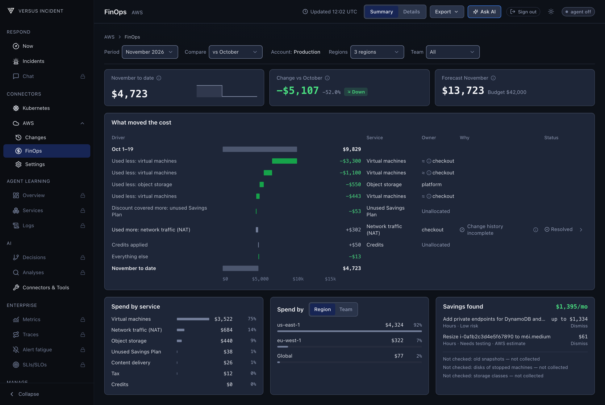
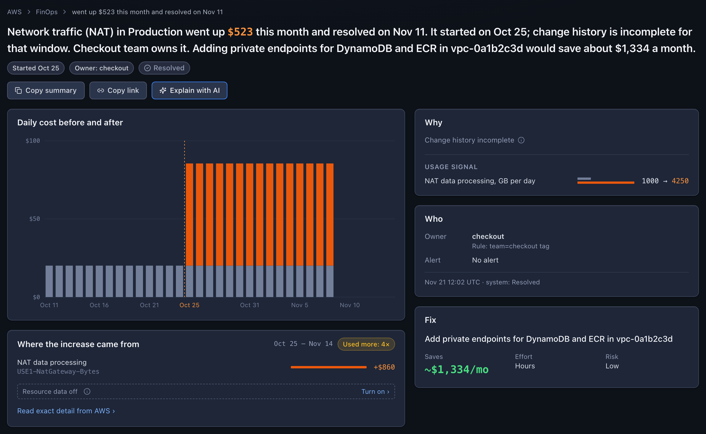
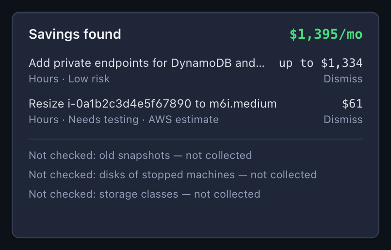
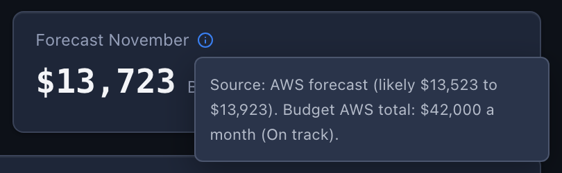
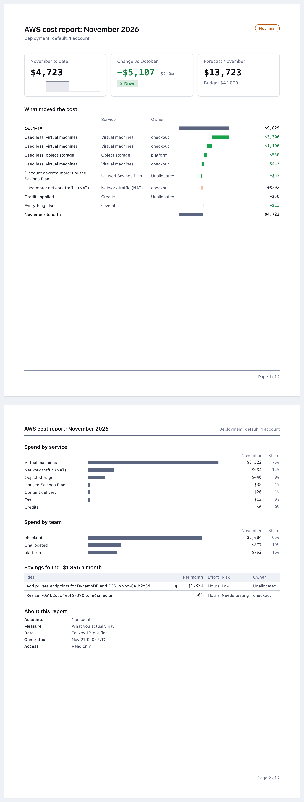

# AWS FinOps

**See why your AWS bill went up, who owns each part, and where you can save.**
Open **AWS > FinOps**. The page reads Cost Explorer once a day and only reads:
nothing on it changes AWS, and every saving is a guide you follow yourself.

**Try it quickly:** [AWS Quickstart](/agent/aws/quickstart)

**Full setup and every setting:** [FinOps setup](/agent/aws/configuration#finops-setup)

## Read the page in 30 seconds

| Part | What it tells you | What you do |
| --- | --- | --- |
| Scope bar | Which period, comparison, accounts, Regions and teams you are looking at | Narrow to the account or team you care about |
| Three cards | The cost, the change and the month-end forecast | Check the change word: **Up**, **Down** or **About the same** |
| Gap lines | Only shown when some cost is missing or skipped | Follow the action on the same line |
| What moved the cost | Last period's total, one row per cause, this period's total | Click the orange row: the largest open increase |
| Spend by service | Where the money goes | Look for a service you did not expect |
| Spend by | The split by account, Region or team | Find the owner of a large share |
| Savings found | What you could save each month | Open **Guide ›** and apply it yourself |

**Summary | Details** at the top changes labels and columns, never the numbers.
Summary uses plain names; Details adds AWS service names and usage types.

## Scope bar

| Control | What it does |
| --- | --- |
| **Period** | **This month, to date**, one of the last three months, or **Last 30 days** |
| **Compare** | **Previous period** or **Same period last year**. Shows `none yet` until a full earlier period exists. |
| **Accounts** | **All N**, or one account. With one account it is a plain label. |
| **Regions** | All, or one Region. **Global** holds cost that has no Region. |
| **Team** | All, or one team. Reads `no tag` when no team tag splits the cost. |
| **Learning until** *date* | Shown while history is too short to detect increases. Totals, spend and savings work from day one. |

The header shows freshness: `Updated 09:02 UTC`, or `Stale since Nov 1` after
a failed refresh. Click it for the last complete day, the next refresh and
`Paid requests today: N of 20`.

## The cost summary

| Card | Shows |
| --- | --- |
| **Nov to date** or **Oct cost** | What you actually pay: net amortized cost, after discounts, credits and commitments. A small line shows the daily cost. |
| **Change vs Oct** | The amount, the percent and **Up**, **Down** or **About the same** (within ±2%). A month to date compares with the same days of the earlier month. |
| **Forecast December** | The month-end forecast from AWS, with its likely range behind the ⓘ. With a budget, one line says **Budget $X** or **Over budget by $X**. |

- The ⓘ on each card names the measure, the last complete day and the data lag.
- **Includes $X one-time** under the change means a one-time charge, such as
  a support fee, is part of it.
- **≈** marks a figure that rests on an estimated split. See
  [Exact and estimated](#exact-and-estimated).
- Amounts stay in your bill's currency. Cost in a second currency shows as its
  own line: `Also billed in EUR: €120 (not converted)`.

## What moved the cost

The chart starts with the earlier total, adds or subtracts one row per cause,
and ends with this period's total. The rows add up to the change.

| Column | Meaning |
| --- | --- |
| Name | The cause in plain words. Small causes are grouped as **Everything else**. |
| Service | The AWS service. **Details** adds the usage type. |
| Owner | The team that owns the row. Hidden when it would say the same on every row; one line says why. |
| Why | The change that likely started it, or the named gap |
| Status | **Open**, **Expected** or **Resolved** |

The **Why** column never guesses:

| Text | Meaning |
| --- | --- |
| The change and who made it, *change* `by` *actor* | The change that most likely started this row |
| **Several changes fit; open the increase** | More than one change fits equally well |
| **No change found** | Change history covers the window and nothing fits |
| **Change history incomplete** | Some history is missing, so no change is named |
| **No collector** | Change history is not collected yet. **Collectors ›** opens AWS Settings. |
| **Not connected** | The account has no Versus role, only cost. **Connect ›** opens AWS Settings. |

When no cause is above the minimum (`min_driver_usd`, default $50), the card
reads `No driver above $50; the cost was steady`.

## Increases

Click a row in **What moved the cost** to open the increase.

The title is one sentence, for example *Network traffic in Production went up
$1,980 in October*. Chips show **Started** *day*, **Owner** and the status.

| Card | What it tells you |
| --- | --- |
| **Daily cost before and after** | Each day's cost, the start day marked, and `+$X/mo from now` |
| **Where the increase came from** | The increase by usage type and, when AWS names them, by resource. The chip names the cause: **New**, **Used more**, **Price changed**, **One-time charge** and similar. |
| **Why** | Up to three changes, each **Likely** or **Possible**, with the time and who made it. **Open in Changes ›** shows the change in [AWS Changes](changes.md); **Show on Map ›** shows the resource. |
| **Usage signal** | The usage that grew, before → after, per day |
| **Who** | The owner and the rule that picked them, and whether an alert was sent |
| **Fix** | The matching saving: monthly amount, effort, risk and **View guide ›** |

When several changes fit equally well, none is singled out: all show as
**Possible**, with a link to turn on resource-level data in Cost Explorer to
narrow the list. When nothing fits, the card says
**No change found in the 48 h before**, or **Change history incomplete** when
part of that window is missing.

**What counts as an increase.** A cost line (account, service and usage type)
that stays above its 14-day baseline for 3 complete days, by at least 20% and
$100 a month. Fees, credits, refunds and tax never count. An increase that
falls back inside its normal range becomes **Resolved**.

**Actions on the page:**

- **Mark expected…** (admins): a reason and an end date up to 90 days ahead.
  The row stays in the chart so the totals still add up. It reopens by itself
  on the end date if the cost is still high. **Reopen** undoes it.
- **Copy summary**: what, why, who and the fix in a few lines for Slack or
  email.
- **Copy link** and **Explain with AI**.
- **Read exact detail from AWS ›** (admins): reads one account and service by
  usage type and team. It costs one paid Cost Explorer request (about $0.01),
  asks you to confirm first, and is kept for the day.

## Savings

**Savings found** is the only place the savings total appears. Each item shows:

- the monthly saving, `up to $X` when it is an upper bound, marked
  **AWS estimate** or **list price** when the amount comes from there;
- the effort (**Minutes**, **Hours**, **Days**) and the risk (**No risk**,
  **Low risk**, **Needs testing**);
- **Guide ›**: the steps to apply it yourself. Versus never applies a saving.

How the total is counted:

- **One action per resource.** When a resource has several savings, the
  largest counts. The others show under it as `or: …` and are not added.
- **Commitments stand apart.** A Savings Plan shows as
  `up to $X a month, before other savings` and is never added to the total.
- **Checks that could not run are named**, for example
  `Not checked: private endpoints — needs usage detail (Organization)`. They
  are never shown as $0.

Admins can **Dismiss** a saving with a reason. That hides it in Versus only.

## Teams and tags

Every cost has an owner, picked by the first rule that matches:

| Order | Rule | The page says |
| --- | --- | --- |
| 1 | The team tag on the cost, `team` by default | `team=checkout tag` |
| 2 | The account owner from config (`accounts[].owner`) | `account owner from settings` |
| 3 | Neither | **Unallocated** |

**Unallocated** is a real row with its own share, never hidden. On **Spend by
team** it carries **Find untagged ›**. The owner of an increase is the team with
the most cost on that line since it started.

**Spend by** offers Account, Region and Team only when that view splits the
cost: two or more values, the largest under 95%. When Team is off, the switch
says why:

| Reason | Fix |
| --- | --- |
| **Team tag not active in billing** | Activate the tag in **Billing > Cost allocation tags**. AWS applies it from that day on. |
| **No team tag on this cost** | Tag resources, and add the key to `tags.value_allowlist` with the same case. |
| **All cost has the same team** | Nothing to fix. Team comes back when a second team appears. |

When nothing splits the cost, the **Spend by** card goes away and
**Spend by service** widens to show what is inside each service.

## Budgets and alerts

Budgets come from two places, both read-only on the page:

- `connectors.aws.finops.budgets` in config: one for the whole deployment, one
  account, or one team. See [Full config](/agent/aws/configuration#5-full-config-ownership-and-budgets).
- Monthly cost budgets in AWS Budgets, read with `budgets:ViewBudget`.

| Status | When |
| --- | --- |
| **On track** | Below both limits |
| **At risk** | The forecast is above 90% of the budget |
| **Over budget** | This month's cost is above the budget |

The whole-deployment budget shows on the forecast card. Alerts go through your
existing Versus channels (Slack, Teams, email):

| Alert | Sent |
| --- | --- |
| Increase | Once when it opens, and again only if its monthly impact doubles |
| Budget | Once when it turns **At risk**, once more if it turns **Over budget**, at most once each per month |

## The monthly report, PDF and CSV

Open **Export** at the top of the page:

| Item | What you get |
| --- | --- |
| **PDF** | The report in a new tab, with your browser's print dialog. Save it as PDF. |
| **CSV** | The table you are looking at, with your filters: by service on Overview, by account on Accounts |
| **Copy summary** | A few plain lines for Slack or email |
| **Save as monthly report** | Admins. Freezes a closed month so its numbers never shift. |

The report fits on two pages and always prints light:

1. **AWS cost report:** *month*, the three cards, and **What moved the cost**
   with a short reason under the top rows.
2. Spend by service and by account (by team when tags split it),
   **Savings found** with effort, risk and owner, **Expected increases** with
   their reasons, and **About this report**: accounts, measure, the last
   complete day, **Frozen** or **Generated**, anything missing, and
   `Read only`.

**Not final.** AWS can change last month's cost until it closes the bill on the
5th. Before then the header says **Not final**, PDF and CSV carry a
`Not final` hint, and **Save as monthly report** says `Available after Nov 5`.
For the current month it says `Available when the month ends`.

## The Accounts tab

With 10 or more accounts, an **Accounts** tab lists every account grouped by
your `account_groups`, with status, cost, change, top driver, top team and the
last 30 days. Filter **Cost only**, **New this month** or **Closed**, search
by name or ID, sort by change or cost, and **Export CSV**.

A **Cost only** account is one whose cost comes through the management account
but that has no Versus role. Its rows read **Not connected** under Why.

## What you need

| Need | Detail |
| --- | --- |
| Cost Explorer turned on | Once, in the account that pays. Member accounts also need **Member account access** from the management account. |
| Cost reads | The cost statement on the reader role, or `versus-cost-reader` in the management account. **Copy policy** on the page gives it. |
| Cost reads on in Versus | `connectors.aws.optional_data.cost_explorer: true`. Off by default. |
| Team tag (optional) | Activated as a cost allocation tag, and on `tags.value_allowlist` |
| `infrastructure:view` or `finops:view` | Opens the page |
| `infrastructure:settings:write` | **Mark expected**, **Dismiss**, **Save as monthly report**, **Read exact detail** |

Cost refreshes once a day after `refresh_time` (09:00 by default). Versus makes
at most 20 paid Cost Explorer requests a day, about $0.20. Every step is in
[FinOps setup](/agent/aws/configuration#finops-setup).

## When data is missing

Missing cost is never shown as $0. Every total says what it covers, and every
gap names its reason and its fix on the same line.

| What you see | Meaning | What you do |
| --- | --- | --- |
| **What FinOps answers** and **What it reads**, with **Turn on** | Cost reads are off, the default | Admins: **Turn on**. Others see **Ask an admin to turn on Cost Explorer reads**. |
| **Waiting for the first complete day of cost data** | Cost reads are on; no full day has settled | Wait. A day is complete 24 hours after it ends. |
| **Cost Explorer is not available for** *account* | Cost Explorer was never opened, or member access is off | Follow the three steps on the card |
| **2 of 3 accounts** on the cards | One account's cost could not be read | **Copy fix** on its line, for example `Staging: access denied` |
| **Stale since** *day* | The last refresh failed | Usually nothing: the last good data stays and the next refresh retries. If access was lost, **AWS settings ›**. |
| **Request cap reached: forecast and coverage skipped** | The daily paid-request limit was reached | Wait for tomorrow, or **Raise cap in Settings ›** |
| **Partial** and a dashed bar | Today is not complete | Nothing. It is left out of the total and never raises an increase. |
| **Not final** | Last month's bill is not closed | Wait for the 5th |
| **No previous month** or **No full October** | No full period to compare with | Nothing. The change starts with the first full period. |
| Forecast **Estimate** | Too little history for the AWS forecast | Month to date plus the average of the last 7 complete days |
| Forecast **Not enough history** | Fewer than 7 complete days | Wait |
| Forecast **Skipped today** | The forecast fell under the request cap | Wait for tomorrow |
| **Resources not named** or **Resource data off** | Cost Explorer has no resource-level data for this | The amounts are complete. Turn it on in AWS (AWS may charge for it). |
| **No account can read cost** | Cost was read before; no account can read it now | **AWS settings ›**. The stored cost stays on the page. |

## Exact and estimated

Totals per account, service, team and Region are exact. Cost Explorer splits
cost only two ways per request, so a figure that crosses more, such as one
team's share of one service across accounts, is shared out in proportion. Only
those carry **≈** and an **Estimated split** ⓘ.

## Tiers

| | OSS | Enterprise |
| --- | --- | --- |
| The whole page: cost, drivers, increases, savings, budgets, alerts, report, PDF, CSV, Accounts tab | Yes | Yes |
| Ask AI and the agent's cost tools | Yes | Yes |
| A finance role that sees FinOps without the other AWS pages | — | Yes |
| Cost limited to the accounts a role may see | — | Yes |
| Cost history | 13 months | Longer than 13 months |

A role limited to some accounts can read FinOps but not change it: budgets,
frozen reports and increase decisions act on the whole bill.

## Ask AI

Click **Ask AI** to ask about cost in plain words, for example "Why did AWS
cost go up in October?" The agent's cost tools (`cost_breakdown`,
`cost_drivers`, `cost_increases`, `cost_increase_detail`,
`savings_opportunities`, `budget_status`) read the cost Versus already stores.
They never call AWS and never change anything. Versus computes every number;
the agent explains it. See the [Tool Reference](../tools/overview.md).
