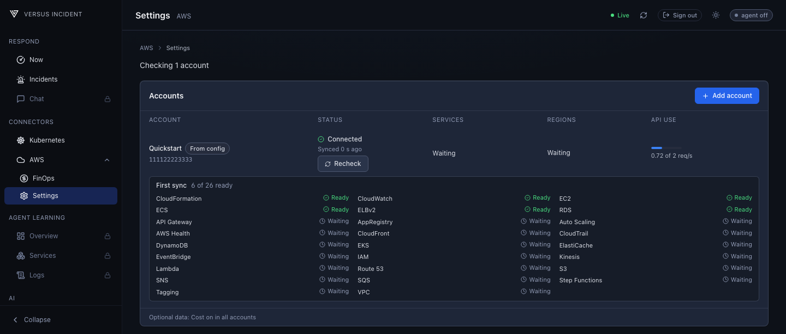
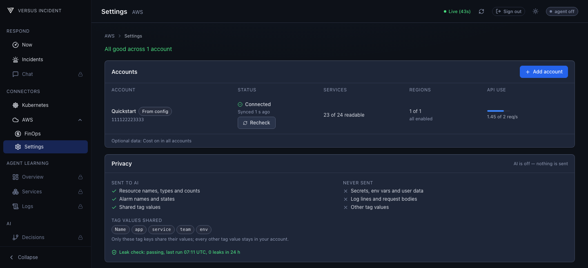
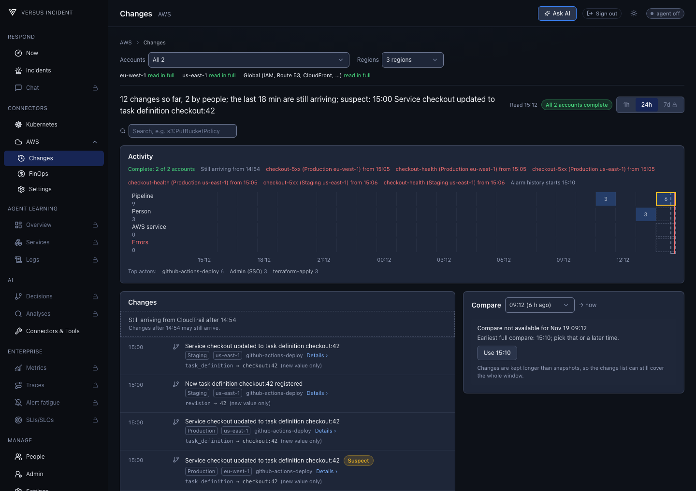
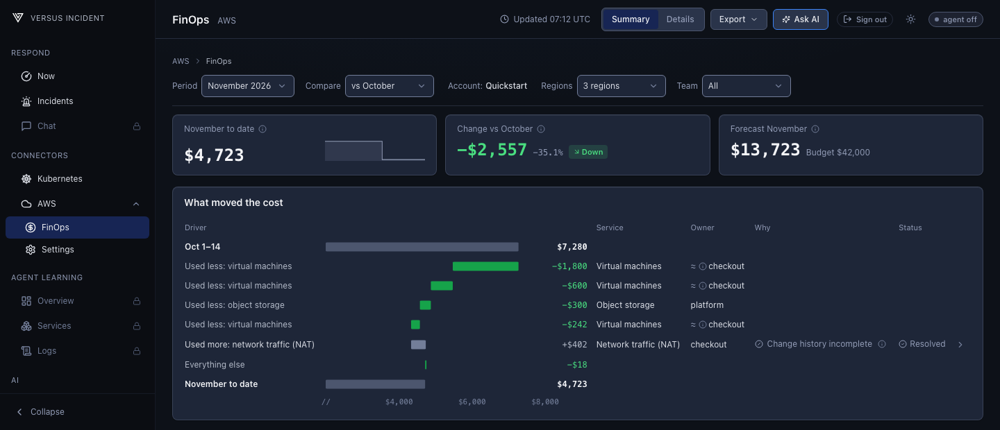
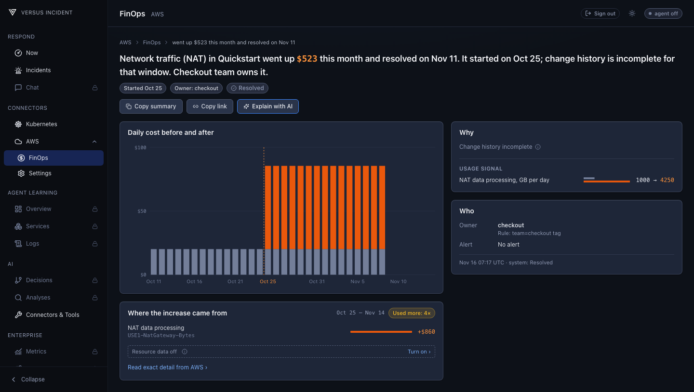
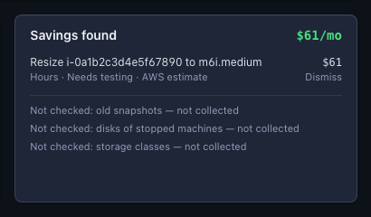

# AWS Quickstart

The quickstart guide to run Versus using Docker Compose or Helm, and let it read your AWS
account: its resources, its changes and its cost. Versus signs in with the access key of a
new IAM user that can only read.

> **This setup is for trying Versus.** The access key is long-lived. Delete it
> when you are done (see [Clean up](#clean-up)), and use roles in production
> (see [Next steps](#next-steps)).

## Before you start

You need:

- The AWS CLI v2, signed in as someone who may create IAM users. Check (the
  answer is your account ID and your identity):

  ```bash
  aws sts get-caller-identity
  ```

- Cost Explorer turned on in the account. Open the
  [Billing and Cost Management console](https://console.aws.amazon.com/costmanagement/home),
  then **Cost Explorer**, and turn it on once. AWS can take up to 24 hours to
  fill in cost data after that.

## Clone the Versus repository

Run every command on this page from its root folder:

```bash
git clone https://github.com/VersusControl/versus-incident.git
cd versus-incident
```

The repository ships the quickstart config in
`examples/quickstart/aws/config/`, ready to use. You don't edit it: each
`${VAR}` is filled from the variables you export in
[Step 2](#step-2-export-the-settings). These are the keys it needs, from
`connectors.yaml`:

```yaml
connectors:
  aws:
    enable: true                         # turn on the AWS connector (default false)
    accounts:
      - account_id: "${AWS_ACCOUNT_ID}"  # the 12-digit account the key belongs to
        display_name: Quickstart         # name shown in the UI (default: the account ID)
        regions: ["${AWS_REGION}"]       # regions to read
        auth:
          mode: default_chain            # sign in with AWS_ACCESS_KEY_ID and AWS_SECRET_ACCESS_KEY
    optional_data:
      cost_explorer: true                # read cost for FinOps (default false)
```

For every other option, see [AWS configuration](/agent/aws/configuration).

## Step 1: Create the IAM user

**1. Create the user.**

```bash
aws iam create-user --user-name versus-quickstart
```

Expected output: JSON with `"UserName": "versus-quickstart"`.

**2. Attach the read-only policy.**

```bash
aws iam put-user-policy --user-name versus-quickstart --policy-name versus-quickstart --policy-document file://scripts/aws/versus-quickstart-policy.json
```

This prints nothing when it works.

The policy only reads. It already grants `cloudtrail:LookupEvents`, which the
Changes page uses to read CloudTrail event history, so there is nothing to add.
CloudTrail event history is on in every account, with no trail needed. See
[Changes setup](/agent/aws/configuration#changes-setup).

**3. Create an access key.**

```bash
aws iam create-access-key --user-name versus-quickstart
```

The key appears in this command's output, under `AccessKey`:
`AccessKeyId` (starts with `AKIA`) and `SecretAccessKey`. AWS shows the secret
only this once, so keep the terminal open for Step 2.

## Step 2: Export the settings

In the same terminal, export the key from Step 1 and the region Versus reads.
Replace the values with your own:

```bash
unset AWS_SESSION_TOKEN
export AWS_ACCESS_KEY_ID=AKIA...
export AWS_SECRET_ACCESS_KEY=...
export AWS_REGION=us-east-1
```

`unset AWS_SESSION_TOKEN` clears a token from your own sign-in, which would
not match the new key.

Then export your account ID:

```bash
export AWS_ACCOUNT_ID=$(aws sts get-caller-identity --query Account --output text)
```

This also proves the key works: the AWS CLI now signs in with it. If it fails
with `InvalidClientTokenId`, wait ten seconds for the new key to take effect
and run it again. Check the value (12 digits):

```bash
echo "$AWS_ACCOUNT_ID"
```

You never edit a config file. Versus reads the account and region from these
variables.

## Step 3, Option A: Docker Compose

Need Docker with Docker Compose v2. Check:

```bash
docker compose version
```

**1. Start Versus.**

```bash
cd examples/quickstart/aws && docker compose up -d
```

If a variable is missing, Compose stops and names it, for example:

```text
required variable AWS_ACCOUNT_ID is missing a value: export AWS_ACCOUNT_ID, the 12-digit account ID from aws sts get-caller-identity
```

Export it as in [Step 2](#step-2-export-the-settings), then run the command
again.

**2. Open the UI.** Browse to `http://localhost:3000`. The port is open on
your machine only.

**3. Sign in** with the gateway secret `change-me`.

To use your own secret, export it before you start Versus:

```bash
export GATEWAY_SECRET=$(openssl rand -hex 32)
```

| Variable | Default | What it does |
| --- | --- | --- |
| `GATEWAY_SECRET` | `change-me` | The secret for signing in to the UI. |
| `VERSUS_IMAGE` | `ghcr.io/versuscontrol/versus-incident:latest` | The Versus image to run. |

Go to [What you'll see](#step-4-what-youll-see).

## Step 3, Option B: Kubernetes

Need Helm 3.8 or newer. For a detailed EKS setup with IRSA or Pod Identity, several accounts and
FinOps, see [AWS on EKS](/examples/aws-eks-irsa-pod-identity).

**1. Store the key in a Secret.** The key reaches the pod as environment
variables only, never in a ConfigMap.

```bash
kubectl create secret generic versus-aws \
  --from-literal=AWS_ACCESS_KEY_ID="$AWS_ACCESS_KEY_ID" \
  --from-literal=AWS_SECRET_ACCESS_KEY="$AWS_SECRET_ACCESS_KEY"
```

Expected output: `secret/versus-aws created`.

**2. Install the chart** with the AWS connector and Cost Explorer turned on:

```bash
helm install versus ./helm/versus-incident \
  --set connectors.aws.enable=true \
  --set connectors.aws.credentials.existingSecret=versus-aws \
  --set "connectors.aws.accounts[0].accountId=$AWS_ACCOUNT_ID" \
  --set "connectors.aws.accounts[0].regions[0]=$AWS_REGION" \
  --set connectors.aws.optionalData.costExplorer=true
```

Keep the quotes around the `accounts[0]` arguments: zsh reads square brackets
as a file pattern without them.

**3. Wait until it is ready.**

```bash
kubectl rollout status deploy/versus-versus-incident
```

**4. Open the UI.** This command keeps running and holds the terminal. Leave
it running, and open a second terminal for the next step:

```bash
kubectl port-forward svc/versus-versus-incident 3000:3000
```

Then browse to `http://localhost:3000`.

**5. Sign in.** The chart made a gateway secret on install. Print it, then
paste it into the sign-in page:

```bash
kubectl get secret versus-versus-incident-secrets -o jsonpath='{.data.gateway_secret}' | base64 -d; echo
```

The install notes print these commands too. To see them again, run
`helm status versus`.

## Step 4: What you'll see

Open **AWS > Settings** in the sidebar. Your account is listed there (as
**Quickstart** with Docker Compose).

The first time, Versus reads the whole account. The page says **Checking 1
account**, and the readable counts show **Waiting** until the first check is
done. The account shows **First sync** with a count such as `6 of 26 ready`,
and each service moves from **Waiting** to **Loading** to **Ready**.



*The first sync in progress: services fill in as Versus reads them.*

When the first sync is done, the account shows its services and regions.



*The account after the first sync: readable services are counted. Services this account can't read, such as ones that need a support plan, aren't counted.*

### Changes

Open **AWS > Changes**. The page shows who changed what in your account, and
which change most likely started an alarm. The summary card counts the
changes, splits them into people and automation, and names the likely cause.
The services filter starts on RDS and IAM; open it to add others.



*The Changes page: who changed what, and the likely cause of an alarm.*

The first read covers the last 24 hours.

### FinOps

Open **AWS > FinOps**. Versus first reads your cost as soon as the account is
confirmed, with no wait for the daily refresh. Until AWS has a full day of
cost, the page says **Waiting for the first complete day of cost
data**. Then it shows your spend, what moved it and what you could save.



*The FinOps overview: this month's spend, the forecast, and what changed.*

Select an increase to see what caused it.



*One increase, explained: which service and usage drove it.*



*Savings found: Versus shows how to apply each one; it never applies them.*

## If something is wrong

These titles appear on **AWS > Settings** or on the FinOps page.

| What you see | What it means | Fix |
| --- | --- | --- |
| **The Versus server has no AWS identity** | Versus found no access key, or AWS rejected it. Usually the key was not exported, or was copied wrong. | Export `AWS_ACCESS_KEY_ID` and `AWS_SECRET_ACCESS_KEY` again from [Step 1](#step-1-create-the-iam-user), then restart Versus (see below). |
| **The AWS credentials belong to another account** | Versus signed in, but the key is from another account than `AWS_ACCOUNT_ID`, so it reads nothing. | Run the `export AWS_ACCOUNT_ID=...` command from [Step 2](#step-2-export-the-settings) again with the same key, then restart Versus. |
| **The server's AWS credentials are not valid** | The key worked before and AWS now rejects it: it was deleted or made inactive. Versus keeps showing the cost it already has. | Create a new key with `aws iam create-access-key --user-name versus-quickstart`, export it, then restart Versus. |

To restart Versus with the new values:

- **Option A:** from `examples/quickstart/aws`, run `docker compose up -d`.
  Compose recreates the container when a variable changed.
- **Option B:** for a new key, delete and create the `versus-aws` Secret again
  with the commands from Option B, step 1, then run
  `kubectl rollout restart deploy/versus-versus-incident`. For a new account
  ID, run `helm upgrade versus ./helm/versus-incident --reuse-values --set "connectors.aws.accounts[0].accountId=$AWS_ACCOUNT_ID" --set "connectors.aws.accounts[0].regions[0]=$AWS_REGION"`.

## What it costs

- **Cost Explorer:** AWS charges $0.01 for each Cost Explorer request. Versus
  makes at most 20 paid requests a day, so at most $0.20 a day.
- **New accounts:** cost data can take up to 24 hours to appear after Cost
  Explorer is first turned on.
- **Whose cost you see:** a member account of an AWS Organization sees only
  its own cost. The management (payer) account sees the cost of every account
  in the Organization.

## Clean up

**1. Stop Versus.**

Option A, from `examples/quickstart/aws` (`-v` also deletes the stored data):

```bash
docker compose down -v
```

Option B:

```bash
helm uninstall versus
```

```bash
kubectl delete secret versus-aws
```

**2. Delete the access key, the policy and the user.** The quickstart key
cannot delete itself, so sign in as yourself again first. Note the key ID,
then clear the quickstart key from the terminal:

```bash
QUICKSTART_KEY_ID="$AWS_ACCESS_KEY_ID"
unset AWS_ACCESS_KEY_ID AWS_SECRET_ACCESS_KEY
```

```bash
aws iam delete-access-key --user-name versus-quickstart --access-key-id "$QUICKSTART_KEY_ID"
aws iam delete-user-policy --user-name versus-quickstart --policy-name versus-quickstart
aws iam delete-user --user-name versus-quickstart
```

If you signed in to the AWS CLI with a session token, sign in again before
these commands. Check that the user is gone (the answer is `NoSuchEntity`):

```bash
aws iam get-user --user-name versus-quickstart
```

## Next steps

| Goal | How |
| --- | --- |
| Run Versus in production | Use role-based connect: Versus assumes a read-only IAM role, with no long-lived key. See [Connect your AWS account](/in-development/aws-harness-connect). |
| Learn the FinOps page | [AWS FinOps](/agent/aws/finops) |
| See who changed what, and which change started an alarm | [AWS Changes](/agent/aws/changes) |
| Share a cost report | [Read your FinOps report](/in-development/aws-finops-report) |
| See cost per team | [Tag your AWS cost for ownership](/in-development/aws-finops-tagging) |
