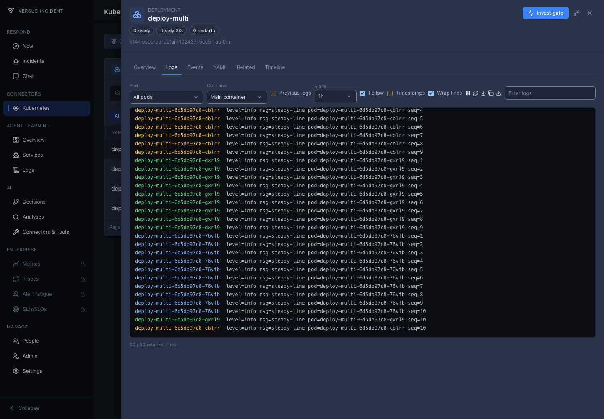
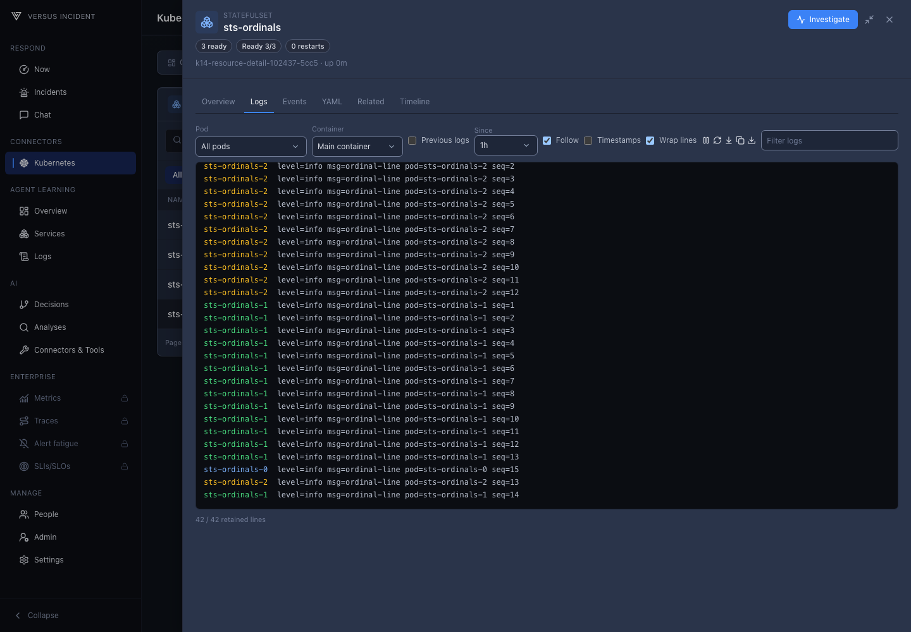

# Kubernetes Connector

Explore your Kubernetes environment in one place: cluster health and capacity, workloads, resource relationships, recent changes, Helm releases, and GitOps status.

This Kubernetes Connector supports the Harness dashboard and AI, enabling Site Reliability Engineers (SREs) to use the same cluster context within the DevOps Chat Agent. Begin with the dashboard to gain insights into a workload, and then go deeper into the details by engaging in the chat with the resource already attached.

## Harness Dashboard

Open **Connectors > Kubernetes** after connecting your cluster. The dashboard
has nine tabs; screenshots below use a synthetic cluster.

### Overview

The compact cluster header identifies the cluster and its **Snapshot**, broken
workloads, and warnings. Start with **Timeline** to review breaks and related
changes; CPU and memory capacity, inventory, and topology summaries appear below.
Usage and requests are separate; missing metrics are **Unavailable**.

### Issues

Issues use the same workload rows as Overview, collapsed by default. Expand a
row to load its related changes and crash evidence. Filter by severity or
namespace and use pagination to browse more results. Select a workload name to
open details. **Timeline** focuses on that workload's break, and **Investigate**
opens Chat with its cluster and resource context. Expand **Warnings (N)** before
interpreting incomplete history as an absence of changes.

### Timeline

Choose a time window, namespace, or resource kind to browse changes. From an
issue's **Timeline** action, the view focuses on that workload around its break.
Resource rows share a horizontal time axis with projected change labels, a red
**Break** line, and **Crash** groups at their actual last recorded termination
timestamps. Counts do not imply distinct crash times. The shaded suspect window
spans break minus 30 minutes through plus 2 minutes; **now** appears only when in
view. Select a marker, then **Open resource** to inspect a change. History warnings remain available through
**Warnings (N)**, including when no markers are recorded in the selected window.

### Topology

Start with the namespace blocks. Search for a namespace and select it to explore
its connected resources; this graph is not paginated.

The filter sidebar groups resource kinds and shows their counts. Ingress,
Service, Deployment, and Pod are visible by default. Use the eye icons to show
or hide other kinds, or reveal all kinds at once. Choose a namespace and refresh
the graph in the header; **Namespaces** returns to the namespace blocks. Use
pan, zoom, and **Fit to view** to navigate the graph.

Connections show which resources manage, expose, route to, or configure others.
Select a resource to open its details. Resources without relationships are not
shown; use **Workloads** to browse workloads outside the graph. If permissions
or collection limits prevent a complete graph, the dashboard shows an error
instead of presenting partial results as complete.

### Workloads

Search workloads and filter by kind, including Deployments, StatefulSets,
DaemonSets, Jobs, CronJobs, and Pods. Select a row to open its details. The list
scrolls within the panel and loads additional pages as requested.

### Live logs

Deployment and StatefulSet details merge arriving logs across their owned Pods,
with **All pods** selected by default. Pod-name prefixes identify each line's
source; use the Pod picker to focus on one Pod and the text filter to narrow
the displayed lines. Newly owned Pods join the live view automatically, within
the stream's source limits. **Previous logs** reads a finite set of logs from
previous container instances, not a live stream. **Download** saves the retained
lines currently displayed, including active filters, rather than a complete log
archive.

*Deployment live logs captured from a real local kind cluster with synthetic workloads.*

*StatefulSet live logs captured from a real local kind cluster with synthetic workloads.*

### Nodes

Browse cluster nodes, readiness, and capacity. Select a node to inspect its
scheduled Pods across namespaces; both inventories use server pagination.

### Helm

Inspect release status, health, namespace, and revision. Expand a release to
view its revision history. This view shows release metadata, not chart values
or rendered manifests, and does not run Helm operations.

### GitOps

Review discovered Argo CD and Flux applications, including sync state, health,
and revision. The **Argo Rollouts** section automatically lists detected
Rollouts and their strategy, progress, and canary weight.

If the relevant APIs are not installed or cannot be read, the page explains
what is unavailable instead of showing an empty successful result.

### Traffic

> **Enterprise**

See observed service-to-service request rates, error rates, latency, and
bytes per second where the source provides them. Filter by namespace and time
window; check the source and freshness before interpreting a flow. Without
supported telemetry, the page shows an unavailable state rather than inventing
connections. Individual metrics remain **Unavailable** when unsupported by
the source.

## Settings 

For connection settings, credentials, and permissions, see
[Configuration](/agent/kubernetes/configuration). To connect more than one
cluster, see [Multi-Cluster](/agent/kubernetes/multi-cluster).