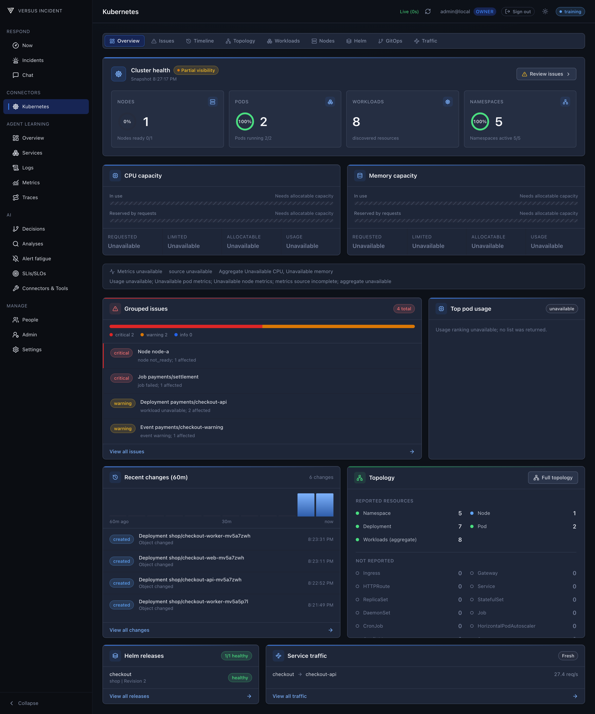
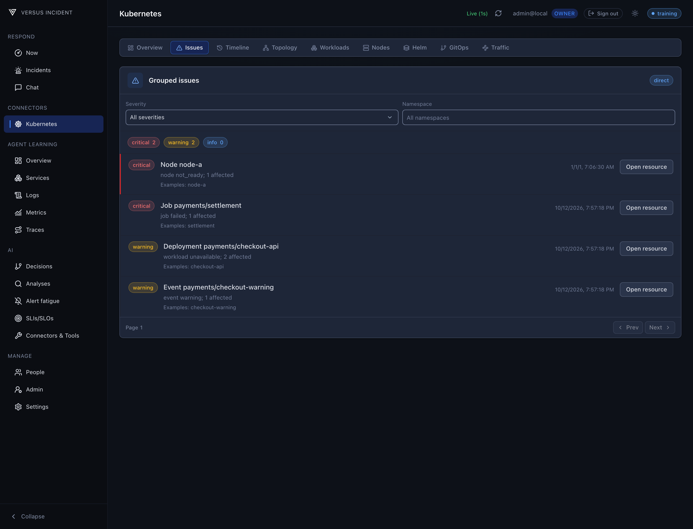
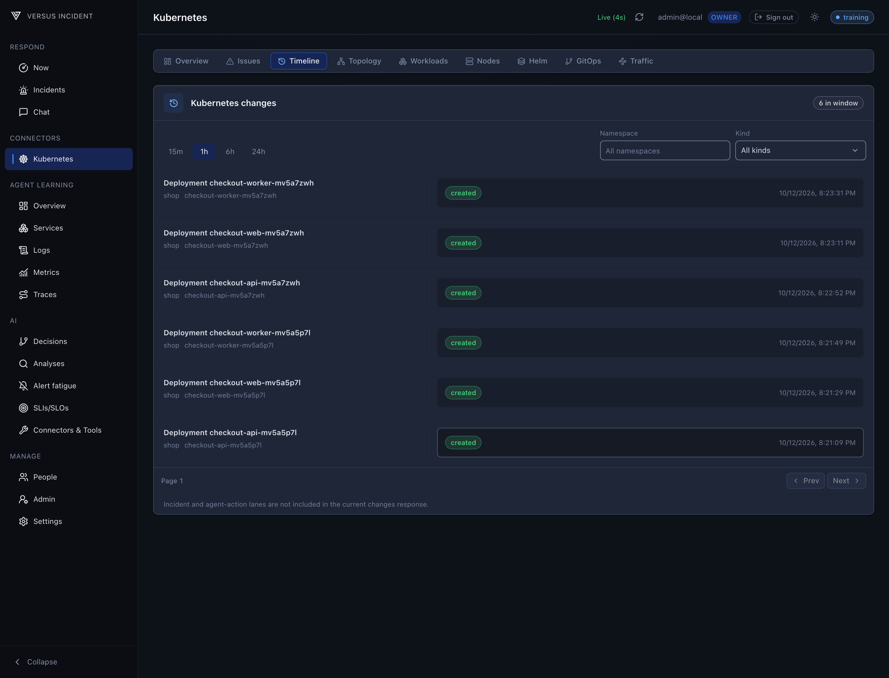
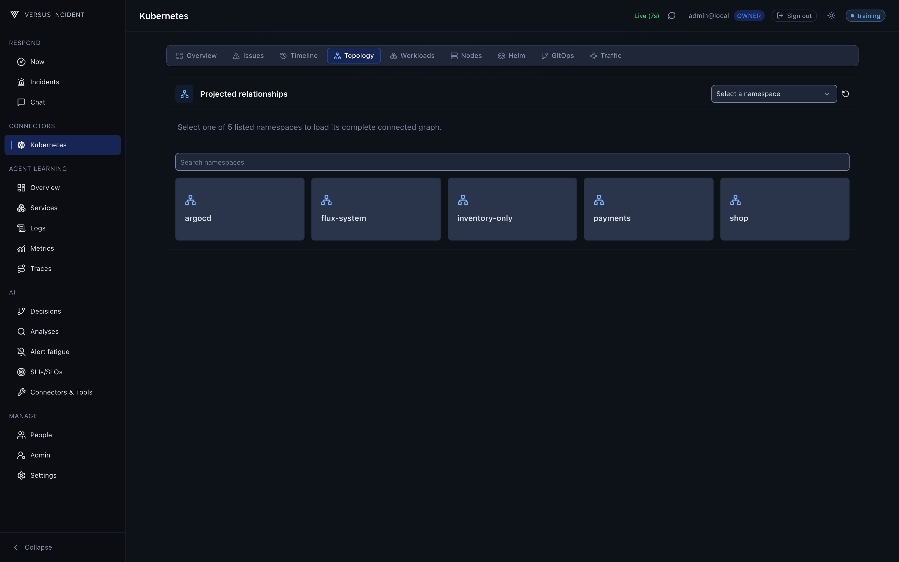
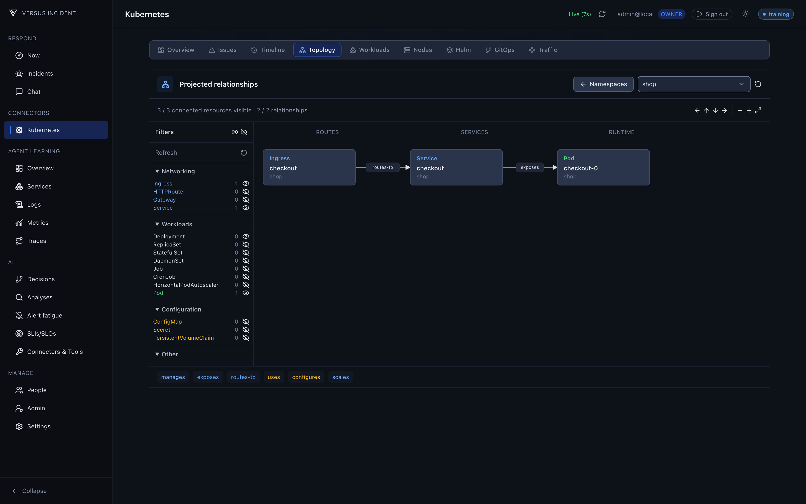
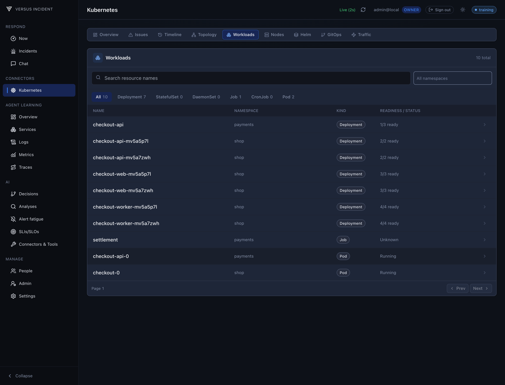
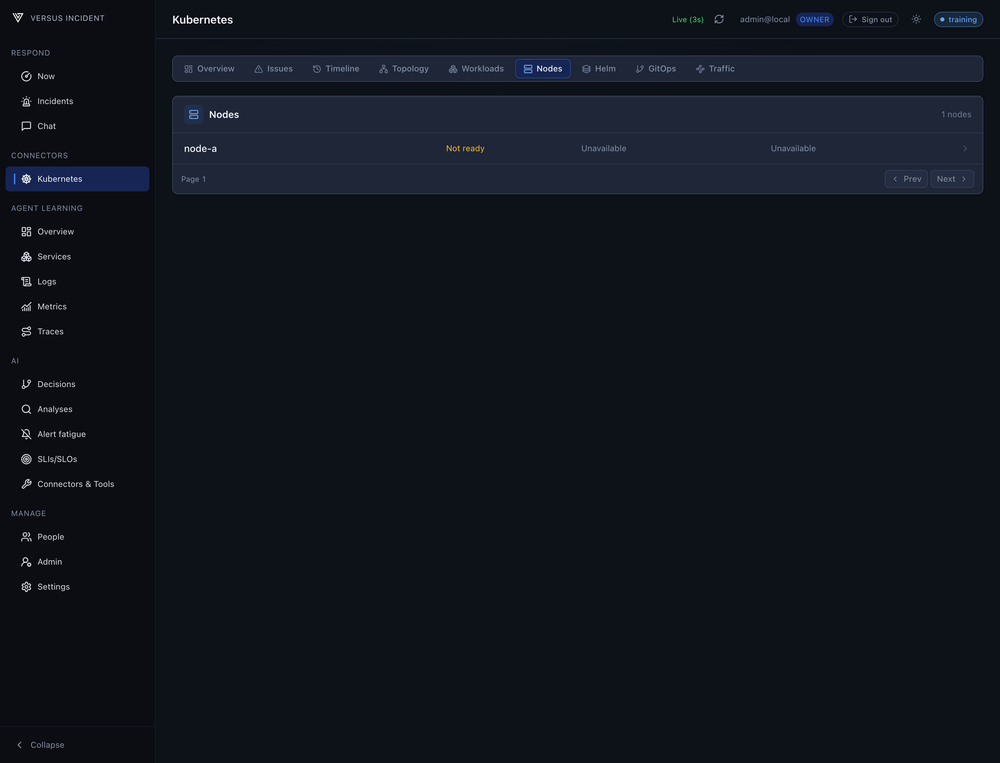
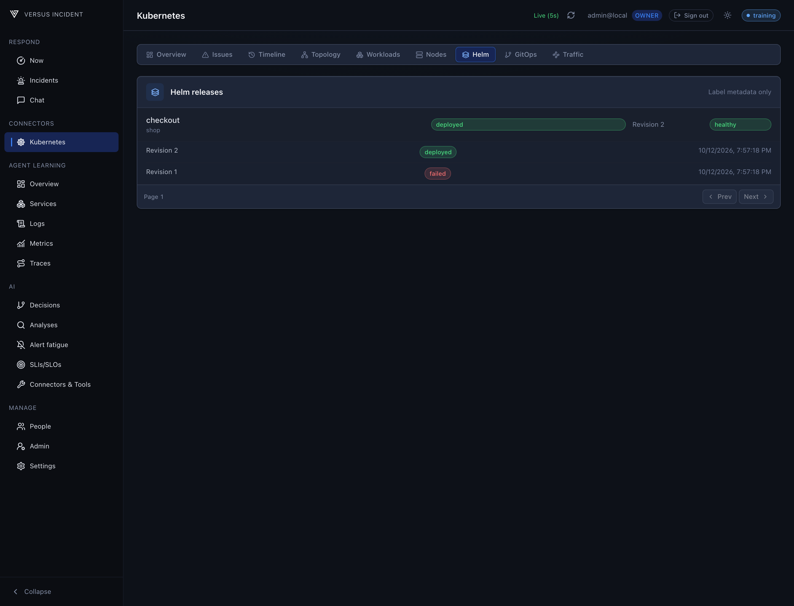
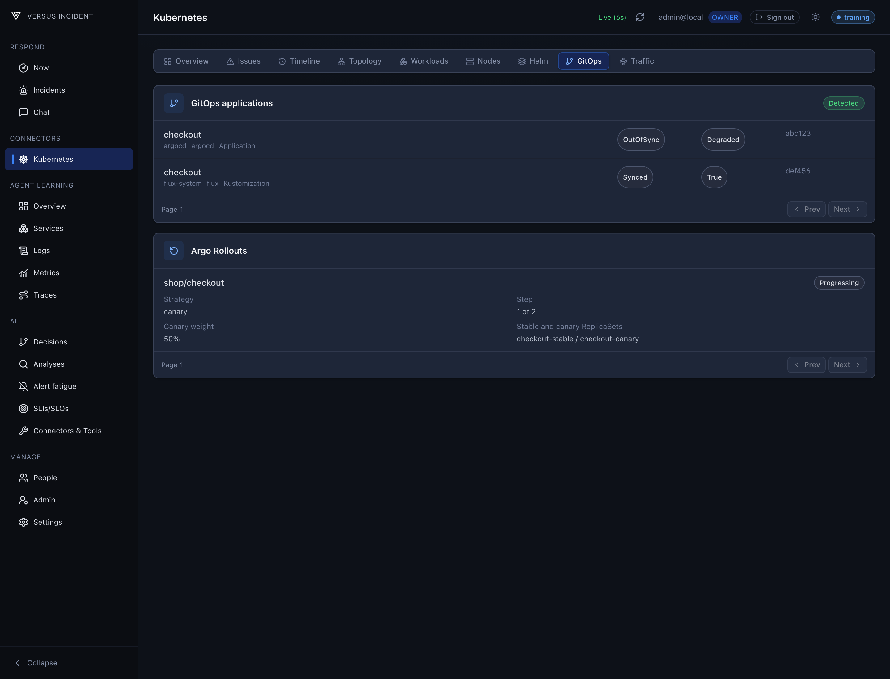
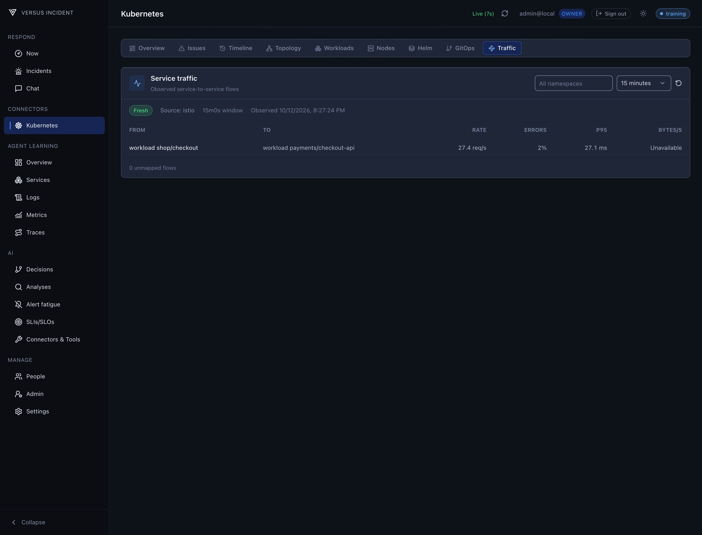

# Kubernetes Connector and Dashboard

Explore your Kubernetes environment in one place: cluster health and capacity,
workloads, resource relationships, recent changes, Helm releases, and GitOps
status. Open a resource to inspect its events, logs, metrics, and deployment
context without switching between tools.

The AI SRE can use the same cluster context in Chat and Analyze. Start with the
dashboard to understand a workload, then investigate it in chat with the
resource already attached.

## Harness Dashboard

Open **Connectors > Kubernetes** after connecting your cluster. The dashboard
has nine tabs; screenshots below use a synthetic cluster.

### Overview

See ready nodes, running pods, workload and namespace counts, and CPU and memory
capacity. Usage and resource requests are shown separately, with the metrics
source and sample time beside them. Missing metrics are labelled **Unavailable**
rather than shown as zero.

Grouped issues, top pod usage, recent changes, and release and traffic summaries
help you choose what to inspect next. The Overview topology summary shows actual
resource counts from inventory and overview metadata, with stale and partial
counts labelled. Reported resources and unreported resources are grouped
separately; unreported counts display **0** with count-availability context,
rather than being treated as verified zero counts. Recent changes and Topology
share an equal-height row with independently scrollable content; on narrow
screens they stack. **Full topology** opens the namespace explorer.

### Issues

Problems are grouped by resource and severity. Filter by severity or namespace,
then select **Open resource** to inspect the affected workload. Pagination loads
the next page without expanding the whole dashboard.

### Timeline

Follow resource creation and deletion, image updates, replica changes, and spec
changes. Choose a time window and filter by namespace or resource kind. Select
a change to open the resource's timeline in the details panel. Recorded history
gaps remain visible so missing evidence is not mistaken for no activity.

### Topology

Start with the namespace blocks. Search for a namespace and select it to explore
its connected resources; this graph is not paginated.

The filter sidebar groups resource kinds and shows their counts. Ingress,
Service, Deployment, and Pod are visible by default. Use the eye icons to show
or hide other kinds, or reveal all kinds at once. Choose a namespace and refresh
the graph in the header; **Namespaces** returns to the namespace blocks. Use
pan, zoom, and **Fit to view** to navigate the graph.

Connections show which resources manage, expose, route to, or configure others.
Select a resource to open its details. Resources without relationships are not
shown; use **Workloads** to browse workloads outside the graph. If permissions
or collection limits prevent a complete graph, the dashboard shows an error
instead of presenting partial results as complete.

### Workloads

Search workloads and filter by kind, including Deployments, StatefulSets,
DaemonSets, Jobs, CronJobs, and Pods. Select a row to open its details. The list
scrolls within the panel and loads additional pages as requested.

### Nodes

Browse cluster nodes, readiness, and capacity. Select a node to inspect its
scheduled Pods across namespaces; both inventories use server pagination.

### Helm

Inspect release status, health, namespace, and revision. Expand a release to
view its revision history. This view shows release metadata, not chart values
or rendered manifests, and does not run Helm operations.

### GitOps

Review discovered Argo CD and Flux applications, including sync state, health,
and revision. The **Argo Rollouts** section automatically lists detected
Rollouts and their strategy, progress, and canary weight.

If the relevant APIs are not installed or cannot be read, the page explains
what is unavailable instead of showing an empty successful result.

### Traffic

> **Enterprise**

See observed service-to-service request rates, error rates, latency, and
bytes per second where the source provides them. Filter by namespace and time
window; check the source and freshness before interpreting a flow. Without
supported telemetry, the page shows an unavailable state rather than inventing
connections. Individual metrics remain **Unavailable** when unsupported by
the source.

## Settings 

For connection settings, credentials, and permissions, see
[Configuration](/agent/kubernetes/configuration). To connect more than one
cluster, see [Multi-Cluster](/agent/kubernetes/multi-cluster).