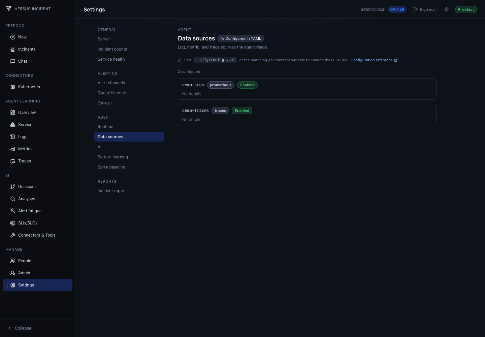

# Data Sources

## Concept

Versus does not collect your telemetry. It **reads what you already have**:
the logs in Loki, Elasticsearch, CloudWatch, Graylog, Splunk, SigNoz or a plain
file and, _Enterprise_, the metrics in Prometheus or CloudWatch and the traces in
Tempo or SigNoz. You point Versus at the backend, it learns what normal looks
like for each service, and it raises an incident only when something **new or
unexpected** shows up.

Every source follows the same journey:
[Training](./training-mode.md) → [Shadow](./shadow-mode.md) →
[Detect](./ai-detect-mode.md).


## Sources

| Source | Kind | Tier | What it needs | Example |
|---|---|---|---|---|
| [File](./data-sources/file.md) | Logs | OSS | A log file Versus can read | [`file/`](https://github.com/VersusControl/versus-incident/tree/main/examples/docker-compose/file) |
| [Loki](./data-sources/loki.md) | Logs | OSS | Loki URL and a LogQL query; optional tenant ID, token or user/password | [`loki/`](https://github.com/VersusControl/versus-incident/tree/main/examples/docker-compose/loki) |
| [Elasticsearch](./data-sources/elasticsearch.md) | Logs | OSS | Node URLs and an index pattern; API key or user/password with `read` and `view_index_metadata` on the index | [`elasticsearch/`](https://github.com/VersusControl/versus-incident/tree/main/examples/docker-compose/elasticsearch) |
| [CloudWatch Logs](./data-sources/cloudwatch-logs.md) | Logs | OSS | Region and log group; AWS credentials with `logs:FilterLogEvents` | Real AWS account |
| [Graylog](./data-sources/graylog.md) | Logs | OSS | Graylog URL; API token or user/password | [`graylog/`](https://github.com/VersusControl/versus-incident/tree/main/examples/docker-compose/graylog) |
| [Splunk](./data-sources/splunk.md) | Logs | OSS | Management URL (port `8089`) and a search; token or user/password | [`splunk/`](https://github.com/VersusControl/versus-incident/tree/main/examples/docker-compose/splunk) |
| [SigNoz](./data-sources/signoz.md) | Logs | OSS | SigNoz v0.87.0+ URL and a query API key | [`signoz/`](https://github.com/VersusControl/versus-incident/tree/main/examples/docker-compose/signoz) |
| [Prometheus](./data-sources/prometheus.md) | Metrics | _Enterprise_ | A Prometheus-compatible URL; optional token or user/password | [`metrics-source/`](https://github.com/VersusControl/versus-incident/tree/main/examples/metrics-source) |
| [SigNoz Metrics](../enterprise/metrics/signoz.md) | Metrics | _Enterprise_ | SigNoz v0.87.0+ URL and a query API key (`type: signoz_metrics`) | [`metrics-source/`](https://github.com/VersusControl/versus-incident/tree/main/examples/metrics-source) (SigNoz overlay) |
| [CloudWatch Metrics](./data-sources/cloudwatch-metrics.md) | Metrics | _Enterprise_ | Region; AWS credentials with `cloudwatch:ListMetrics` and `cloudwatch:GetMetricData` | Real AWS account |
| [Traces](./data-sources/traces.md) | Traces | _Enterprise_ | Tempo URL, or a SigNoz URL and query API key | [`metrics-source/`](https://github.com/VersusControl/versus-incident/tree/main/examples/metrics-source) |

_Enterprise_ sources run on the Enterprise image with a license key that
carries the `intelligence` entitlement. On the OSS image they stop with
`requires Versus Enterprise`. See [Enterprise Getting Started](../enterprise/getting-started.md).

## Add a source

Sources live in **`agent_sources.yaml`**, next to your `config.yaml`. When the
file is there, its list replaces any `agent.sources` in `config.yaml`. You can
list as many sources as you like, of any kind.

```yaml
# config/agent_sources.yaml
sources:
  - name: checkout-logs        # unique; shown in the UI and on incidents
    type: loki                 # file | loki | elasticsearch | cloudwatchlogs | graylog | splunk | signoz
    enable: true
    loki:                      # log sources: the block name matches `type`
      address: http://loki:3100
      query: '{app="checkout"}'

  - name: prod-metrics         # Enterprise sources take an `options:` block
    type: prometheus
    enable: true
    options:
      address: http://prometheus:9090
```

`${VAR}` values are read from the environment, so secrets stay out of the
file. A misspelled key in a log source block stops Versus at startup with an
error that names the key.

Two agent settings apply to every source:

| Setting | Default | What it does |
|---|---|---|
| `agent.poll_interval` | `30s` | How often Versus reads new data from each source. |
| `agent.lookback` | `5m` | How far back Versus reads the first time it starts. |

Versus remembers where it stopped in each source, so a restart neither skips
data nor learns it twice.

## What you see in the UI

**Settings → Data sources** shows one card per configured source, read-only:
its name, its type and whether it is enabled. Some source types also list their
settings; others show "No details." The example below is from a stack with a
Prometheus source and a traces source, both _Enterprise_.



What each source learns shows up under **Agent Learning**: **Logs** for log
sources, and _Enterprise_ **Metrics** and **Traces** for metric and trace
sources. Every incident names the source it came from, for example
`via loki:checkout-logs`.


## Troubleshooting

| Symptom | What to check |
|---|---|
| A source never shows up | `enable: true` is set, and `agent_sources.yaml` sits in the same folder as `config.yaml`. |
| `requires Versus Enterprise` at startup | A metric or trace source on the OSS image, or a license without the `intelligence` entitlement. |
| Repeated `MOVED` errors from Redis | Your Redis or Valkey runs in cluster mode. Set `redis.cluster: true`. See [Cluster mode](../configuration/configuration.md#cluster-mode-redis--valkey). |

## Try it

The fastest way to see a source end to end is the
[AIOps SRE Quickstart](./quickstart.md), which runs Versus next to a local
Loki. Every source page also ends with a **Try it with Docker Compose**
section, except CloudWatch, which reads a real AWS account.
