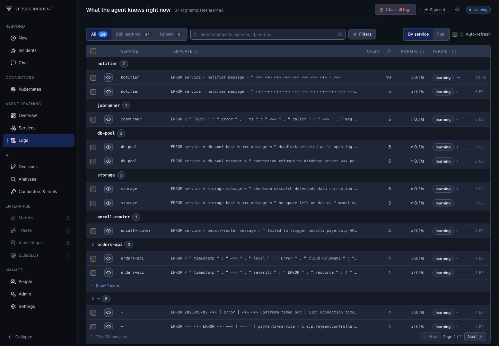

# File

## Concept

The file source reads one log file from disk, line by line, as it grows.
Use it for a container's log file on a mounted volume, for a host log, or to
try the agent before you connect a real log backend. Lines can be plain text
or one JSON object per line.

## Minimal config

```yaml
# config/agent_sources.yaml
sources:
  - name: my-app
    type: file
    enable: true
    file:
      path: /var/log/my-app/app.log
```

By default Versus starts at the end of the file and reads only new lines. Set
`from_beginning: true` to read the whole file the first time. When the file is
rotated or truncated, Versus starts again from the top of the new file.

| Key | Default | What it does |
|---|---|---|
| `path` | required | The file to read. One file per source; globs are not supported. |
| `format` | `text` | `text` or `json` (one JSON object per line). |
| `from_beginning` | `false` | Read the existing content on first start. |
| `cursor_path` | `.versus-cursor-<name>` next to the log | Where Versus records how far it has read. |
| `max_line_bytes` | `65536` | Longer lines are cut to this length. |
| `max_lines_per_pull` | `1000` | Lines read per poll. A large backlog is read over several polls. |
| `timestamp_layout` | auto-detect | `text` only. A Go time layout for the leading timestamp. |
| `message_field` | `message` | `json` only. Field that holds the log line. |
| `timestamp_field` | `@timestamp` | `json` only. Field that holds the time. |
| `severity_field` | `level` | `json` only. Field that holds the level. |

For Docker's JSON log files, use `format: json` with `message_field: log` and
`timestamp_field: time`.

## What you see in the UI

New patterns from the file appear in **Agent Learning → Logs**, grouped by
service, within one poll of the lines being written.



## Permissions

Versus needs to **read** the log file and **write** to the folder that holds
its read position: the log's own folder by default, or the folder of
`cursor_path`. If the log folder is mounted read-only, set `cursor_path` to a
writable path such as `/app/data/my-app.cursor`.

## Troubleshooting

| Symptom | Likely cause |
|---|---|
| Nothing is learned | The file does not exist yet, or the lines do not match the agent's [match pattern](../regex.md) (by default, lines containing `error`). |
| Old lines are never read | `from_beginning` is `false`, so Versus starts at the end. Set it to `true` before the first start. |
| `read cursor` error at startup | Versus cannot read or write its position file. Check the folder permissions or set `cursor_path`. |
| JSON lines show as raw text | `format` is still `text`, or `message_field` names a field the lines do not have. |

## Try it with Docker Compose

You need Git, Docker with Docker Compose v2, and Python 3 for the demo
traffic script. Clone the repository and go into it:

```bash
git clone https://github.com/VersusControl/versus-incident.git
cd versus-incident
```

Every command below runs from this `versus-incident` folder, the repository
root.

[`examples/docker-compose/file/`](https://github.com/VersusControl/versus-incident/tree/main/examples/docker-compose/file)
runs Versus (OSS image) and Redis. The agent reads `./local/logs/app.log`,
mounted into the container at `/var/log/sample/app.log`. The first start
creates the file empty; `local/` is ignored by git, so the demo leaves your
checkout clean:

```yaml
# examples/docker-compose/file/config/agent_sources.yaml
sources:
  - name: sample-app
    type: file
    enable: true
    file:
      path: /var/log/sample/app.log
      format: text
      from_beginning: true
      max_lines_per_pull: 1000
```

Start it:

```bash
docker compose -f examples/docker-compose/file/docker-compose.yml up -d
```

Start the training traffic: 20 lines every 5 seconds, stamped with the
current time, with one line of each ordinary error in every batch. The script
needs Python 3 on your machine. Leave it running while the agent learns; press
`Ctrl+C` to stop it.

```bash
OUTPUT=examples/docker-compose/file/local/logs/app.log \
  scripts/run_noisy_logs.sh
```

Open `http://localhost:3000`, enter the gateway secret `change-me`, and go to
**Agent Learning → Logs**. The example polls every 15 seconds.

Within about a minute all 6 patterns show **Known**.

To see an incident, keep the training traffic running for 3 minutes. Then open
a second terminal in the `versus-incident` folder, switch the agent to
detect, and send one incident burst:

```bash
AGENT_MODE=detect docker compose -f examples/docker-compose/file/docker-compose.yml \
  up -d --force-recreate versus
OUTPUT=examples/docker-compose/file/local/logs/app.log \
  scripts/run_noisy_logs.sh --scenario db-outage
```

The burst sends 60 lines and exits. Within about 30 seconds of the burst, often sooner, two
`db-pool` incidents appear on the **Incidents** page, and the normal traffic
raises none.

Clean up:

```bash
docker compose -f examples/docker-compose/file/docker-compose.yml down -v
```
