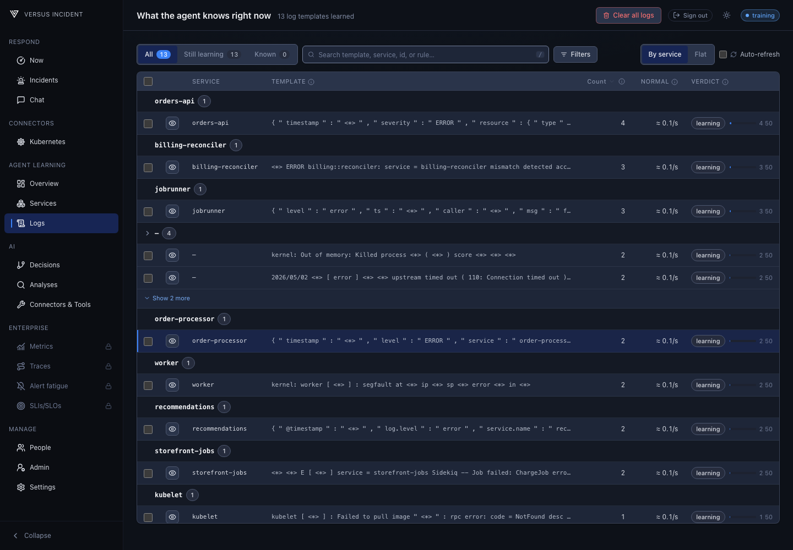

# Graylog

## Concept

The Graylog source reads messages from [Graylog](https://graylog.org/) through
its search API. You give it a Graylog search query and, optionally, one stream;
Versus reads matching messages oldest first on every poll.

## Minimal config

```yaml
# config/agent_sources.yaml
sources:
  - name: prod-graylog
    type: graylog
    enable: true
    graylog:
      address: https://graylog:9000
      api_token: ${GRAYLOG_API_TOKEN}
      query: 'level:3 AND service:api'
```

| Key | Default | What it does |
|---|---|---|
| `address` | required | Graylog base URL (web and REST API). |
| `api_token` | none | Graylog access token. Used instead of `username`/`password` when both are set. |
| `username` / `password` | none | Basic auth with a Graylog user. |
| `query` | `*` | Graylog search query. `*` matches every message. |
| `stream_id` | none | Read only this stream. |
| `message_field` | `message` | Field that holds the log text. |
| `severity_field` | `level` | Field that holds the level. |
| `fields` | all fields | Fields Graylog returns per message. Smaller is faster. |
| `extra_fields` | none | Fields kept with each line. Each must also be in `fields` when `fields` is set. |
| `page_size` | `500` | Messages read per poll. |
| `insecure_skip_verify` | `false` | Skip TLS verification. Local testing only. |

Test the query in the Graylog **Search** page first.

## What you see in the UI

Patterns learned from Graylog appear in **Agent Learning → Logs**, grouped by
service. Incidents show `via graylog:<source name>`.



## Permissions

Use a Graylog user that can read the streams you search, and create an access
token for it under **System → Users and Teams → (user) → Edit tokens**. Versus
only reads.

## Troubleshooting

| Symptom | Likely cause |
|---|---|
| `401 Unauthorized` | Wrong token or password. |
| `400 Bad Request` | Invalid search query. Test it in Graylog **Search**. |
| No messages, but Graylog has them | The query or `stream_id` matches nothing, or Graylog has no input receiving logs. |
| Severity is always empty | `severity_field` names a field your messages do not have. |

## Try it with Docker Compose

You need Git, Docker with Docker Compose v2, and Python 3 for the demo
traffic script. Clone the repository and go into it:

```bash
git clone https://github.com/VersusControl/versus-incident.git
cd versus-incident
```

Every command below runs from this `versus-incident` folder, the repository
root.

[`examples/docker-compose/graylog/`](https://github.com/VersusControl/versus-incident/tree/main/examples/docker-compose/graylog)
runs Versus (OSS image), Redis, Graylog 5, MongoDB and OpenSearch. Give Docker at
least 6 GB of memory. A setup step creates the GELF UDP input (port `12201`)
that the demo traffic is sent to.

```yaml
# examples/docker-compose/graylog/config/agent_sources.yaml
sources:
  - name: demo-graylog
    type: graylog
    enable: true
    graylog:
      address: http://graylog:9000
      username: admin
      password: ${GRAYLOG_PASSWORD}       # admin in the example
      query: "*"
      message_field: message
      severity_field: level
      extra_fields:
        - source
        - service
      page_size: 500
```

The example's Graylog admin password is `admin`, and `docker-compose.yml`
stores its SHA-256 in `GRAYLOG_ROOT_PASSWORD_SHA2`. To use another password,
change both together: export `GRAYLOG_PASSWORD` and replace the hash with the
SHA-256 of the new password (`echo -n <password> | shasum -a 256`). Changing
only one breaks startup, because the Graylog health check and Versus both
sign in with `GRAYLOG_PASSWORD`.

Start it and wait about 60 seconds for Graylog:

```bash
docker compose -f examples/docker-compose/graylog/docker-compose.yml up -d
docker compose -f examples/docker-compose/graylog/docker-compose.yml logs graylog-init
```

Start the training traffic: 20 lines every 5 seconds, stamped with the
current time, with one line of each ordinary error in every batch. The script
needs Python 3 on your machine. Leave it running while the agent learns; press
`Ctrl+C` to stop it.

```bash
scripts/run_noisy_logs.sh --target graylog
```

Open `http://localhost:3000`, enter the gateway secret `change-me`, and go to
**Agent Learning → Logs**. Browse the same messages in Graylog at
`http://localhost:9000` (`admin` / `admin`, **Search**).

Within about a minute all 6 patterns show **Known**.

To see an incident, keep the training traffic running for 3 minutes. Then open
a second terminal in the `versus-incident` folder, switch the agent to
detect, and send one incident burst:

```bash
AGENT_MODE=detect docker compose -f examples/docker-compose/graylog/docker-compose.yml \
  up -d --force-recreate versus
scripts/run_noisy_logs.sh --target graylog --scenario db-outage
```

The burst sends 60 lines and exits. Within about 30 seconds of the burst, often sooner, two
`db-pool` incidents appear on the **Incidents** page, and the normal traffic
raises none.

Clean up:

```bash
docker compose -f examples/docker-compose/graylog/docker-compose.yml down -v
```
