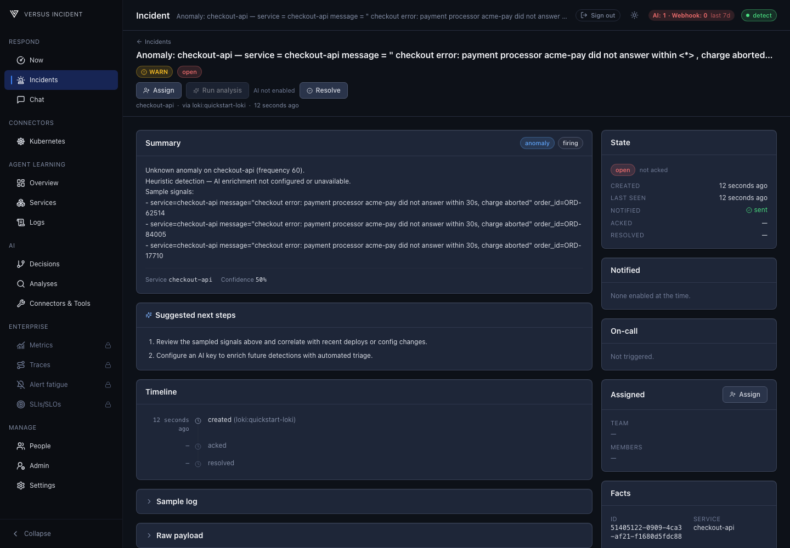

# Loki

## Concept

The Loki source reads log lines from [Grafana Loki](https://grafana.com/oss/loki/),
self-hosted or Grafana Cloud Logs. You give it a LogQL query; Versus reads the
lines that match, oldest first, on every poll. Stream labels such as `app` or
`namespace` can travel with each line.

## Minimal config

```yaml
# config/agent_sources.yaml
sources:
  - name: prod-loki
    type: loki
    enable: true
    loki:
      address: http://loki:3100
      query: '{app="api"} |= "error"'
```

For **Grafana Cloud**, use your instance ID and an access-policy token:

```yaml
    loki:
      address: https://logs-prod-006.grafana.net
      username: ${GRAFANA_CLOUD_INSTANCE_ID}
      password: ${GRAFANA_CLOUD_API_TOKEN}
      query: '{namespace="prod"} |~ "(?i)error|panic"'
```

| Key | Default | What it does |
|---|---|---|
| `address` | required | Loki base URL. |
| `query` | required | LogQL selector and filter. |
| `tenant_id` | none | Tenant for multi-tenant Loki, sent as `X-Scope-OrgID`. |
| `bearer_token` | none | Token auth. Used instead of `username`/`password` when both are set. |
| `username` / `password` | none | Basic auth. |
| `insecure_skip_verify` | `false` | Skip TLS verification. Local testing only. |
| `severity_field` | none | The stream **label** that holds the level, for example `level`. |
| `extra_labels` | none | Stream labels kept with each line, for example `app`, `namespace`. |
| `service_label` | `service` | The stream label AI Chat and Analyze use to filter this source by service. |
| `page_size` | `500` | Lines read per request. |

Test your query in Grafana **Explore** first. If Explore shows the lines,
Versus reads them.

## What you see in the UI

Patterns learned from Loki appear in **Agent Learning → Logs**, grouped by
service.


An incident from this source shows `via loki:<source name>` under its title.



## Permissions

| Loki | What to give Versus |
|---|---|
| Self-hosted | Loki has no users of its own. Put it behind a gateway and pass `bearer_token` or `username`/`password`; add `tenant_id` when multi-tenancy is on. |
| Grafana Cloud | An access policy with the `logs:read` scope, and a token under that policy. |

Versus only reads; it never writes to Loki.

## Troubleshooting

| Symptom | Likely cause |
|---|---|
| `401 Unauthorized` | Wrong instance ID or token, or a missing `tenant_id`. |
| `400` with a parse error | Invalid LogQL. Test the query in Grafana Explore. |
| No lines, but Loki has logs | The query matches nothing in the time read. Widen the selector. |
| Severity is always empty | `severity_field` reads a stream **label**, not the line. Make the level a label, or drop `severity_field`. |

## Try it with Docker Compose

The quickest Loki run is the [AIOps SRE Quickstart](../quickstart.md): it ships
a demo log stream and walks you to an incident in Slack.

You need Git, Docker with Docker Compose v2, and Python 3 for the demo
traffic script. Clone the repository and go into it:

```bash
git clone https://github.com/VersusControl/versus-incident.git
cd versus-incident
```

Every command below runs from this `versus-incident` folder, the repository
root.

[`examples/docker-compose/loki/`](https://github.com/VersusControl/versus-incident/tree/main/examples/docker-compose/loki)
is the bare version: Versus (OSS image), Redis, Loki and Grafana.

```yaml
# examples/docker-compose/loki/config/agent_sources.yaml
sources:
  - name: demo-loki
    type: loki
    enable: true
    loki:
      address: http://loki:3100
      query: '{app=~".+"}'
      severity_field: level
      extra_labels:
        - app
      page_size: 500
```

Start it and wait about 10 seconds for Loki to be ready:

```bash
docker compose -f examples/docker-compose/loki/docker-compose.yml up -d
```

Start the training traffic: 20 lines every 5 seconds, stamped with the
current time, with one line of each ordinary error in every batch. The script
needs Python 3 on your machine. Leave it running while the agent learns; press
`Ctrl+C` to stop it.

```bash
scripts/run_noisy_logs.sh --target loki
```

Open `http://localhost:3000`, enter the gateway secret `change-me`, and go to
**Agent Learning → Logs**. Browse the same lines in Grafana at
`http://localhost:3001` (**Explore**, query `{app=~".+"}`).

Within about a minute all 6 patterns show **Known**.

To see an incident, keep the training traffic running for 3 minutes. Then open
a second terminal in the `versus-incident` folder, switch the agent to
detect, and send one incident burst:

```bash
AGENT_MODE=detect docker compose -f examples/docker-compose/loki/docker-compose.yml \
  up -d --force-recreate versus
scripts/run_noisy_logs.sh --target loki --scenario db-outage
```

The burst sends 60 lines and exits. Within about 30 seconds of the burst, often sooner, two
`db-pool` incidents appear on the **Incidents** page, and the normal traffic
raises none.

Clean up:

```bash
docker compose -f examples/docker-compose/loki/docker-compose.yml down -v
```
