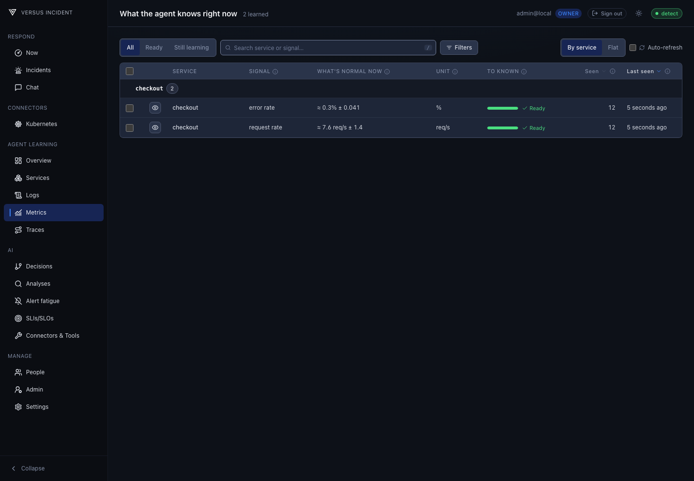

# Prometheus

_Enterprise_

## Concept

Point Versus at Prometheus and it finds what to watch on its own. For each
service it picks the request rate, the error rate, the p99 latency and
resource gauges such as memory and CPU, then learns each signal's normal by
time of week: 2pm Tuesday is compared with past 2pm Tuesdays. It raises an
incident only when a signal moves far outside its normal **and stays there**,
not on one noisy reading. You write no queries and set no thresholds.

It works with any Prometheus-compatible API: Prometheus, Mimir, Cortex, Thanos,
VictoriaMetrics and Grafana Cloud.


Metrics move through the same modes as logs. In
[training](../training-mode.md) Versus learns and never alerts; a new signal
cannot alert until it has seen enough data. In [shadow](../shadow-mode.md) it
records what it would have raised. In [detect](../ai-detect-mode.md) it raises
incidents.

## Minimal config

```yaml
# config/agent_sources.yaml
sources:
  - name: prod-metrics
    type: prometheus
    enable: true
    options:
      address: http://prometheus:9090
```

With auth:

```yaml
    options:
      address: https://prometheus.internal:9090
      bearer_token: ${PROM_TOKEN}
```

| Key | Default | What it does |
|---|---|---|
| `address` | required | Prometheus-compatible base URL. Versus only sends reads. |
| `bearer_token` | none | Token auth. |
| `username` / `password` | none | Basic auth, used when no `bearer_token` is set. |
| `insecure_skip_verify` | `false` | Skip TLS verification. Local testing only. |
| `filter` | watch everything | A label selector that limits what Versus watches. See below. |
| `queries` | none | Extra PromQL signals of your own. See below. |
| `step` | `60s` | Sampling resolution. |
| `max_services` | `50` | Most services Versus watches. |
| `max_signals` | `200` | Most signals Versus watches in total. |
| `discovery_interval` | `1h` | How often Versus looks for new services and signals. |
| `discovery_lookback` | `1h` | Time range Versus looks at when it searches (at least `5m`). |
| `allow_private_networks` | `false` | Lets AI Chat and Analyze read from a private address such as `prometheus` on a Docker network. |
| `allow_loopback` | `false` | Lets AI Chat and Analyze read from `localhost`. |

### What it watches

Versus names each service from the first label it finds: `service`,
`service_name`, `app_kubernetes_io_name`, `app`, then `job`.

| Signal | Comes from | Watches |
|---|---|---|
| Traffic | request counters such as `*_requests_total` | how busy the service is |
| Errors | the 5xx share of those requests | how often requests fail |
| Latency | duration histograms such as `*_duration_seconds*` | the p99 response time |
| Resource use | memory, CPU, queue, pool and goroutine gauges | one signal per gauge |

A service gets at most 6 signals. When data is sparse, Versus says coverage is
thin instead of guessing.

## Scope discovery with `filter`

On a large or shared Prometheus, `filter` limits what Versus watches. It is a
PromQL label selector, and it applies both to finding signals and to reading
them:

```yaml
    options:
      address: http://prometheus:9090
      filter: '{namespace="prod"}'
```

| `filter` | Watches |
|---|---|
| `'{namespace="prod"}'` | series in the `prod` namespace |
| `'{cluster=~"prod-.*"}'` | every cluster whose name starts with `prod-` |
| `'{namespace="prod", tier!="batch"}'` | `prod`, without the `batch` tier |
| unset, `'*'` or `'{}'` | everything |

A malformed selector stops the source at startup. `filter` does not change your
own `queries`.

## Add your own signals

For something Versus would not find by itself, such as a business metric, add
PromQL under `queries`. Your queries run **alongside** the automatic signals.
A query raises a signal while it returns any series, so write it as a
condition:

```yaml
    options:
      address: http://prometheus:9090
      queries:
        - query: 'rate(orders_failed_total[5m]) > 0.1'
          severity: critical
          service_label: service
```

| Key | What it does |
|---|---|
| `query` | PromQL condition. Each series it returns raises a signal. |
| `severity` | Severity on the incident. |
| `service_label` | The series label that names the service. |

## What you see in the UI

**Agent Learning → Metrics** lists every signal Versus watches, by service,
with its source and unit. The **Ready** tab shows signals whose normal is
learned; **Still learning** shows the rest.



Incidents from this source appear on the **Incidents** page and name the
source they came from. In shadow, would-have-raised results are in
**AI → Decisions**, on the **Shadow** tab.

## Permissions

Versus only reads: it calls the Prometheus query, series, label and metadata
APIs. Give it a token or user with read access, or none if your Prometheus has
no auth. It needs the Enterprise image and a license key with the
`intelligence` entitlement.

## Troubleshooting

| Symptom | Likely cause |
|---|---|
| `requires Versus Enterprise` | OSS image, or a license without the `intelligence` entitlement. |
| Nothing under Metrics | No series carry a service label from the list above. Add `queries` with `service_label`, or relabel in Prometheus. |
| Coverage reported as thin | Few request, error or latency metrics. Versus watches what exists. |
| Source fails at startup | A malformed `filter` selector. Quote label values: `{namespace="prod"}`. |
| Chat or Analyze cannot read metrics | The address is private or loopback. Set `allow_private_networks` or `allow_loopback`. |

## Try it with Docker Compose

You need Git, Docker with Docker Compose v2, and a Versus Enterprise
license key. Clone the repository and go into it:

```bash
git clone https://github.com/VersusControl/versus-incident.git
cd versus-incident
```

Every command below runs from this `versus-incident` folder, the repository
root.

[`examples/metrics-source/`](https://github.com/VersusControl/versus-incident/tree/main/examples/metrics-source)
runs **Versus Enterprise** (`ghcr.io/versuscontrol/versus-enterprise`) with
Postgres, Redis, Prometheus and a Pushgateway. A demo traffic service pushes
healthy traffic for a `checkout` service every 2 seconds. The example starts
in detect.

```yaml
# examples/metrics-source/config/agent_sources.yaml
sources:
  - name: demo-prom
    type: prometheus
    enable: true
    options:
      address: http://prometheus:9090
      step: 15s                      # one sample every 15s
      filter: '{service!=""}'        # learn only the demo series
      discovery_interval: 1m         # look for new series every minute
```

Start the stack and the demo traffic, with your license key from the
environment:

```bash
export LICENSE_KEY=<your license key>
docker compose -f examples/metrics-source/docker-compose.yml --profile fake-metrics up -d
```

Versus Enterprise prints the admin password once, on the first boot against an
empty database. Keep it:

```bash
docker compose -f examples/metrics-source/docker-compose.yml logs versus \
  | grep -A6 "DEFAULT ADMIN CREDENTIALS"
```

Open `http://localhost:3000` and sign in as `admin` with that password. Within
a minute **Agent Learning → Metrics** lists `checkout` with its request rate
and error rate. Wait about 2 minutes, until they are learned, then fire a
90-second error and latency spike:

```bash
docker compose -f examples/metrics-source/docker-compose.yml run --rm metrics-spike
```

About a minute into the spike, an incident appears on the **Incidents** page:

```text
Anomaly: checkout — error_rate (… above baseline …)
```

A spike fired before the signals are learned is taken as normal and raises
nothing. Check the same data in Prometheus at `http://localhost:9090`.

Clean up:

```bash
docker compose -f examples/metrics-source/docker-compose.yml --profile fake-metrics down -v
```

For the full walkthrough, including SLOs, see
[Prometheus Metrics Demo](../../enterprise/metrics/prometheus.md).
