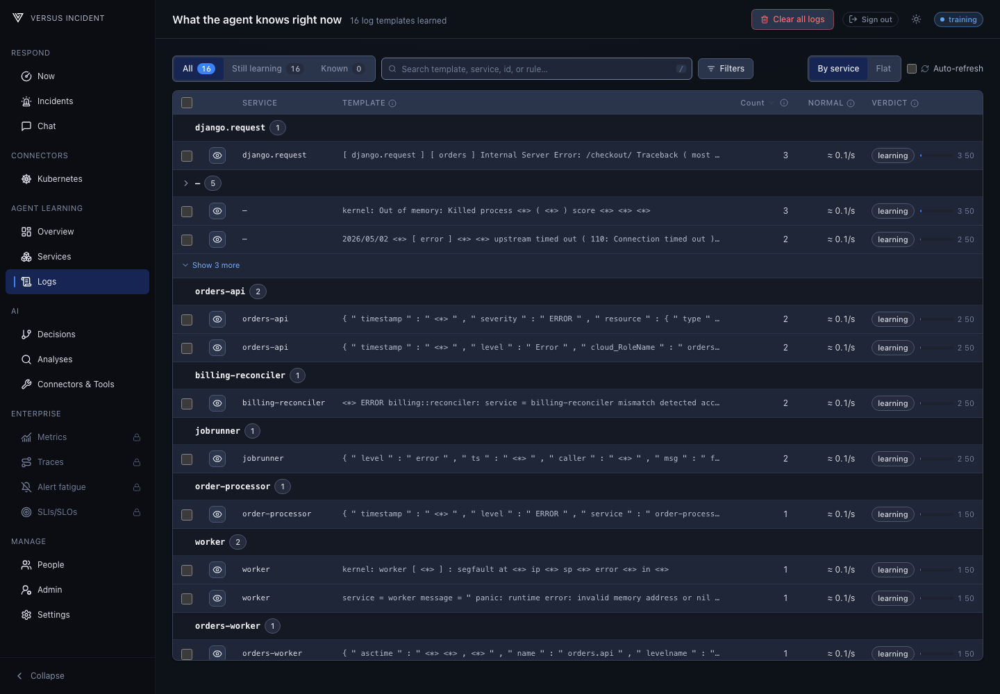

# SigNoz

## Concept

The SigNoz source reads log rows from [SigNoz](https://signoz.io/), self-hosted
or SigNoz Cloud, through the SigNoz query API. You give it a filter expression,
the same syntax as the SigNoz **Logs Explorer** filter bar; Versus reads the
matching rows on every poll. It needs **SigNoz v0.87.0 or later**.

SigNoz metrics and traces are _Enterprise_ sources: see
[SigNoz Metrics](../../enterprise/metrics/signoz.md) and
[Traces → SigNoz](./traces.md#signoz-backend).

## Minimal config

```yaml
# config/agent_sources.yaml
sources:
  - name: prod-signoz
    type: signoz
    enable: true
    signoz:
      address: https://<region>.signoz.cloud
      api_key: ${SIGNOZ_API_KEY}
      query: "severity_text = 'ERROR'"
```

For self-hosted SigNoz on a private network, set `address` to your SigNoz URL
and add `allow_private_networks: true`.

| Key | Default | What it does |
|---|---|---|
| `address` | required | SigNoz URL (UI and query API), or `https://<region>.signoz.cloud`. Not the collector port. |
| `api_key` | required | A SigNoz **query** API key, sent as the `SIGNOZ-API-KEY` header. Not an ingestion key. |
| `query` | match all | Filter expression, for example `service.name = 'api'`. Not LogQL or SQL. |
| `message_field` | `body` | Field that holds the log text. |
| `severity_field` | `severity_text` | Field that holds the level. |
| `extra_fields` | none | Attributes kept with each line, for example `service.name` or `resources_string.service.name`. |
| `allow_private_networks` | `false` | Must be `true` to reach a private address (`10.x`, `172.16.x`, `192.168.x`). |
| `allow_loopback` | `false` | Must be `true` to reach `localhost`. |
| `insecure_skip_verify` | `false` | Skip TLS verification. Local testing only. |
| `page_size` | `500` | Rows per request, up to `1000`. |
| `reorder_window` | `2m` | How far back each poll looks again, to catch rows that arrive late. |

Use HTTPS in production. Over plain HTTP the API key travels unencrypted.
Versus does not follow redirects, so set `address` to the final URL.

| Goal | `query` |
|---|---|
| Errors only | `severity_text = 'ERROR'` |
| One service | `service.name = 'api'` |
| Errors from one service | `severity_text = 'ERROR' AND service.name = 'api'` |
| Everything | leave `query` empty |

## What you see in the UI

Patterns learned from SigNoz appear in **Agent Learning → Logs**, grouped by
service. Incidents show `via signoz:<source name>`.



## Permissions

Create a query API key under **Settings → API Keys** in SigNoz. Creating one
needs the **Admin** role; the key itself only needs to read (a viewer role is
enough). Keys are available on SigNoz Cloud and on self-hosted SigNoz. Versus
never writes to SigNoz.

## Troubleshooting

| Symptom | Likely cause |
|---|---|
| `401` or `403` on every poll | An ingestion key instead of a query API key, or a revoked key. |
| `404` on `/api/v5/query_range` | SigNoz is older than v0.87.0. Upgrade. |
| `400` on every poll | Invalid `query`. Test it in the Logs Explorer. |
| Refused, or a redirect error | `address` is private or loopback without the matching `allow_*` key, or it redirects. Set the final URL. |
| No rows, but SigNoz has logs | `address` points at the collector (`4317`/`4318`), or the query matches nothing. |

## Try it with Docker Compose

You need Git, Docker with Docker Compose v2, and Python 3 for the demo
traffic script. Clone the repository and go into it:

```bash
git clone https://github.com/VersusControl/versus-incident.git
cd versus-incident
```

Every command below runs from this `versus-incident` folder, the repository
root.

[`examples/docker-compose/signoz/`](https://github.com/VersusControl/versus-incident/tree/main/examples/docker-compose/signoz)
runs Versus (OSS image), Redis and a self-hosted SigNoz (ClickHouse, ZooKeeper,
an OTel collector and the SigNoz server). **Give Docker at least 4 GB of
memory.** A setup step creates the SigNoz admin and a read-only API key for
Versus, so you do not paste a key.

```yaml
# examples/docker-compose/signoz/config/agent_sources.yaml (comments trimmed)
sources:
  - name: demo-signoz
    type: signoz
    enable: true
    signoz:
      address: ${SIGNOZ_ADDRESS}          # http://signoz:8080 in the example
      api_key: ${SIGNOZ_API_KEY}          # created on first boot
      allow_private_networks: true
      query: ${SIGNOZ_QUERY}              # empty: every log
      message_field: body
      severity_field: severity_text
      extra_fields:
        - resources_string.service.name
        - resources_string.deployment.environment
        - attributes_string.http.status_code
      page_size: 500
      reorder_window: 2m
```

Start it. The first boot takes about 70 seconds:

```bash
docker compose -f examples/docker-compose/signoz/docker-compose.yml up -d
```

Start the training traffic: 20 lines every 5 seconds, stamped with the
current time, with one line of each ordinary error in every batch. The script
needs Python 3 on your machine. Leave it running while the agent learns; press
`Ctrl+C` to stop it.

```bash
scripts/run_noisy_logs.sh --target signoz
```

The traffic is sent over OTLP, the same path your services use.

Open `http://localhost:3000`, enter the gateway secret `change-me`, and go to
**Agent Learning → Logs**. Browse the same logs in SigNoz at
`http://localhost:8080` (`admin@versus.local` / `Versus-Dev-12345`).

Within about a minute all 6 patterns show **Known**.

To see an incident, keep the training traffic running for 3 minutes. Then open
a second terminal in the `versus-incident` folder, switch the agent to
detect, and send one incident burst:

```bash
AGENT_MODE=detect docker compose -f examples/docker-compose/signoz/docker-compose.yml \
  up -d --force-recreate versus
scripts/run_noisy_logs.sh --target signoz --scenario db-outage
```

The burst sends 60 lines and exits. Within about 30 seconds of the burst, often sooner, two
`db-pool` incidents appear on the **Incidents** page, and the normal traffic
raises none.

Clean up:

```bash
docker compose -f examples/docker-compose/signoz/docker-compose.yml down -v
```

That also drops the created API key, so the next start sets it up again.
