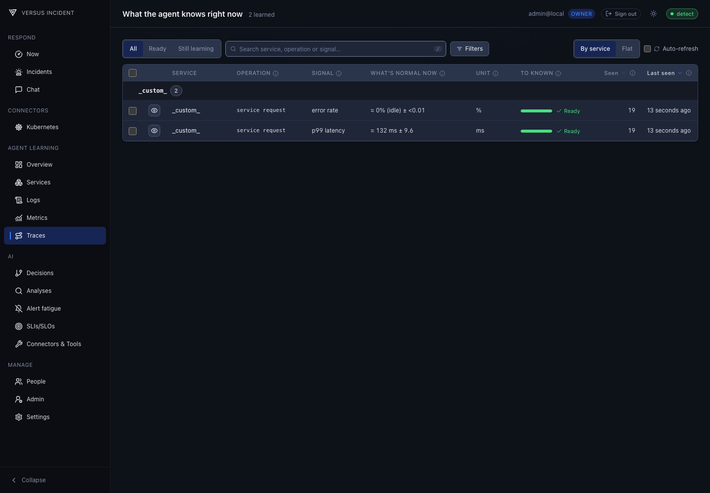

# Traces

_Enterprise_

## Concept

Point Versus at your tracing backend and it finds what to watch on its own:
every service and the operations inside it, such as `GET /checkout`. For each
operation it learns two things by time of week: how fast it usually is (p99
latency) and how often it usually fails (error rate). It raises an incident
only when an operation gets clearly slower or fails more **and stays that
way**, not on one slow request. You write no TraceQL and set no thresholds.

Two backends are supported:

| Backend | `type` |
|---|---|
| Grafana Tempo | `traces` |
| SigNoz (v0.87.0+) | `signoz_traces` |

Traces move through the same modes as logs: [training](../training-mode.md)
learns and never alerts, [shadow](../shadow-mode.md) records what it would have
raised, and [detect](../ai-detect-mode.md) raises incidents.

## Minimal config (Tempo)

```yaml
# config/agent_sources.yaml
sources:
  - name: prod-traces
    type: traces
    enable: true
    options:
      address: http://tempo:3200
      backend: tempo
```

| Key | Default | What it does |
|---|---|---|
| `address` | required | Tempo base URL. Versus only sends reads. |
| `backend` | `tempo` | Only `tempo` is supported. |
| `bearer_token` | none | Token auth. |
| `username` / `password` | none | Basic auth, used when no `bearer_token` is set. |
| `insecure_skip_verify` | `false` | Skip TLS verification. Local testing only. |
| `query` | none | Extra TraceQL of your own, for example `{ status = error }`. Each matching trace raises a signal, alongside the automatic targets. |
| `page_size` | `100` | Traces searched per target on each poll. |
| `max_services` | `50` | Most services Versus watches. |
| `max_operations` | `10` | Most operations per service. |
| `max_targets` | `200` | Most service and operation pairs in total. |
| `discovery_interval` | `1h` | How often Versus looks for new services and operations. |
| `allow_private_networks` | `false` | Lets AI Chat and Analyze read from a private address such as `tempo` on a Docker network. |
| `allow_loopback` | `false` | Lets AI Chat and Analyze read from `localhost`. |
| `tool_scope_service` | none | Limits AI Chat and Analyze reads to one service. |

For AI Chat and Analyze reads, a token or password needs HTTPS, except on a
`localhost` address with `allow_loopback: true`.

### What it watches

Versus names each service from the first trace attribute it finds:
`resource.service.name`, then `service.name`, then `service`. Operations come
from the span name. Every service and operation pair is one target with two
signals:

| Signal | Watches |
|---|---|
| Speed | the p99 latency of the operation |
| Error rate | the share of the operation's traces that fail |

When there is no operation name, Versus watches the service as a whole.

## SigNoz backend

For traces in SigNoz, Cloud or self-hosted, use `type: signoz_traces`. It
watches the same targets and learns the same two signals; only the connection
differs.

```yaml
sources:
  - name: prod-signoz-traces
    type: signoz_traces
    enable: true
    options:
      address: https://<region>.signoz.cloud
      api_key: ${SIGNOZ_API_KEY}
```

| Key | Default | What it does |
|---|---|---|
| `address` | required | SigNoz URL, or `https://<region>.signoz.cloud`. Use HTTPS in production. |
| `api_key` | required | A SigNoz **query** API key, not an ingestion key. |
| `allow_private_networks` | `false` | Must be `true` for a self-hosted SigNoz on a private address. |
| `allow_loopback` | `false` | Must be `true` to reach `localhost`. |
| `insecure_skip_verify` | `false` | Skip TLS verification. |
| `query` | none | Extra filter expression of your own, alongside the automatic targets. |
| `page_size` | `100` | Spans searched per target on each poll. |
| `max_services` / `max_operations` / `max_targets` | `50` / `10` / `200` | Limits, as for Tempo. |
| `discovery_interval` | `1h` | How often Versus looks for new services and operations. |
| `discovery_lookback` | `1h` | Time range Versus samples spans from (at least `5m`). |
| `discovery_samples` | `200` | Spans sampled per search, up to `1000`. Raise it on a quiet backend. |

Create the query key under **Settings → API Keys** in SigNoz (needs the Admin
role). A service that sent no spans in the last `discovery_lookback` is found on
a later search.

## What you see in the UI

**Agent Learning → Traces** lists every target Versus watches, by service,
with the operation, the signal and its source. The **Ready** tab shows targets
whose normal is learned; **Still learning** shows the rest. Incidents appear
on the **Incidents** page and name the source they came from.



## Permissions

Versus only reads traces. For Tempo, give it a token or user with read access,
or none if Tempo has no auth. For SigNoz, a query API key with a viewer role is
enough. Both sources need the Enterprise image and a license key with the
`intelligence` entitlement; on the OSS image they stop with
`requires Versus Enterprise`.

## Troubleshooting

| Symptom | Likely cause |
|---|---|
| `requires Versus Enterprise` | OSS image, or a license without the `intelligence` entitlement. |
| Nothing under Traces | Spans carry no service attribute from the list above, or `address` points at the OTLP port (`4317`/`4318`) instead of the query API. |
| Only whole services, no operations | Spans have no name Versus can read. |
| SigNoz `401` or `403` | An ingestion key instead of a query API key. |
| Chat or Analyze cannot read traces | The address is private or loopback. Set `allow_private_networks` or `allow_loopback`. |

## Try it with Docker Compose

You need Git, Docker with Docker Compose v2, and a Versus Enterprise
license key. Clone the repository and go into it:

```bash
git clone https://github.com/VersusControl/versus-incident.git
cd versus-incident
```

Every command below runs from this `versus-incident` folder, the repository
root.

[`examples/metrics-source/`](https://github.com/VersusControl/versus-incident/tree/main/examples/metrics-source)
runs **Versus Enterprise** (`ghcr.io/versuscontrol/versus-enterprise`) with
Prometheus. The traces overlay, `docker-compose.traces.yml`, adds Tempo and a
`traces` source. The demo traffic sends spans for `checkout` to Tempo, about
half of them errors during a spike. The example starts in detect.

```yaml
# examples/metrics-source/config/agent_sources.traces.yaml (the traces source, trimmed)
  - name: demo-traces
    type: traces
    enable: true
    options:
      backend: tempo
      address: http://tempo:3200
      allow_private_networks: true
      query: '{ resource.service.name = "checkout" }'
      discovery_interval: 1m
```

The example sets an explicit `query`, so its trace targets are listed under the
service `_custom_`.

Start the stack and the demo traffic, with your license key from the
environment. Use both Compose files on every command:

```bash
export LICENSE_KEY=<your license key>
docker compose -f examples/metrics-source/docker-compose.yml \
  -f examples/metrics-source/docker-compose.traces.yml \
  --profile fake-metrics up -d
```

Versus Enterprise prints the admin password once, on the first boot against an
empty database. Keep it:

```bash
docker compose -f examples/metrics-source/docker-compose.yml \
  -f examples/metrics-source/docker-compose.traces.yml \
  logs versus | grep -A6 "DEFAULT ADMIN CREDENTIALS"
```

Open `http://localhost:3000` and sign in as `admin` with that password. Within
a minute **Agent Learning → Traces** lists the `_custom_` targets with their
error rate and p99 latency. It can also list an `_all_` group: Versus watches
all traces together until Tempo reports service names, which takes about a
minute after start. That group then stops updating; ignore it. Wait about 2 minutes, until they are learned, then
fire a 90-second spike:

```bash
docker compose -f examples/metrics-source/docker-compose.yml \
  -f examples/metrics-source/docker-compose.traces.yml \
  run --rm metrics-spike
```

An incident appears on the **Incidents** page about a minute into the spike.
Tempo's search API is on `http://localhost:3200`.

Clean up:

```bash
docker compose -f examples/metrics-source/docker-compose.yml \
  -f examples/metrics-source/docker-compose.traces.yml \
  --profile fake-metrics down -v
```

To run against SigNoz instead, use the example's `docker-compose.signoz.yml`
overlay; see the example's README.
