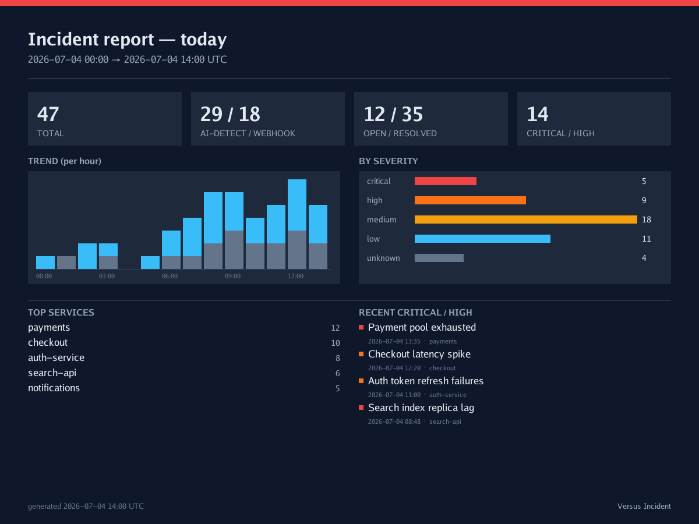

# Incident Reports

## Concept

At the end of a noisy week someone always asks: *"How many incidents did we
have, and where?"* An **Incident Report** answers with one picture: a summary
card for a time window, rendered as an image and posted to a channel your team
already reads.

The card counts every incident in the window, both those the agent detected and
those that came in by webhook:

| Section | What it tells you |
|---|---|
| **Totals** | All incidents, open and resolved, and how many were critical or high. |
| **By origin** | AI-detected incidents versus webhook incidents. |
| **By severity** | How many were critical, high, and so on. |
| **Top services** | Which services had the most incidents. |
| **Trend** | Incidents over time, hourly or daily. |

Every text on the card passes through [Redaction](./redaction.md) before it is
drawn. Reports only read incidents; they never change or create one.

## Example

Your team wants the past week's picture in `#sre` every morning. You set the
default window to **Last 7 days**, the default channel to Slack, and turn on
the daily schedule at `09:00`. Each morning the card arrives: 42 incidents,
most of them from `checkout-api`, with a peak on Friday after the release.
Nobody has to screenshot a dashboard.

## What you see in the UI

On the **Incidents** page, click **Report**. Pick a window (**Today**,
**Last 24h** or **Last 7 days**) and a channel. The preview of the card loads
by itself; click **Send** to deliver it.

| Window | Covers | Trend |
|---|---|---|
| **Today** | Since midnight | Hourly |
| **Last 24h** | The last 24 hours | Hourly |
| **Last 7 days** | The last 7 days | Daily |

How the card travels depends on the channel:

| Channel | Receives |
|---|---|
| Slack, Telegram, Email | The PNG image. |
| Microsoft Teams, Viber, Lark | A masked text summary. If the top-level `public_host` is set, it links to the image. |

If one channel fails, the others still get the report.

## Turn it on

Reports are off by default and turned on in the UI, with no restart. Open
**Settings → Reports → Incident report**:

| Setting | Default | What it does |
|---|---|---|
| Enable the incidents report action | off | Shows the **Report** action. Nothing else works while it is off. |
| Default channel | none | Where a report goes when you don't pick a channel. |
| Default window | **Today** | The window preselected in **Report**, and used by the schedule. |
| Include charts | on | Draws the trend chart. Off gives a text-only card. |
| Send the report on a daily schedule | off | Sends the card every day to the default channel. |
| Send time / Time zone | `09:00` / `UTC` | When the daily report is sent. The window ends at the send time. |
| Rate limit | `6` per minute | How many previews and sends are allowed per window per minute. |

Reports need a storage backend for incidents. See
[PostgreSQL Storage](../configuration/postgres-storage.md) and
[Configuration](../configuration/configuration.md).

## Reference

- [Notification Channels](./channels.md): setting up each channel.
- [Redaction](./redaction.md): what is masked on the card.
- [Configuration](../configuration/configuration.md): the top-level `public_host`.
