# Automatically Detect Kubernetes Issues

Open **Kubernetes** and select the cluster and namespace you want to investigate.  Use **Issues** to find affected Kubernetes resources, then **Timeline** to examine changes, crashes, and logs around the break.

> If the cluster is not available, see [Configuration](configuration.md). For more than one cluster, see [Multi Cluster](multi-cluster.md).

Review an example: in the `shop` namespace, the **Deployment** `checkout` is in CrashLoopBackOff, with OOMKilled terminations and restarts. An image update from `v41` to `v42`, a ConfigMap change, and a scaling change precede the break.

## Triage In Issues

Open **Issues** to review the severity, resource kind, namespace/name, issue description, affected count, and break or first-seen time. Start with critical issues, then examine warnings such as unavailable Pods or a stalled rollout.

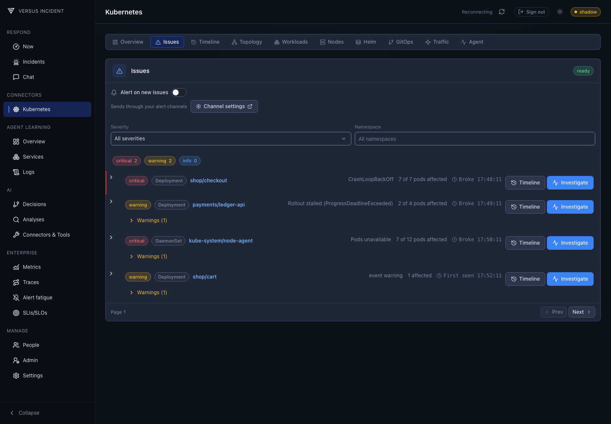

*Issues brings the affected workloads together before you open individual Pods.*

**Expand The Evidence**

Expand `checkout` with the row's chevron. Review the preceding changes and how long before or after the break each was recorded. On a narrow screen, **more changes** opens the focused Timeline instead of listing every change in the row.

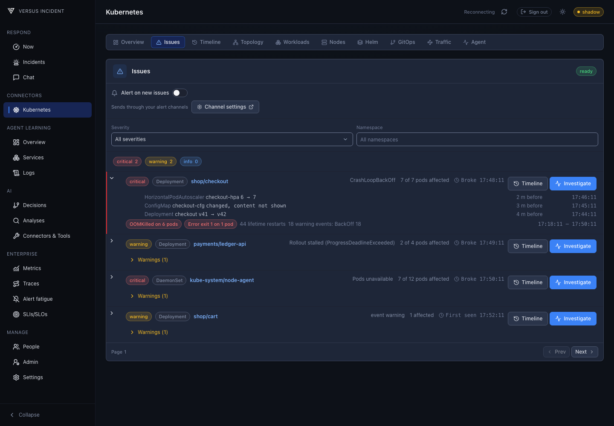

*The expanded row connects workload identity, change timing, and crash evidence without declaring a cause.*

## Alerts

**Alert on new issues** is off by default for each cluster and requires continuous change capture. **Critical** sends critical issues only; **Warning** sends warning and critical issues.

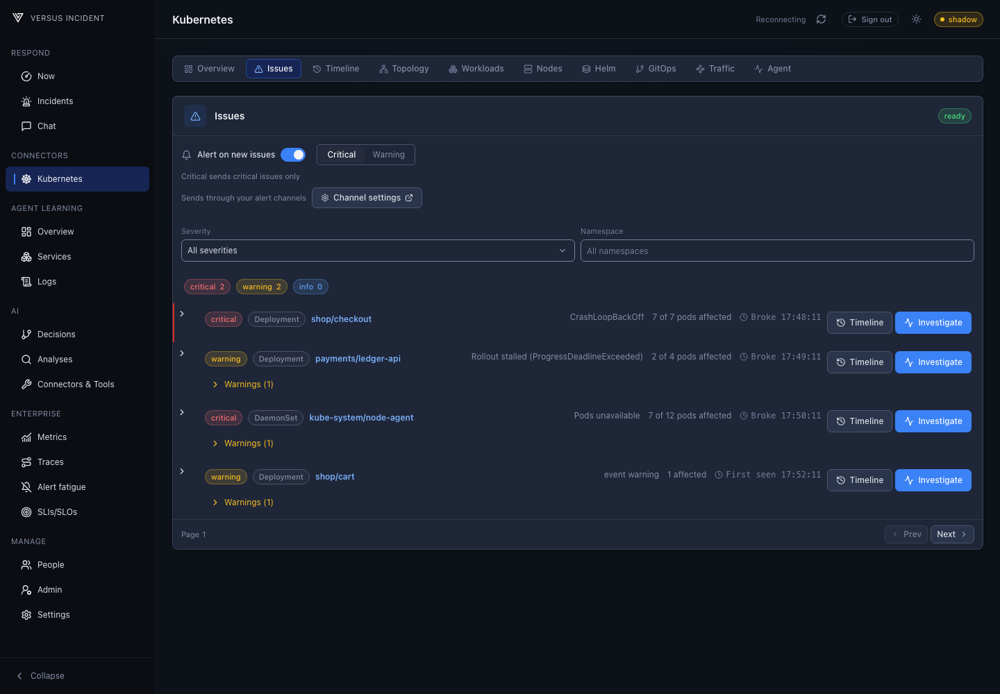

*Synthetic demonstration data: alerts are enabled for critical issues only; warning issues remain visible in the list.*

Alerts use your configured notification channels and on-call routing. With `public_host` configured, alert links open the issue's **Timeline** or **DevOps Agent** investigation. The agent link prefills context without sending a message.

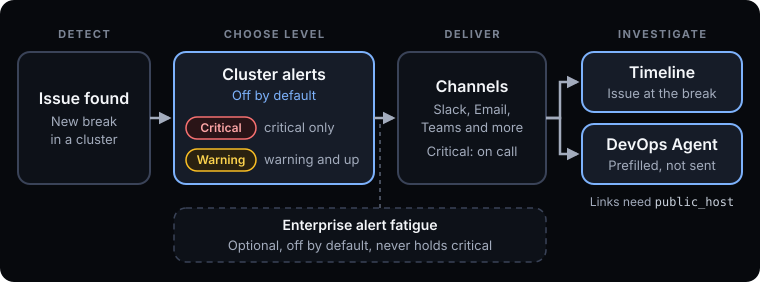

*Delivery connects a newly detected issue to notification channels and investigation context.*

## Reconstruct The Incident In Timeline

Open **Timeline**, or use **Full timeline** from the overview. Choose **15m**, **1h**, **6h**, or **24h**, then use **Namespace** and **Kind** to narrow the history.

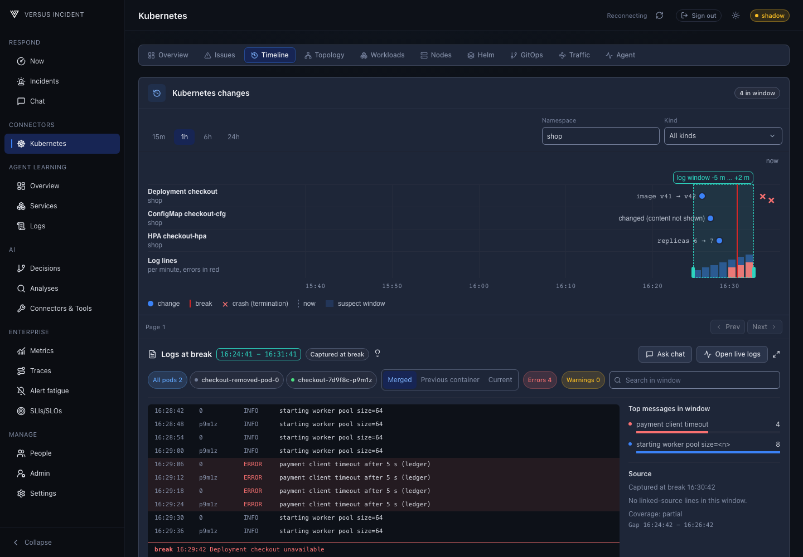

*Resource lanes show when changes occurred across the selected scope.*

### Read Lanes And Markers

Each lane identifies a resource kind, name, and namespace. Change markers, crash markers, the **break** line, and **now** share a time axis. Select a marker or its label to inspect details; closely spaced events may be grouped together.

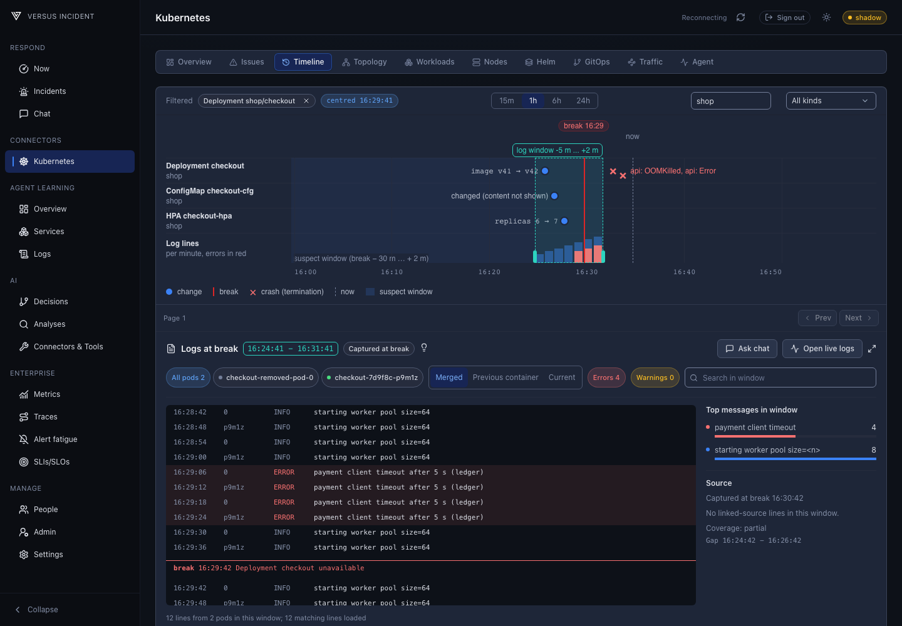

*Focus on checkout to compare the image and configuration changes with the recorded break and terminations.*

An image-change marker can show `v41` to `v42`. Open its details and **Open resource** to inspect the resource's **Timeline** history. Compare the recorded fields' before/after values with the last known healthy version.

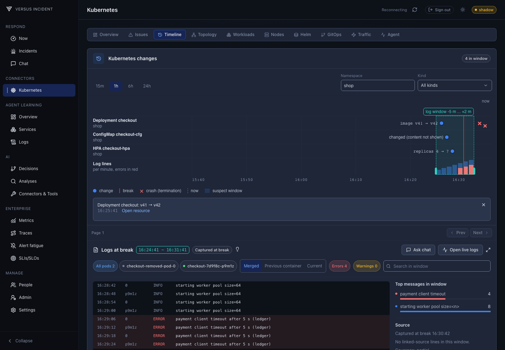

*Compare the recorded image change before deciding whether the rollout needs further investigation.*

### Inspect A Crash

Select a crash marker to see the container, Pod, termination reason, exit code, and time. **Open pod** opens that specific Pod. **Logs before crash** selects that Pod, switches to **Previous container**, and sets the log window to the five minutes ending at the selected crash.

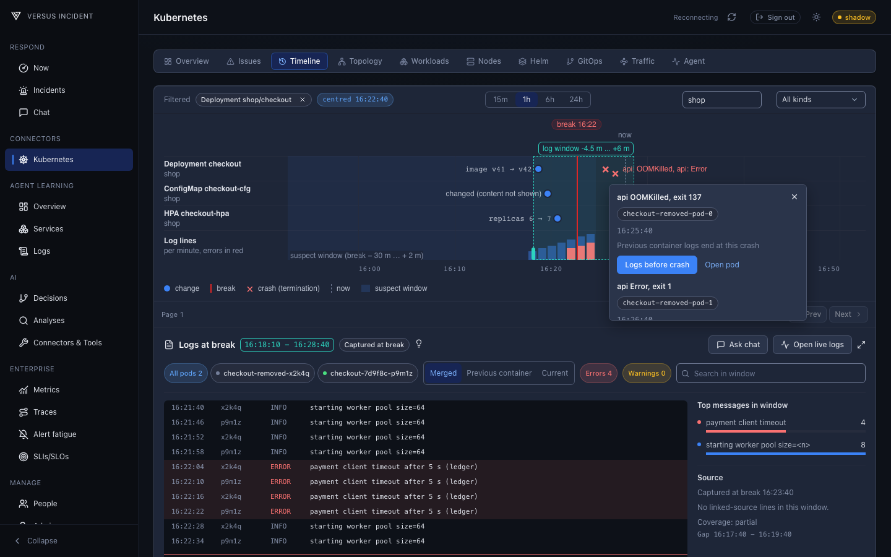

*Go directly from a termination to the previous container's available output.*

## Read Logs Around The Break

In a focused workload Timeline with an available break time, **Logs at break** shows a bounded window, initially five minutes before through two minutes after the break. The **Log lines** lane shows per-minute volume with errors in red. Use it to locate a burst, then read the actual messages before drawing a conclusion.

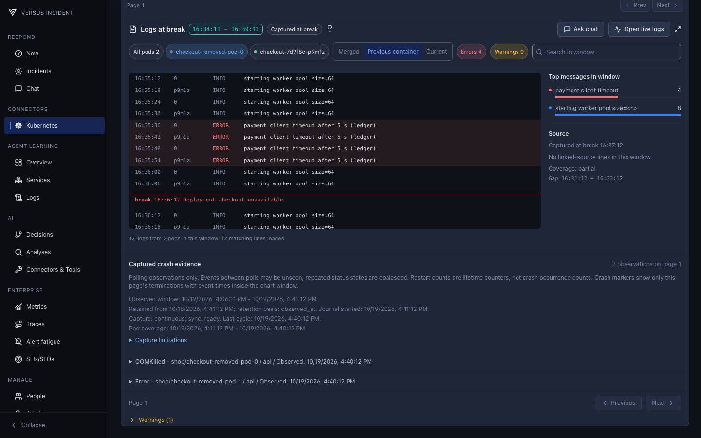

*Narrow the logs to the Pods, container output, and messages relevant to the failure.*

| Control or detail | How to use it | What it helps answer |
| --- | --- | --- |
| **All pods** and Pod chips | Select one or more Pods, or return to all available Pods. | Is the failure isolated to one replica? |
| **Merged**, **Previous container**, **Current** | Choose the available container output to examine. | Did the message come before the restart or from the replacement container? |
| **Errors** and **Warnings** | Toggle the severity filter; select it again to clear it. | Which messages deserve a closer look? |
| **Search in window** | Search within the selected log interval. Clear it to restore other messages. | Are timeout, memory, or startup messages present? |
| **Top messages in window** | Review repeated message patterns and their counts. | Is one failure repeated, or are there several distinct symptoms? |
| **Load more logs** | Load the next page with the current window and filters. | Are matching lines still waiting to be loaded? |
| **Expand logs** | Open the larger log viewer. | Do long messages need more room? |

### Handle Missing History

Open **Log coverage tip** when the lightbulb appears. It explains why part of the requested interval is unavailable, such as repeated restarts, a deleted Pod, rotated logs, a late capture, or missing read permission. Kubernetes may retain only the last previous container's output; selecting an older crash cannot recreate logs that are no longer available.

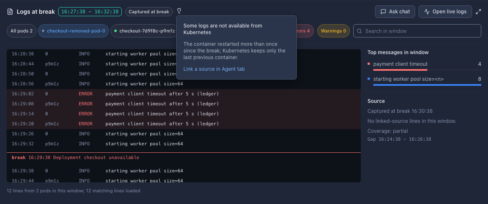

*Check the coverage tip before treating missing messages as evidence that nothing failed.*

The tip's **Link a source in Agent tab** opens this cluster's source settings. Check the workload scope and use **Test link** to inspect the preview; a successful preview does not guarantee complete incident history. For setup, see [Configuration](configuration.md) and the [Kubernetes connector guide](../connectors/kubernetes.md).

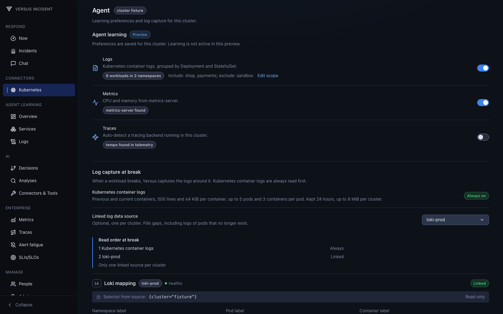

*The Agent tab is a secondary step when the incident window needs an additional log source.*

## Check The Workload Now

Use **Open live logs** to open the workload drawer's **Logs** tab. The workload **Live** view reads the last hour, up to 500 lines per Pod: it is a bounded snapshot, not a continuously streaming tail.

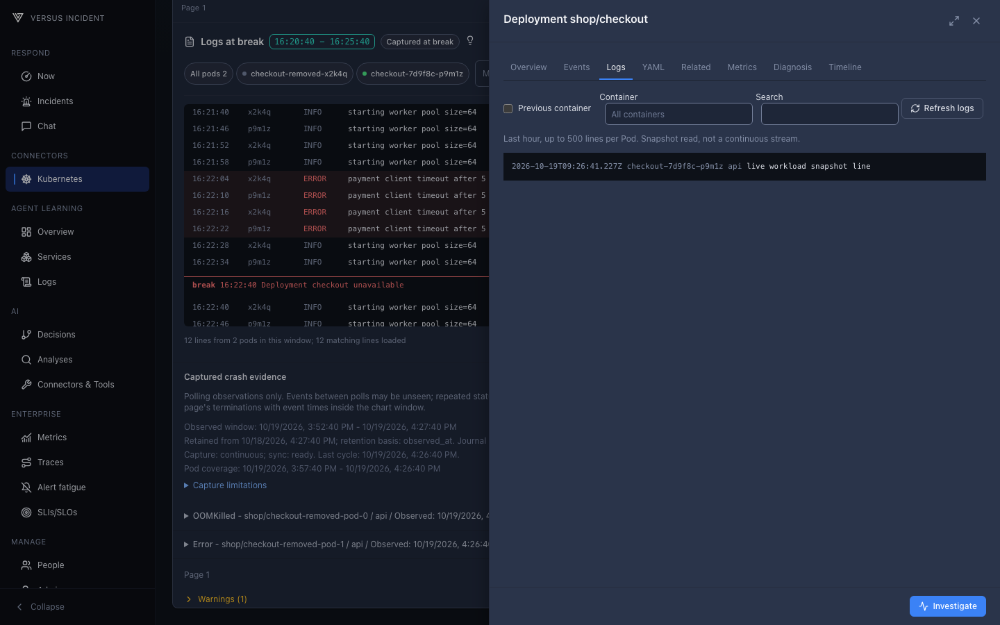

*Compare recent workload output with the messages captured around the break.*

Use **Ask chat** from **Logs at break** to carry the workload and selected time window into an investigation. For example: "Compare checkout's OOMKilled evidence with the v41 to v42 image change and available logs in this window. What should I verify next, and what evidence is missing?" This supplies investigation context.

Keep the distinction between what was observed, what may explain it, and what you verified after remediation. This makes the investigation useful even when some historical evidence is unavailable.
