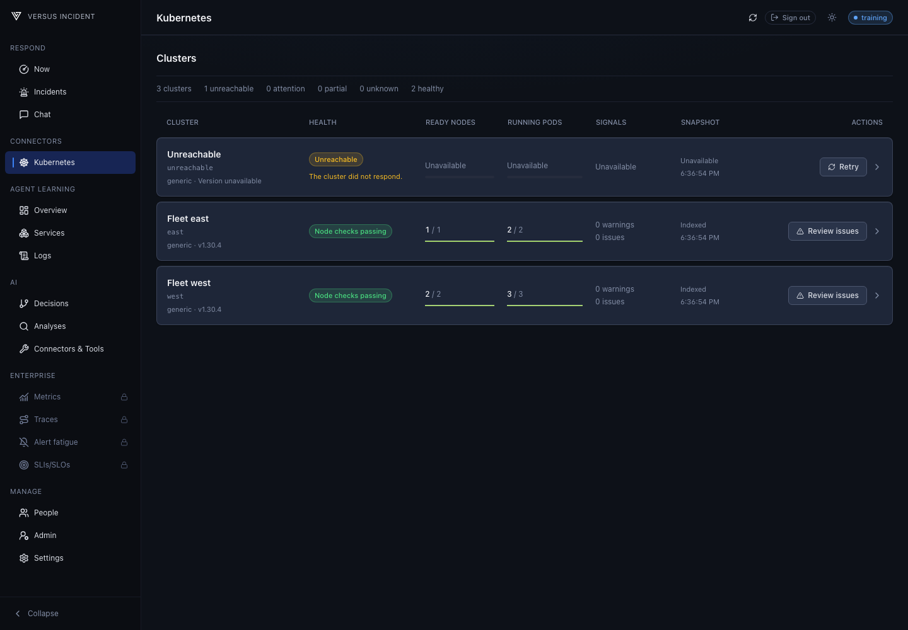

# Kubernetes Multi-Cluster

Connect several Kubernetes clusters to one self-hosted Versus deployment.
Use the fleet view to compare cluster health, then open a cluster's
[Harness Dashboard](/agent/connectors/kubernetes) to investigate workloads,
issues, and recent changes.

Multi-cluster connections are available in OSS and Enterprise. Enterprise
adds per-member cluster permissions within the deployment's single
organization; clusters are not assigned to separate organizations.



## Setup

Configure `connectors.kubernetes` in `config.yaml`, or in an optional
`connectors.yaml` beside it. Both files use the root `connectors:` wrapper.
Set `multiple: true` and put each cluster's connection settings under `clusters`:

```yaml
connectors:
  kubernetes:
    multiple: true
    clusters:
      - cluster_id: east
        display_name: Production East
        endpoint: https://east.api.example
        ca_data: ${KUBERNETES_EAST_CA_DATA}
        auth:
          mode: token_file
          token_file: /run/secrets/kubernetes-east-reader-token
      - cluster_id: west
        display_name: Production West
        endpoint: https://west.api.example
        ca_data: ${KUBERNETES_WEST_CA_DATA}
        auth:
          mode: token_file
          token_file: /run/secrets/kubernetes-west-reader-token
```

Use 1 to 16 entries. Each `cluster_id` must be unique, use lowercase letters,
digits, or hyphens, begin and end with a letter or digit, and contain at most
63 characters. API endpoints must be distinct after normalization. At most one
entry may use `auth.mode: in_cluster`. Optional `display_name` is limited to
128 bytes; the UI uses the ID when no display name is set.

Only `multiple` and `clusters` may appear directly under `kubernetes` in this
mode. Each entry owns its reader `auth`, network/TLS settings, and optional
`actions` settings; nothing is inherited from a top-level endpoint, auth, or
actions block. Auth modes may differ across clusters. Actions remain disabled
unless enabled on that entry and require separate actor credentials; never
reuse reader credentials for writes.

See [Configuration](/agent/kubernetes/configuration) for authentication modes,
reader and actor RBAC, network restrictions, safety controls, and error codes.
The [EKS with IRSA example](/examples/eks-irsa-kubernetes-reader) shows how to
prepare an IAM-authenticated reader for an EKS entry.

For Helm, use the same `multiple`/`clusters` structure with chart keys such as
`clusterID`, `displayName`, `caData`, and `auth.tokenFile` inside each entry.
Do not place single-cluster fields beside `clusters`. Restart Versus after
changing connector configuration.

### Existing single-cluster setups

Omitting `multiple` is equivalent to `multiple: false`. Existing single-cluster
configuration remains valid: keep connection and authentication fields directly
under `connectors.kubernetes` and omit `clusters`.

```yaml
connectors:
  kubernetes:
    multiple: false
    endpoint: https://api.example
    ca_data: ${KUBERNETES_CA_DATA}
    auth:
      mode: token_file
      token_file: /run/secrets/kubernetes-reader-token
```

The dashboard opens directly, without a fleet selector or a required `cluster`
URL parameter.

## Fleet Health

Open **Connectors > Kubernetes** to see the fleet. Each cluster row shows its
display name, ID, provider, available Kubernetes version, ready/total nodes,
running/total Pods, warnings, issues, and snapshot state and time. Missing issue
or version evidence is labelled unavailable.

Health is a bounded cluster check, not a claim that every workload is healthy:

| Label | Meaning |
| --- | --- |
| **Unreachable** | The cluster did not respond successfully within the summary budget. Counts are unavailable; use **Retry**. |
| **Needs attention** | Some nodes are not ready, warnings exist, or the available issue summary reports issues. |
| **Partial visibility** | Inventory was truncated, omitted, or includes failed resource reads. |
| **No node evidence** | No nodes were observed, without evidence supporting another health state. |
| **Node checks passing** | Nodes were observed and ready, with no warnings or reported issues changing the state. |

Unreachable and attention states appear first, followed by partial, unknown,
and healthy states. Name/ID filtering appears for more than six clusters. The
catalog refreshes every 30 seconds while the page is active; successful
summaries may be cached for 30 seconds. A failing cluster does not prevent the
other configured clusters from appearing.

## Open and Switch Clusters

Select a cluster row to open its dashboard, or **Review issues** to open its
Issues tab. In the application, the fleet URL is `/agent/kubernetes`; a selected
cluster uses `/agent/kubernetes?cluster=east`, with `&view=issues` for Issues.
These are application URLs, separate from this documentation site's routes.

Use the dashboard cluster selector to switch clusters, or **Clusters** to
return to the fleet. Switching preserves the dashboard view but clears the
selected resource, its detail tab, and namespace selection from the URL.
Resource selections and cached evidence are scoped to the selected cluster;
switching does not reuse another cluster's dashboard state. In multi-cluster
mode, cluster-specific API requests require an explicit `cluster` selection.

If a cluster is removed or access is revoked, its dashboard returns to the
fleet with an unavailable notice. Unknown and unauthorized cluster IDs are
not disclosed as separate cases.

## Permissions

OSS retains gateway authentication for admin access and exposes the configured
clusters to authenticated operators. It does not add Enterprise organization
or per-member cluster grants. Kubernetes RBAC still applies independently to
every connector identity.

Enterprise requires `infrastructure:view` and applies the signed-in member's
effective cluster grants, including team grants, within the self-hosted
deployment's single organization. The fleet omits clusters the member cannot
access, and direct requests for an invisible cluster return not found.
Organization identity comes from the authenticated request, not a cluster URL
parameter or a per-cluster organization assignment. If no clusters are visible,
the fleet shows **No clusters available**.

Versus permissions do not grant Kubernetes API access. Configure each reader
and actor identity's Kubernetes RBAC separately, as described in
[Configuration](/agent/kubernetes/configuration).

## Troubleshooting

| Symptom | Check |
| --- | --- |
| Configuration is rejected at startup | With `multiple: true`, keep only `multiple` and `clusters` at the top level. Check entry count, IDs, duplicate endpoints, display-name length, and that no more than one entry uses `in_cluster`. |
| A cluster is **Unreachable** | Check its endpoint, network/TLS restrictions, and reader credentials from the Versus runtime, then use **Retry**. Other cluster rows remain available. |
| A cluster has **Partial visibility** | Inspect the dashboard's missing or failed evidence. Check the connector identity's Kubernetes read RBAC and collection limits before treating counts as complete. |
| A cluster link returns to the fleet, or no clusters are available | Check that the cluster is still configured. In Enterprise, also check `infrastructure:view` and the member's effective cluster grants. Unknown and unauthorized IDs both remain undisclosed. |
| An API request reports `cluster_required` | Supply the configured `cluster` ID explicitly in multi-cluster mode. |

For credential-specific failures and action safety settings, use the
[Configuration reference](/agent/kubernetes/configuration).
