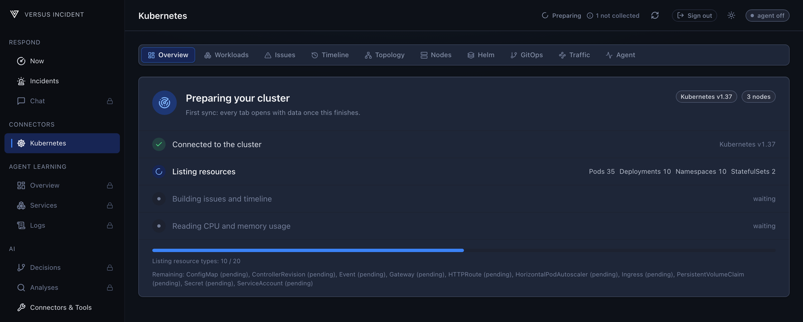
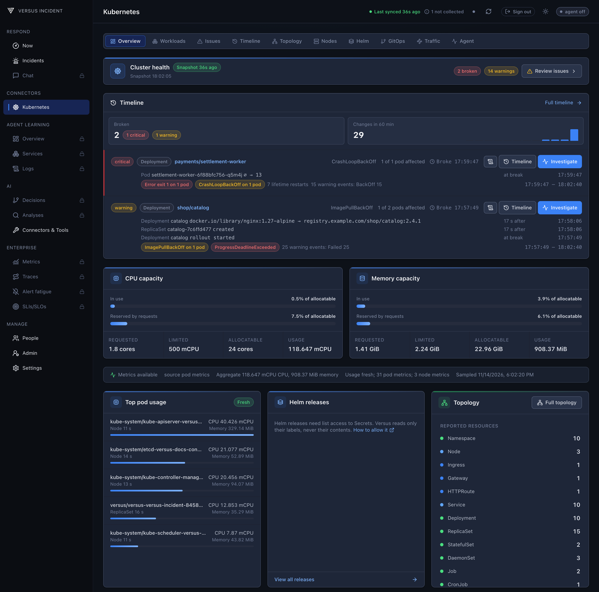

# Kubernetes Quickstart

Run Versus inside a Kubernetes cluster you already have, and let it read that
cluster with its own ServiceAccount (`auth.mode: in_cluster`). Pick one way to
install:

- **Option A:** one `kubectl apply` of a single manifest.
- **Option B:** `helm install` with the flag that turns on the Kubernetes connector.

Both give the same result: the Versus UI, the Kubernetes connector turned on,
and a read-only role for it.

## Before you start

You need:

- A Kubernetes cluster, with `kubectl` pointed at it. Check:

  ```bash
  kubectl get nodes
  ```

- Permission to create a ClusterRole. Check (the answer must be `yes`):

  ```bash
  kubectl auth can-i create clusterroles
  ```

- For Option B only: Helm 3.8 or newer.

What Versus can read:

| | |
| --- | --- |
| Access | Read-only: `get` and `list` on cluster resources, plus Pod logs and metrics. |
| Secrets | Not read. Secret values are never shown. |
| Other data | The read-only identity can also read ConfigMap contents, Pod environment values, and Pod logs across the cluster. |
| Changes | None. Versus never creates, edits, or deletes anything in the cluster. |

## Option A: `kubectl apply`

**1. Create the namespace and the sign-in secret.**

```bash
kubectl create namespace versus --save-config
```

Expected output: `namespace/versus created`.

```bash
kubectl -n versus create secret generic versus-incident --from-literal=gateway_secret=$(openssl rand -hex 32)
```

Expected output: `secret/versus-incident created`.

**2. Apply the manifest.**

```bash
kubectl apply -f https://raw.githubusercontent.com/VersusControl/versus-incident/main/examples/kubernetes/k8s-connector-in-cluster-enabled.yaml
```

Expected output: one line per object, starting with `namespace/versus configured`,
and no warnings.

**3. Wait until it is ready.**

```bash
kubectl -n versus rollout status deploy/versus-incident
```

**4. Open the UI.** This command keeps running and holds the terminal. Leave it
running, and open a second terminal for the next step:

```bash
kubectl -n versus port-forward svc/versus-incident 3000:3000
```

Then browse to `http://localhost:3000`.

**5. Sign in.** In the second terminal, print the sign-in secret, then paste it into **Gateway secret**:

```bash
kubectl -n versus get secret versus-incident -o jsonpath='{.data.gateway_secret}' | base64 -d; echo
```

Go to [What you'll see](#what-youll-see).

## Option B: Helm

**1. Create the namespace and the sign-in secret** with the two commands from
[Option A, step 1](#option-a-kubectl-apply).

**2. Install the chart** with the Kubernetes connector turned on:

```bash
helm install versus-incident oci://ghcr.io/versuscontrol/charts/versus-incident --namespace versus --set connectors.kubernetes.enabled=true --set gatewaySecretExistingSecret=versus-incident
```

`connectors.kubernetes.enabled=true` turns on the connector with in-cluster
access and creates its read-only reader role. Without it, Versus runs without
Kubernetes. `gatewaySecretExistingSecret=versus-incident` reads the sign-in
secret from the Secret you created.

**3. Wait until it is ready.**

```bash
kubectl -n versus rollout status deploy/versus-incident
```

**4. Open the UI and sign in** with steps 4 and 5 of Option A. The commands are
the same.

The install notes print these commands too. To see them again, run
`helm status versus-incident -n versus`.

> **Argo CD, Flux, or `helm template`?** Keep
> `gatewaySecretExistingSecret`. Without it the chart generates a sign-in
> secret, which changes on every render there and restarts the pod on each
> sync. See [GitOps and `helm template`](/configuration/helm#gitops-and-helm-template).

## What you'll see

Open **Connectors > Kubernetes** in the sidebar.

The first time, Versus reads the whole cluster. The page shows **Preparing your
cluster** with four steps:

1. Connected to the cluster
2. Listing resources
3. Building issues and timeline
4. Reading CPU and memory usage



*The first sync in progress: the cluster is connected and resources are being listed.*

When the first sync is done, the page switches to the **Overview**.



*The Overview after the first sync: a crash-looping worker and a failed rollout show up as issues on the timeline.*

## Check it works

- The Overview shows your namespaces and workloads.
- The top bar says **Last synced** with how long ago, for example
  `Last synced 12s ago`.
- Next to it, a grey info marker says **1 not collected**. Hover or press it:
  the details say `Not collected by configuration: Secret`. This is expected,
  because the default role does not read Secrets.

## Next steps

The commands below use the Helm release from Option B. If you used Option A,
you can switch to Helm at any time: uninstall the manifest (see
[Uninstall](#uninstall)), then follow Option B. Keep
`connectors.kubernetes.enabled=true` in every `helm upgrade`;
`--reset-then-reuse-values` (Helm 3.14 or newer) does that for you. On older
Helm, pass `--set connectors.kubernetes.enabled=true` again.

| Goal | How |
| --- | --- |
| Keep history across restarts | By default, data lives in the pod and is lost on restart. Use [PostgreSQL storage](/configuration/postgres-storage), or set `storage.persistence.enabled=true` with a StorageClass (`storage.persistence.storageClassName`). |
| Reach the UI without port-forward | Set `ingress.enabled=true` and `ingress.hosts`, and set `config.publicHost` to the browser URL. See [Installing with Helm](/configuration/helm). |
| Turn off the optional kinds | `--set kubernetesReaderRBAC.optionalKinds=false` drops Gateway API, Argo CD, Argo Rollouts and Flux. See [Optional kinds](/agent/kubernetes/configuration#optional-kinds). |
| Let Versus list Helm releases | `--set kubernetesReaderRBAC.secrets=true`. Read the trade-off first: [Helm releases need Secret access](/agent/kubernetes/configuration#helm-releases-need-secret-access). |
| Limit Versus to some namespaces | Bind your own Roles in each namespace, then `--set kubernetesReaderRBAC.external=true --set 'connectors.kubernetes.namespaces={shop,payments}'`. History is off for namespace-only access. See [Namespace-only access](/agent/kubernetes/configuration#namespace-only-access). |
| Turn the Kubernetes connector off | `--set connectors.kubernetes.enabled=false` |
| Read several clusters | [Multi-Cluster](/agent/kubernetes/multi-cluster) |

Apply a setting with `helm upgrade`, for example:

```bash
helm upgrade versus-incident oci://ghcr.io/versuscontrol/charts/versus-incident -n versus --reset-then-reuse-values --set storage.persistence.enabled=true
```

## Troubleshooting

| What you see | Fix |
| --- | --- |
| Sign-in says **Credential rejected by the agent.** | Print the secret again with the command from step 5 of Option A, and paste the whole value. |
| **Kubernetes connector is not configured.** | Versus was installed without `--set connectors.kubernetes.enabled=true`, so the connector is off. Turn it on: `helm upgrade versus-incident oci://ghcr.io/versuscontrol/charts/versus-incident -n versus --reset-then-reuse-values --set connectors.kubernetes.enabled=true`. |
| The info marker next to **Last synced** says **not readable**; its details list kinds under **Not readable with this connector identity:** with a permission-denied reason | The reader role is missing or was changed, so it no longer covers those kinds. With Helm, check you did not set `kubernetesReaderRBAC.external=true` without binding your own role. Test the ServiceAccount: `kubectl auth can-i list pods -A --as=system:serviceaccount:versus:versus-incident`. |
| The info marker's details say **Not collected by configuration: Secret** | Expected with the default role: Versus does not read Secrets. Nothing to fix. To read them, see [Helm releases need Secret access](/agent/kubernetes/configuration#helm-releases-need-secret-access). |
| The Helm tab says **Helm releases need list access to Secrets.** | Expected with the default role. See [Helm releases need Secret access](/agent/kubernetes/configuration#helm-releases-need-secret-access). |
| **Preparing your cluster** does not finish | Read the logs: `kubectl -n versus logs deploy/versus-incident`. |
| The pod does not start | Run `kubectl -n versus get pods`, then the logs command above. `sign-in secret is missing` means the Secret from Option A step 1 does not exist: create it, then run `kubectl -n versus rollout restart deploy/versus-incident`. |

## Uninstall

**Option A:**

```bash
kubectl delete -f https://raw.githubusercontent.com/VersusControl/versus-incident/main/examples/kubernetes/k8s-connector-in-cluster-enabled.yaml
```

This also deletes the `versus` namespace, with the sign-in secret in it.

**Option B:**

```bash
helm uninstall versus-incident -n versus
```

```bash
kubectl delete namespace versus
```

Check that nothing is left. This prints nothing:

```bash
kubectl get clusterrole,clusterrolebinding | grep versus
```
