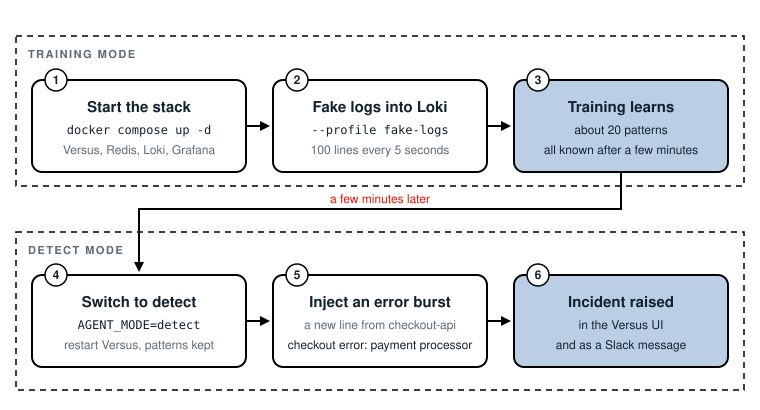
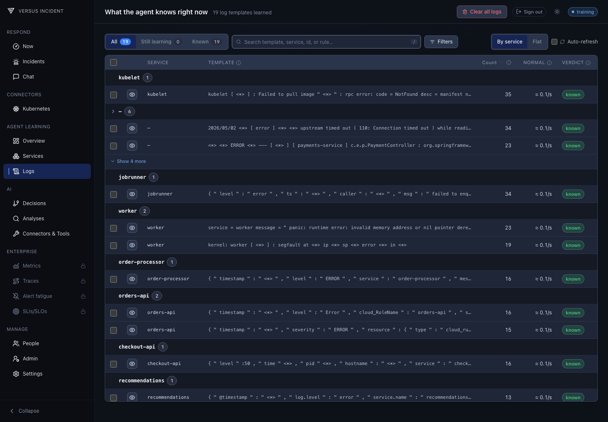
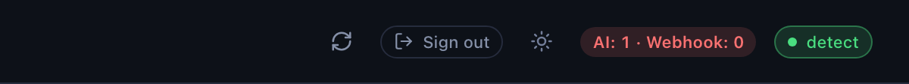
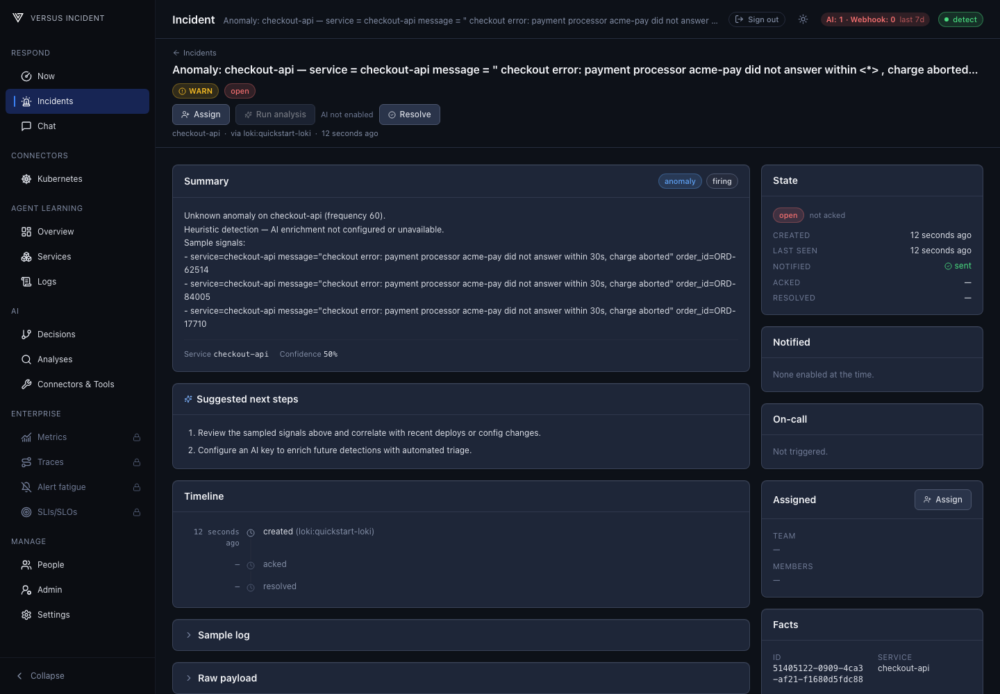
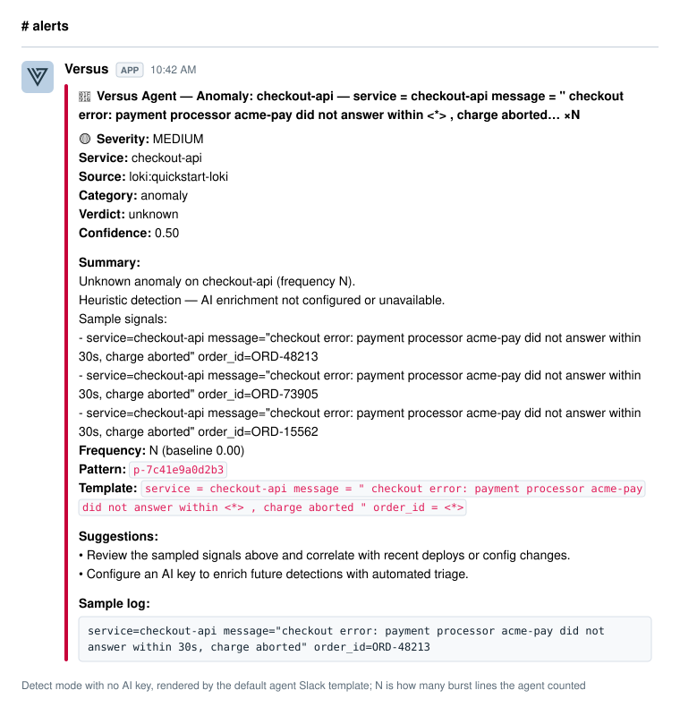

# AIOps SRE Quickstart

Run Versus next to a local Loki with Docker Compose and watch the SRE Agent
learn what your normal logs look like. Then switch it to detect mode, send a
burst of an error it has never seen, and see the incident in the Versus UI and
in Slack.



## Before you start

You need Git, and Docker with Docker Compose v2. Check:

```bash
docker compose version
```

You do not need Python, an AI key, or Slack. Slack and the AI key are optional;
you add them when you switch to detect in step 5.

## 1. Start the stack

Clone the repository and go into the quickstart folder:

```bash
git clone https://github.com/VersusControl/versus-incident.git
cd versus-incident/examples/quickstart/sre-agent
```

Every command on this page runs from that folder,
`versus-incident/examples/quickstart/sre-agent`. If you open a new terminal,
`cd` into it first.

The stack runs on your machine and uses the OSS image:

| Service | Address | What it is |
| --- | --- | --- |
| Versus | `http://localhost:3000` | The UI. |
| Grafana | `http://localhost:3001` | Optional. Browse the same logs; Loki is already set up as its data source. |
| Loki | `http://localhost:3100` | The log store the agent reads. |
| Redis | not exposed | Used by Versus. |

All ports listen on your machine only. Open the UI at `http://localhost:3000`.

Start the stack:

```bash
docker compose up -d
```

Check that the services are up. The **STATUS** column of `versus`, `redis`,
`loki` and `grafana` reads `Up …` (Versus, Redis and Loki add `(healthy)` after a few
seconds):

```bash
docker compose ps
```

The agent starts in [training mode](/agent/training-mode): it reads logs and learns their patterns,
and never raises an incident.

## 2. Open the UI

Browse to `http://localhost:3000` and enter the gateway secret `change-me`.

## 3. Start the demo logs (optional)

The demo stream pushes 100 mixed application log lines into Loki every 5
seconds. Skip this step if you push your own logs into the local Loki.

```bash
docker compose --profile fake-logs up -d
```

To watch it run (press `Ctrl+C` to stop following; the stream keeps running):

```bash
docker compose logs -f log-generator
```

What you'll see: `pushing 100 log lines to Loki every 5s`.

## 4. Watch training learn patterns

Open **Agent Learning → Logs** in the UI. New patterns appear within a minute.

The agent learns lines that contain `error` (the quickstart's
[match pattern](/agent/regex)), so the demo stream settles at about 20
patterns. A pattern counts as **known** once it has been seen 5 times. Give it
about 5 minutes, until every pattern is known.



*The learned patterns after a few minutes of training.*

> **Why wait?** Switch to detect too early and the demo stream's rarer lines are
> still new to the agent, so they raise incidents of their own.

## 5. Switch to detect

The mode comes from the `AGENT_MODE` variable, so you switch it from the
command line; the OSS UI has no mode switch. You recreate the Versus container
with the new value, and what it has learned is kept.

Slack and the AI key are read when the container is created, so export them
now, in the same terminal, before the switch command. The burst in step 6
raises one incident, and the agent does not send it again while that incident
is open, so a variable added after the burst does not change that message.

### Send incidents to Slack (optional)

You need a Slack bot token (`xoxb-…`) and a channel ID. See
[Slack](/agent/channels/slack#get-the-credentials) for how to get them. Invite
the bot to the channel first (`/invite @your-bot`).

```bash
export SLACK_ENABLE=true
export SLACK_TOKEN=xoxb-...
export SLACK_CHANNEL_ID=C0123456789
```

### Add an AI key for richer alerts (optional)

With a key, the AI writes the summary, the category and suggested next steps
instead of the heuristic note. Detect raises incidents without a key.

```bash
export AGENT_AI_ENABLE=true
export AGENT_AI_API_KEY=sk-...
```

This uses OpenAI with `gpt-4o-mini`. For another provider, set
`AGENT_AI_PROVIDER` to `deepseek`, `qwen`, `claude` or `gemini`, and set
`AGENT_AI_MODEL` to a model name from that provider; without it Versus sends
`gpt-4o-mini`, which the other providers reject. See
[AI Detect Mode](/agent/ai-detect-mode).

### Switch

```bash
AGENT_MODE=detect docker compose up -d versus
```

Check it: reload the UI. The agent chip at the top right of every page now
reads **detect**, in green; in training it reads **training**, in blue. The
**Agent** tile on **Now** shows the same mode.



*The agent chip after the switch to detect.*

Read more about the modes: [Training](/agent/training-mode),
[Shadow](/agent/shadow-mode), [AI Detect](/agent/ai-detect-mode).

## 6. Send a new error burst

```bash
docker compose run --rm error-burst
```

This pushes a burst of one error for the `checkout-api` service, all lines
back to back:
`checkout error: payment processor acme-pay did not answer within 30s, charge aborted`.
The demo stream never produces that line, so the agent has never seen it.
Run it once.

## 7. See the incident

The agent reads new logs every 15 seconds, so the incident appears within
30 seconds of the burst, usually after 10 to 20.

Open **Incidents** in the UI. The new incident is on the **AI Detected** tab,
which the page opens on. Open it:

| Field | What the page shows |
| --- | --- |
| Title | `Anomaly: checkout-api — service = checkout-api message = " checkout error: payment processor acme-pay …` |
| Severity | **WARN** |
| Status | **open** |
| Source | `via loki:quickstart-loki`, service `checkout-api` |
| Summary | `Unknown anomaly on checkout-api (frequency N).`, the heuristic note, and three sample lines. N is how many of the burst's lines the agent counted, up to 60. |



*The detected incident in the Versus UI.*

Open **AI → Decisions** to see the decision the agent made for the burst.

Without an AI key, the summary reads:
`Heuristic detection — AI enrichment not configured or unavailable.` That is
expected: detect raises incidents without a key.

If you exported the Slack variables in step 5, the same incident is in the
channel:



*An illustration of the Slack message for the detected incident.*

## Check it works

- **Agent Learning → Logs** lists about 20 patterns, all known.
- The agent chip at the top right reads **detect**.
- **Incidents**, on the **AI Detected** tab, has an `Anomaly: checkout-api — …`
  incident.
- **AI → Decisions** has a decision for the same burst.

## Troubleshooting

| What you see | Fix |
| --- | --- |
| Sign-in says the credential is rejected | Enter `change-me`, or the value of `GATEWAY_SECRET` if you exported one before starting the stack. |
| **Agent Learning → Logs** stays empty | Check the demo stream is running: `docker compose --profile fake-logs ps`. Then read its output: `docker compose logs log-generator`. `push failed, retrying` means Loki is not ready yet; it retries on its own. |
| Incidents for lines other than the burst | You switched to detect before every pattern was known. Go back to training (`docker compose up -d versus`), wait until **Agent Learning → Logs** shows them all as known, then switch to detect again. |
| No incident after the burst | Check the mode is `detect` (step 5). Then read the Versus log: `docker compose logs versus`. |
| Nothing in Slack | Check the bot is in the channel and the three variables were exported in the same terminal before `AGENT_MODE=detect docker compose up -d versus`. Read `docker compose logs versus` for the Slack error. To get a new message, fix the setup, run `docker compose down -v`, and start again from step 1 with `docker compose up -d`: while the first incident is open, another burst does not send a new one. |
| The mode went back to training | Every `docker compose up -d versus` without `AGENT_MODE=detect` starts training again. Run it with `AGENT_MODE=detect`. |

## Clean up

```bash
docker compose --profile fake-logs --profile error-burst down -v
```

`-v` also deletes the volumes, including the learned patterns.

## Next steps

| Goal | Where to go |
| --- | --- |
| Read your own Loki | [Loki](/agent/data-sources/loki) |
| Read another log source | [Data Sources](/agent/data-sources): [Elasticsearch](/agent/data-sources/elasticsearch), [CloudWatch Logs](/agent/data-sources/cloudwatch-logs), [Graylog](/agent/data-sources/graylog), [Splunk](/agent/data-sources/splunk), [SigNoz](/agent/data-sources/signoz), [File](/agent/data-sources/file) |
| Try detect without paging anyone | [Shadow Mode](/agent/shadow-mode) |
| Catch sudden jumps in known errors | [Spike Detection](/agent/spike) |
| Send incidents somewhere else | [Notification Channels](/agent/channels) |
| Tune the agent | [Configuration](/agent/configuration) |
