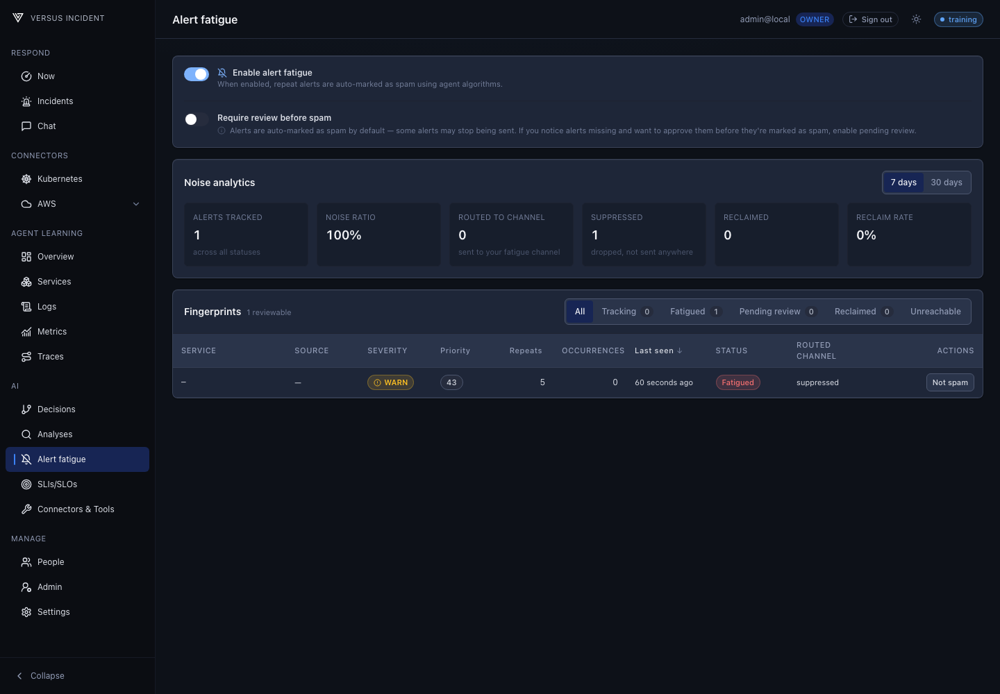

# Alert Fatigue

_Enterprise_

## Concept

When the same low-priority alert fires again and again, on-call stops reading
alerts. Alert fatigue spots an alert that repeats and stops the repeats from
paging. The first one still reaches your channels. Every repeat is recorded, so
you can review it. If an alert was not really noise, mark it **Not spam** and
its future repeats page again; repeats already quieted are not re-sent.

- **Repeat:** the same alert again within 10 minutes. From the second one on,
  the alert is **fatigued**.
- **Where repeats go:** nowhere, by default; they are suppressed and only
  recorded. You can send them to a separate **fatigue channel** instead, such as
  a `#alert-noise` Slack channel.
- **Never quieted:** critical and high alerts, and any alert with a priority of
  80 or more, always page.

It is off until an admin turns it on, and it needs Postgres.


## Example

Prometheus sends a warning `DiskSpaceLow` alert for the same disk five times in
a few minutes.

- **Off:** five Slack messages.
- **On:** one Slack message. The next four are suppressed. **AI → Alert
  fatigue** shows one row: severity **WARN**, **Repeats** 5, status
  **Fatigued**, routed channel **suppressed**.

If the same disk alert comes in as **critical**, it pages every time.

## What you see in the UI

Open **AI → Alert fatigue**.



| Part | What it shows |
|---|---|
| **Enable alert fatigue** | The master switch. |
| **Require review before spam** | When on, repeats keep paging until you confirm them. |
| **Noise analytics** | For the last 7 or 30 days: **Alerts tracked**, **Noise ratio**, **Routed to channel**, **Suppressed**, **Reclaimed**, **Reclaim rate**. |
| **Fingerprints** | One row per repeating alert: **Service**, **Source**, **Severity**, **Priority**, **Repeats**, **Occurrences**, **Last seen**, **Status**, **Routed channel**, **Actions**. Filter by **All**, **Tracking**, **Fatigued**, **Pending review**, **Reclaimed** or **Unreachable**. |

A row does not show the alert's name, and **Service** and **Source** show `—`
when the alert does not carry them. Click a row to open the fingerprint and see
the alert's content, with secrets masked.

| Status | Meaning | Actions |
|---|---|---|
| **Tracking** | Seen, still paging. | **Mark as spam** |
| **Fatigued** | Repeats no longer page. | **Not spam** |
| **Pending review** | A repeat waiting for you. Still paging. | **Confirm spam**, **Not spam** |
| **Reclaimed** | You marked it **Not spam**. It always pages. | **Mark as spam** |
| **Unreachable** | A record from an older version that no alert can match. Ages out. | none |

A critical or high row shows **Always pages** instead of **Mark as spam**.

## Turn it on

1. Run the Enterprise image with a license key and Postgres storage.
2. Sign in as an owner or admin.
3. Open **AI → Alert fatigue** and switch on **Enable alert fatigue**.
4. Optional: switch on **Require review before spam** to approve each
   fatigued alert yourself. The page notes that, by default, alerts are
   auto-marked as spam and some may stop being sent.
5. Optional: in **Admin → Alert fatigue**, set up a fatigue channel, alert
   grouping or downstream suppression (below). Changes apply to the next alert.

## Try it with Docker Compose

The [Webhook Quickstart](../webhook/quickstart.md#8-quiet-repeats-with-alert-fatigue-enterprise)
runs this example end to end. In short, from
[`examples/quickstart/webhook/`](https://github.com/VersusControl/versus-incident/tree/main/examples/quickstart/webhook):

```bash
export LICENSE_KEY=<your license key>
docker compose -f docker-compose.yml -f docker-compose.enterprise.yml up -d
docker compose -f docker-compose.yml -f docker-compose.enterprise.yml logs versus | grep -i password
```

Open `http://localhost:3000`. Use `localhost`, not `127.0.0.1`: turning the
feature on from `127.0.0.1` fails with `CSRF validation failed`. Sign in as
`admin`, open **AI → Alert fatigue**, switch on **Enable alert fatigue**, then
send the warning alert five times:

```bash
for i in 1 2 3 4 5; do
  curl -s -X POST http://localhost:3000/api/incidents \
    -H 'Content-Type: application/json' \
    -d @payloads/alertmanager-warning.json
done
```

Refresh the screen: the **Fingerprints** table has the WARN row from the
picture above. Clean up with
`docker compose -f docker-compose.yml -f docker-compose.enterprise.yml --profile alertmanager down -v`.

## Reference

All three settings below are in **Admin → Alert fatigue** and need an owner or
admin.

### Fatigue channel

**Send fatigued alerts to a channel** sends repeats to a channel you set up
here, instead of dropping them. Pick a channel type (Slack, Telegram, Email,
Microsoft Teams, Lark or Viber) and fill in its fields; secrets are masked once
saved. **Remove channel** goes back to suppressing. If a send to the fatigue
channel fails, the repeat stays suppressed: the failure is logged and the row
is marked as failed. It does not page instead.

### Alert grouping

**Enable same-service correlation** folds a storm of alerts from one service
into one group. The first alert pages; other alerts from the same service
within the **Correlation window** join its group and do not page. An alert
more severe than the first still pages, and critical and high alerts are never
grouped.

| Setting | Default | Range |
|---|---|---|
| Correlation window | 5 minutes | 30 seconds to 1 hour |

### Downstream suppression

**Enable dependency-aware suppression** holds alerts from a service while a
service it depends on has an open incident. You declare the dependencies as
edges: *downstream* depends on *upstream*. When `checkout` depends on
`payments` and `payments` has an open incident, `checkout`'s alerts are held:
recorded and dropped. Nothing is released or re-sent when `payments` clears;
`checkout`'s later alerts simply page again. The upstream incident itself, and
any alert more severe than it, still page.

| Setting | Default | Range |
|---|---|---|
| Open-incident lookback | 1 hour | 1 minute to 24 hours |

### What it never does

- It never quiets a critical or high alert, or one with priority 80 or more.
- When it cannot decide (the feature is off or a lookup fails), the alert
  pages.
- It keeps a record of every quieted alert in the list. **Not spam** makes the
  alert's future repeats page again; quieted repeats are not re-sent.

## Troubleshooting

| Symptom | Likely cause |
|---|---|
| **Alert fatigue is an Enterprise capability** | No `LICENSE_KEY`, or the key failed to verify. |
| `CSRF validation failed` when switching it on | You opened the UI at `127.0.0.1`. Use `http://localhost:3000`. |
| The fatigue channel form says it needs Postgres | Versus runs on file storage. Set `STORAGE_TYPE=postgres`. |
| A repeat still paged | It is critical or high, its priority is 80 or more, it was reclaimed, or **Require review before spam** is on. |
| **requires the admin role** | You are signed in as viewer or responder. |

## See also

- [Webhook Quickstart](../webhook/quickstart.md): the example above, step by step.
- [Notification Channels](../agent/channels.md)
- [SLI/SLO](./slo.md): a service burning its error budget fast always pages.
