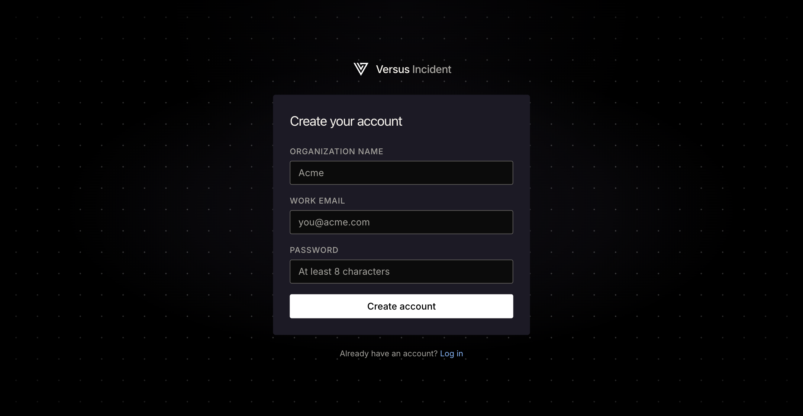
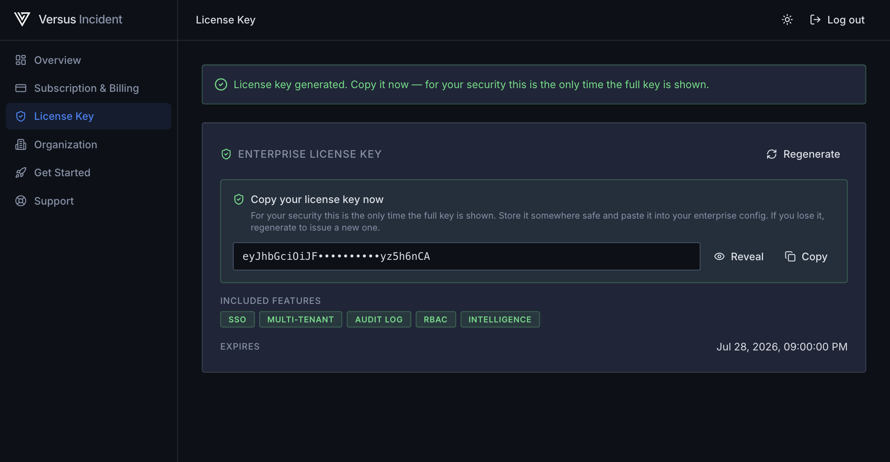
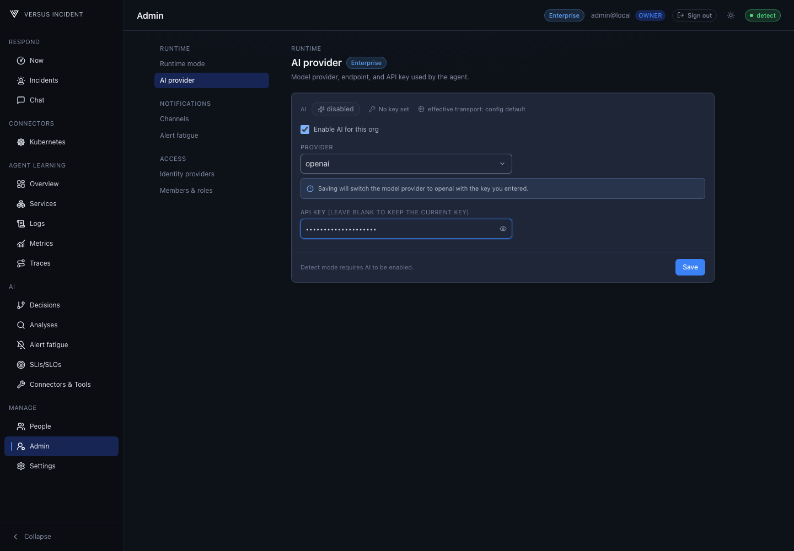
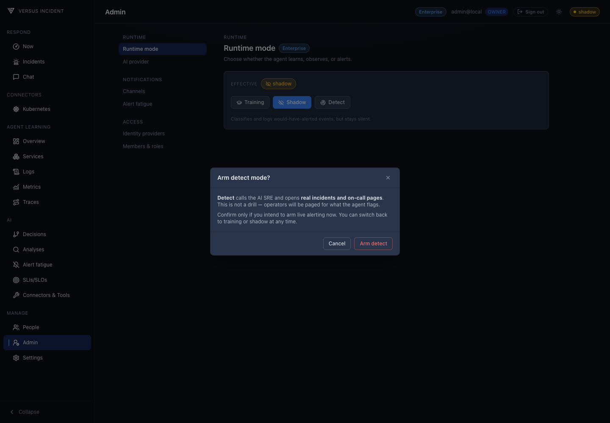

# Getting Started with Enterprise

_Enterprise_

## What Enterprise adds

Versus Enterprise is Versus with a license key. It runs the Enterprise image,
`ghcr.io/versuscontrol/versus-enterprise`, which does everything the OSS image
does: log sources, training, shadow and detect, AI Chat and Analyze, webhook
alerts, channels and on-call. A license key turns on the features below.


| Feature | OSS | Enterprise |
|---|---|---|
| Log sources, training, shadow and detect | Yes | Yes |
| AI Chat and Analyze, webhook alerts, channels, on-call | Yes | Yes |
| [Metrics](./metrics/overview.md) from Prometheus, CloudWatch and SigNoz | | Yes |
| [Traces](./traces.md) from Tempo and SigNoz | | Yes |
| [SLI/SLO auto-define](./slo.md) and error-budget burn alerts | | Yes |
| [Alert fatigue](./alert-fatigue.md): repeat alerts stop paging | | Yes |
| [Single sign-on](./sso/overview.md) with roles | | Yes |
| [High availability](./ha/overview.md): several replicas on one Postgres | | Yes |
| Runtime mode, AI key and channels changed from the UI, with no restart | | Yes |

### Licensed and unlicensed

The Enterprise image reads `LICENSE_KEY` when it starts.

| | Without a license key | With a license key |
|---|---|---|
| OSS features | All work, as on the OSS image. | All work. |
| Enterprise screens | The sidebar groups **Metrics**, **Traces**, **Alert fatigue** and **SLIs/SLOs** under **Enterprise** with a lock, and each shows an **Enterprise capability** card. | Open, in their usual places. |
| Metrics and traces sources | Stop with `requires Versus Enterprise`. | Run. |
| Sign-in | The OSS gateway secret (`GATEWAY_SECRET`). | The built-in `admin` account, then SSO. |

A key that fails to verify is logged as
`enterprise: license validation failed, falling back to community mode`, and
Versus runs unlicensed.

### Key renewal

A license key lasts 30 days. Versus renews it online while your subscription
is active:

| | Behavior |
|---|---|
| When | 30 seconds after start, then every 24 hours (`LICENSE_RENEW_INTERVAL`). It calls only when 10 days or less remain (`LICENSE_RENEW_WINDOW`). |
| Key already expired at start | One extra attempt, of up to 15 seconds, before Versus finishes starting. |
| Across restarts | The renewed key is kept only when `LICENSE_CACHE_PATH` is set. Otherwise Versus starts again from `LICENSE_KEY`. |
| No network | Versus keeps the current key until it expires, then runs unlicensed. |
| Subscription cancelled | Renewal stops; the key runs out within its 30 days. |

Air-gapped deployments cannot renew: the attempts fail and are logged. Contact
us for a long-lived key.

## Before you start

| You need | Why |
|---|---|
| A Versus account on the Founding plan | Only a paid plan issues a license key. |
| Postgres | Enterprise keeps users, settings and learned state there. Alert fatigue and HA need it. |
| An AI provider key (optional) | Only to arm detect from the UI and to get AI-written summaries. |

## 1. Get a license key

You generate the key on the Versus management platform,
[versusincident.com](https://versusincident.com). It is a separate web console
from the Versus you run.

1. **Sign up or log in** with your email and a password. The sign-up form also
   asks for an **Organization name**.

   

2. **Subscribe to the Founding plan.** On the free tier, click **Upgrade to
   Founding** on the dashboard. Once payment is confirmed, the dashboard shows
   your plan as **Founding**.
3. **Generate the key.** Open the **License Key** tab and click **Generate
   license key**. The full key is shown once. Copy it now. Later the dashboard
   shows only a masked preview; if you lose the key, click **Regenerate**.

   

## 2. Give the key to Versus

Pass the key as the `LICENSE_KEY` environment variable. Keep it out of files
you commit.

```bash
export LICENSE_KEY=<your license key>

docker run -d --name versus-enterprise \
  -p 127.0.0.1:3000:3000 \
  -e LICENSE_KEY \
  -e VERSUS_ENTERPRISE_COOKIE_INSECURE=true \
  -e STORAGE_TYPE=postgres \
  -e POSTGRES_DSN="postgres://versus:<password>@<host>:5432/versus?sslmode=disable" \
  -v versus-data:/app/data \
  ghcr.io/versuscontrol/versus-enterprise
```

`VERSUS_ENTERPRISE_COOKIE_INSECURE=true` lets the sign-in cookie work over
plain HTTP on `localhost`; leave it out when you serve Versus over HTTPS.

To try it without your own Postgres, use the Compose example
[below](#try-it-with-docker-compose).

## 3. Sign in as the built-in admin

On its first start against an empty database, Versus prints a generated
password for the built-in `admin` account, once:

```text
================================================================================
  DEFAULT ADMIN CREDENTIALS (shown once — copy them now)
--------------------------------------------------------------------------------
  Username: admin
  Password: <random>
--------------------------------------------------------------------------------
  Change or disable this account after your first login.
================================================================================
```

```bash
docker logs versus-enterprise 2>&1 | grep -A6 "DEFAULT ADMIN CREDENTIALS"
```

Open `http://localhost:3000` and sign in as `admin` with that password. You
are the **owner**, with every permission. The password is not printed again on
later starts; keep it.

Then, when you are ready:

1. Add an identity provider: see [Single Sign-On](./sso/overview.md).
2. Your team signs in with SSO. New users start as **viewer** (read-only).
3. Promote one of them to **admin** or **owner** in **Admin → Members & roles**.
4. Click **Disable default admin** there. Versus refuses while `admin` is the
   only owner or admin, so you cannot lock yourself out. You can turn it back
   on later for break-glass access.

## 4. Unlock the controls

Open **Admin** (under **Manage** in the sidebar). Its sections are **Runtime
mode**, **AI provider**, **Channels**, **Alert fatigue**, **Identity
providers** and **Members & roles**.

| Signed in as | What you see |
|---|---|
| `owner` or `admin` | Live controls. |
| `viewer` or `responder` | A **requires the admin role** notice. |
| Not signed in | A **sign in to manage** notice. |
| No license key | The locked **Enterprise capability** card. |

## 5. Add an AI key (optional)

In **Admin → AI provider**:

1. Tick **Enable AI for this org**.
2. Pick your provider from the **Provider** list, for example `openai`. A note
   says that saving switches the model provider to it with the key you enter.
3. Paste your provider key into **API key** and click **Save**.



The key is stored encrypted. The UI shows only its last four characters and
never returns the full key. When you change provider, enter that provider's
key in the same save. **Clear runtime override** goes back to the AI settings
in your config file.

## 6. Switch the agent mode

In **Admin → Runtime mode**, click a mode. The change applies right away, with
no restart.

| Mode | What it does |
|---|---|
| **Training** | Learns what normal looks like. Never alerts. |
| **Shadow** | Records what it would have raised. Stays silent. |
| **Detect** | Raises real incidents and pages on-call. |

Choosing **Detect** asks you to confirm (**Arm detect mode?** → **Arm
detect**). From the UI, detect also needs AI turned on with a key; without
one, the control points you to **AI provider**. Starting Versus with
`AGENT_MODE=detect` has no such check.



Start in training, check shadow's results, then arm detect when you trust them.
The modes are described in [Training Mode](../agent/training-mode.md),
[Shadow Mode](../agent/shadow-mode.md) and [AI Detect Mode](../agent/ai-detect-mode.md).

## Try it with Docker Compose

You need Git, Docker with Docker Compose v2, and a Versus Enterprise
license key. Clone the repository and go into it:

```bash
git clone https://github.com/VersusControl/versus-incident.git
cd versus-incident
```

Every command below runs from this `versus-incident` folder, the repository
root.

[`examples/metrics-source/`](https://github.com/VersusControl/versus-incident/tree/main/examples/metrics-source)
runs Versus Enterprise with Postgres and a Prometheus that has demo traffic.

```bash
export LICENSE_KEY=<your license key>
export AGENT_MODE=training
docker compose -f examples/metrics-source/docker-compose.yml --profile fake-metrics up -d
docker compose -f examples/metrics-source/docker-compose.yml logs versus \
  | grep -A6 "DEFAULT ADMIN CREDENTIALS"
```

Open `http://localhost:3000`, sign in as `admin`, and open **Admin**. Within
a few minutes **Agent Learning → Metrics** lists the `checkout` service. The
walkthrough continues in [Prometheus Metrics](./metrics/prometheus.md).

Run the same commands without `LICENSE_KEY` to see the unlicensed state: the
Admin sections are locked and the Prometheus source logs
`requires Versus Enterprise`.

Clean up:

```bash
docker compose -f examples/metrics-source/docker-compose.yml --profile fake-metrics down -v
```

## Next steps

| Goal | Page |
|---|---|
| Let your team sign in with Google, Entra ID or OIDC | [Single Sign-On](./sso/overview.md) |
| Watch metrics and traces | [Metrics](./metrics/overview.md), [Traces](./traces.md) |
| Quiet repeat alerts | [Alert fatigue](./alert-fatigue.md) |
| Run more than one replica | [High Availability](./ha/overview.md) |
