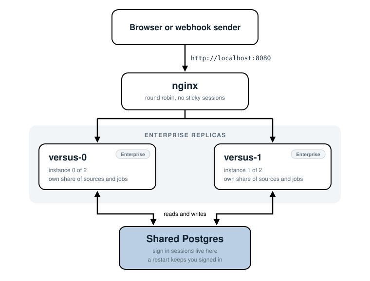
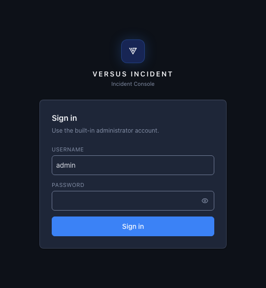

# HA on Docker Compose

_Enterprise_

## Concept

See high availability on your laptop: two Versus Enterprise replicas, one
Postgres, and an nginx load balancer that sends each request to either replica
in turn. You open one URL, sign in once, and stay signed in whichever replica
answers. See [High Availability](./overview.md) for how it works.



*nginx sends requests to both replicas in turn; because sessions live in the shared Postgres, restarting one replica keeps you signed in.*

## Try it with Docker Compose

You need Git, Docker with Docker Compose v2, and a Versus Enterprise license
key. Clone the repository and go into it:

```bash
git clone https://github.com/VersusControl/versus-incident.git
cd versus-incident
```

Every command below runs from this `versus-incident` folder, the repository
root.

The example is
[`examples/high-availability/docker/`](https://github.com/VersusControl/versus-incident/tree/main/examples/high-availability/docker).

**1. Start the stack** with your license key from the environment:

```bash
export LICENSE_KEY=<your license key>
docker compose -f examples/high-availability/docker/docker-compose.yml up -d
docker compose -f examples/high-availability/docker/docker-compose.yml ps
```

Compose starts Postgres, `versus-0`, `versus-1` and the load balancer. Wait
until all four are `healthy`.

**2. Open the UI through the load balancer.** Browse to
`http://localhost:8080`. The sign-in page loads.



**3. Check each replica's place in the set:**

```bash
docker compose -f examples/high-availability/docker/docker-compose.yml \
  logs versus-0 versus-1 | grep "HA mode"
```

One line from each replica, `instance 0 of 2` and `instance 1 of 2`:

```text
enterprise: HA mode — instance 0 of 2; partitioning signal sources and scheduler jobs by hash-ownership
enterprise: HA mode — instance 1 of 2; partitioning signal sources and scheduler jobs by hash-ownership
```

**4. Sign in.** One replica printed the admin password; search both:

```bash
docker compose -f examples/high-availability/docker/docker-compose.yml \
  logs versus-0 versus-1 | grep -A6 "DEFAULT ADMIN CREDENTIALS"
```

Open `http://localhost:8080` and sign in as `admin`. Click around: nginx sends
your requests to both replicas, and you stay signed in.

**5. Restart one replica.** The other keeps serving:

```bash
docker compose -f examples/high-availability/docker/docker-compose.yml restart versus-0
```

Reload the page in your browser right away. It loads, and you are still
signed in: `versus-1` answers while `versus-0` restarts.

**Clean up:**

```bash
docker compose -f examples/high-availability/docker/docker-compose.yml down -v
```

`-v` also deletes the Postgres volume, so the next start prints a new admin
password.

## What the example sets

Each replica gets these settings from `docker-compose.yml`:

| Setting | Value | Why |
|---|---|---|
| `STORAGE_TYPE` | `postgres` | One shared store; required for more than one replica. |
| `POSTGRES_DSN` | the same on both | Both replicas use the same database. |
| `POD_NAME` | `versus-0`, `versus-1` | The number at the end is the replica's place in the set. |
| `INSTANCE_COUNT` | `2` | Total replicas. |
| `LICENSE_KEY` | from your environment | Empty runs unlicensed. |
| `VERSUS_ENTERPRISE_COOKIE_INSECURE` | `1` | Lets sign-in work over plain HTTP. Local use only. |

Optional variables, from your shell or a `.env` file (see `.env.example`):

| Variable | Default | Purpose |
|---|---|---|
| `VERSUS_ENTERPRISE_IMAGE` | `ghcr.io/versuscontrol/versus-enterprise` | Image to run, for example to pin a tag. |
| `LB_PORT` | `8080` | Load balancer port on `127.0.0.1`. |
| `POSTGRES_USER`, `POSTGRES_PASSWORD`, `POSTGRES_DB` | `versus` | Local Postgres. |

## Without a license

Without `LICENSE_KEY` the stack still starts, and each replica still logs its
place in the set, so you can see the topology. There is no built-in admin, and
the Enterprise screens stay locked.

## Troubleshooting

| Symptom | Likely cause |
|---|---|
| A replica exits at start | `STORAGE_TYPE` is not `postgres`. File storage is refused with more than one replica. |
| Both replicas log the same instance number | They share a `POD_NAME`. Give each service its own. |
| No `DEFAULT ADMIN CREDENTIALS` in the logs | `LICENSE_KEY` was not exported before `up -d`, or the Postgres volume already holds an admin. Use `down -v` to start over. |
| Signed out after a request reaches the other replica | The replicas use different databases. Both must share one `POSTGRES_DSN`. |
| Port 8080 is in use | Set `LB_PORT`, for example `export LB_PORT=8081`, and open that port. |
