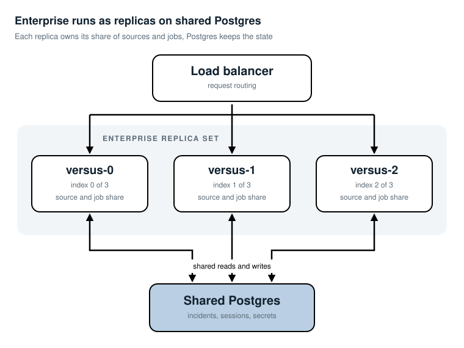

# High Availability (HA)

_Enterprise_

## Concept

High availability runs Versus Enterprise as several replicas behind one load
balancer, all sharing one Postgres. If a replica stops, the others keep serving
the UI, the API and incoming alerts.

The replicas split the agent's work between them: each data source and each
scheduled job, such as the SLO check, runs on exactly one replica. So two
replicas never read the same source twice or page you twice for the same
incident. Sign-ins are shared too: log in once and every replica accepts your
session, so the load balancer needs no sticky sessions.



## Example

You run three replicas, `versus-0`, `versus-1` and `versus-2`, with five log
and metric sources. Each source is read by one replica.

- During a rolling upgrade, `versus-1` restarts. The load balancer sends your
  requests to the other two; you stay signed in.
- The sources owned by `versus-1` pause until it is back, then carry on. No
  other replica picks them up in the meantime, so nothing is read or paged
  twice.

## What you see

Each replica logs its place in the set when it starts:

```text
enterprise: HA mode — instance 1 of 3; partitioning signal sources and scheduler jobs by hash-ownership
```

The built-in admin password is printed once, by whichever replica starts
first. In the UI nothing changes: every replica shows the same incidents,
settings and members.

## Turn it on

Every replica needs:

| Setting | Value |
|---|---|
| Image | `ghcr.io/versuscontrol/versus-enterprise` |
| `LICENSE_KEY` | Your license key. Every replica also needs outbound HTTPS to `versusincident.com` to renew it (see [Key renewal](../getting-started.md#key-renewal)). |
| `STORAGE_TYPE` | `postgres`. Versus refuses to start with `file` storage and more than one replica. |
| `POSTGRES_DSN` | The same database on every replica. |
| `INSTANCE_COUNT` | The number of replicas, for example `3`. |
| `POD_NAME` | This replica's name, ending in its number: `versus-0`, `versus-1`, … Each replica needs a different number. |

On Kubernetes, a StatefulSet sets `POD_NAME` for you. With Docker Compose you
set it per service.

Pick your deployment:

| Guide | What it runs | Start with |
|---|---|---|
| [Docker Compose](./docker.md) | 2 replicas, Postgres and an nginx load balancer on your laptop | `docker compose up -d` |
| [Kubernetes](./kubernetes.md) | 3 replicas from plain manifests | `kubectl apply -k .` |
| [Helm](./helm.md) | 3 replicas from the Versus chart | `helm install … -f values-ha.yaml` |

## Reference

### Trade-off

A source or job owned by a replica that is down waits until that replica comes
back. Incidents, sign-ins and the UI stay available the whole time, because
any replica can serve them. On Kubernetes the StatefulSet restarts the replica
under the same name, so it takes back the same share.

### One source per signal

Each source is read by one replica, so watch a given service signal from one
source only. If two sources report the same service and metric, two replicas
could learn the same signal.

### OSS

The OSS image does not split work. Every instance would read every source and
page for the same incident, and the instances would overwrite each other's
learned log patterns. Run OSS as a single instance. Run HA on the Enterprise
image with a license key: without one, there is no built-in admin and the
Enterprise screens stay locked.

### Encryption key

Versus generates its encryption key on the first licensed start and shares it
with every replica through Postgres. To supply your own, set
`VERSUS_ENTERPRISE_SECRET_KEY` (base64 of 32 bytes, for example from
`openssl rand -base64 32`) to the same value on every replica.

### Secrets

- Pass `LICENSE_KEY` and the DSN from the environment or a Kubernetes Secret.
  Never commit them.
- The example Postgres passwords are local development defaults. In production,
  use a managed Postgres and `sslmode=require`.
- The examples set `VERSUS_ENTERPRISE_COOKIE_INSECURE=1` so sign-in works over
  plain HTTP on your laptop. Never set it in production.

## See also

- [Getting Started](../getting-started.md): the license and the built-in admin.
- [Single Sign-On](../sso/overview.md): sessions shared by every replica.
- [Helm Chart](../../configuration/helm.md): the full chart reference.
