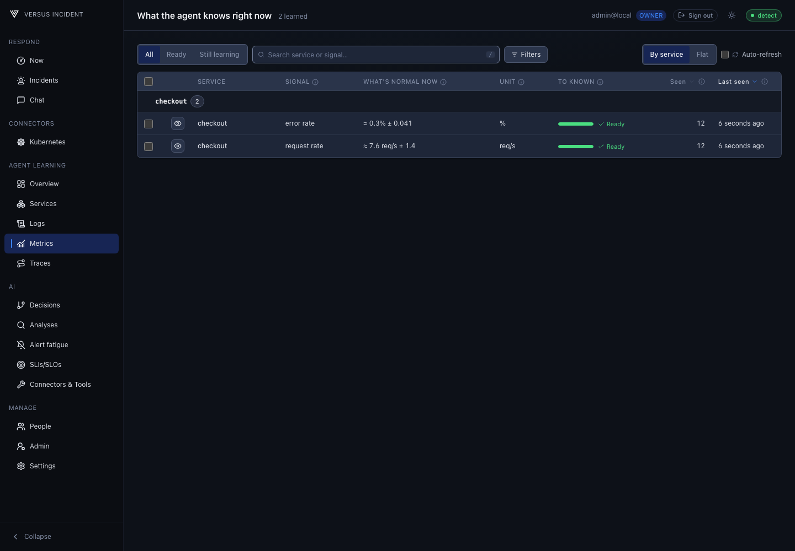

# Metrics

_Enterprise_

## Concept

Versus watches your metrics the way it watches your logs. Point it at where
your metrics live and it finds, for each service, the signals worth watching:
request rate, error rate, latency, and resource use such as memory and CPU. It
learns each signal's normal by time of week, so a Monday morning peak is
compared with past Monday mornings. It raises an incident only when a signal
moves far outside its normal **and stays there**. You write no queries and set
no thresholds.


Metrics follow the same modes as logs: [training](../../agent/training-mode.md)
learns and never alerts, [shadow](../../agent/shadow-mode.md) records what it
would have raised, and [detect](../../agent/ai-detect-mode.md) raises incidents.

## Example

`checkout` normally serves about 10 requests a second with under 1% errors.
After a deploy, about 45% of its requests return `500` for several minutes.
Versus has learned the error rate's normal band, sees it leave the band on
three checks in a row, and raises one incident:

```text
Anomaly: checkout — error_rate (… above baseline …)
```

A single bad sample raises nothing. With a Prometheus source, Versus also
watches each service's error budget and raises an error-budget burn incident
when it is spent too fast (see [SLI/SLO](../slo.md)).

## What you see in the UI



- **Agent Learning → Metrics** lists every signal Versus watches, by service,
  with its source and unit. The **Ready** tab shows signals whose normal is
  learned; **Still learning** shows the rest.
- **Incidents** shows each metric incident with the source it came from. Open
  one and click **Analyze** to let the AI read the related metrics.
- In shadow mode, would-have-raised results are in **AI → Decisions**, on the
  **Shadow** tab.

## Sources

| Source | `type` | Use it for | Local example |
|---|---|---|---|
| [Prometheus](./prometheus.md) | `prometheus` | Prometheus, Mimir, Cortex, Thanos, VictoriaMetrics, Grafana Cloud | Docker Compose |
| [CloudWatch Metrics](./cloudwatch-metrics.md) | `cloudwatch_metrics` | AWS services in one region | None: runs against your AWS account |
| [SigNoz](./signoz.md) | `signoz_metrics` | SigNoz Cloud or self-hosted | Docker Compose |

You can run several sources at once.

## Turn it on

1. Run the Enterprise image with a license key that includes the
   `intelligence` entitlement (see [Getting Started](../getting-started.md)).
2. Turn the agent on and add a source to `config/agent_sources.yaml`:

   ```yaml
   sources:
     - name: prod-metrics
       type: prometheus
       enable: true
       options:
         address: http://prometheus:9090
   ```

3. Start in training, check shadow, then arm detect.

Without a license, a metrics source stops at start with
`requires Versus Enterprise`, and **Agent Learning → Metrics** shows a locked
card.

## Reference

Every option of each source:
[Prometheus](../../agent/data-sources/prometheus.md),
[CloudWatch Metrics](../../agent/data-sources/cloudwatch-metrics.md),
[SigNoz Metrics](./signoz.md#options).
