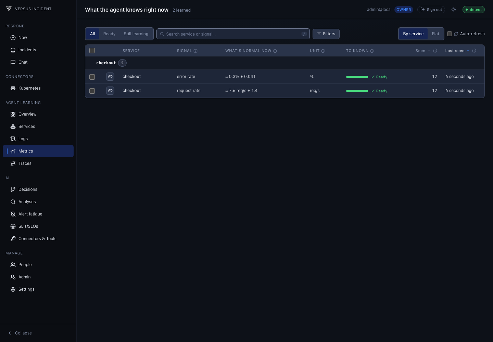

# Prometheus Metrics

_Enterprise_

## Concept

Give Versus the address of your Prometheus and it finds what to watch: for each
service, the request rate, error rate, p99 latency and resource gauges. It
learns each signal's normal by time of week and raises an incident when a
signal moves far outside it and stays there. It works with any
Prometheus-compatible API: Prometheus, Mimir, Cortex, Thanos, VictoriaMetrics
and Grafana Cloud.


## Example

`checkout` exposes `demo_http_requests_total` and a request duration histogram.
Versus finds both, names the service from the `service` label, and learns
`checkout`'s request rate and error rate. When a bad release makes about 45%
of requests fail for 90 seconds, Versus raises one incident about a minute in:

```text
Anomaly: checkout — error_rate (… above baseline …)
```

In shadow mode the same spike is recorded as a would-have-raised decision and
nobody is paged.

## What you see in the UI



| Where | What |
|---|---|
| **Agent Learning → Metrics** | `checkout` with its signals and the source `demo-prom`. **Ready** once a signal's normal is learned, **Still learning** before. |
| **Incidents** | The `Anomaly: checkout — error_rate` incident, with source `demo-prom`. |
| **AI → Decisions**, **Shadow** tab | What the source would have raised, in shadow mode. |
| An incident's **Analyze** button | With an AI key, the AI reads the related metric series and explains the cause. |

## Turn it on

```yaml
# config/agent_sources.yaml
sources:
  - name: prod-metrics
    type: prometheus
    enable: true
    options:
      address: http://prometheus:9090
      filter: '{namespace="prod"}'   # optional: watch only part of Prometheus
```

Run the Enterprise image with `LICENSE_KEY` and `AGENT_ENABLE=true`. Auth,
limits, your own PromQL signals and every other option are in the
[Prometheus data source reference](../../agent/data-sources/prometheus.md).

## Try it with Docker Compose

You need Git, Docker with Docker Compose v2, and a Versus Enterprise
license key. Clone the repository and go into it:

```bash
git clone https://github.com/VersusControl/versus-incident.git
cd versus-incident
```

Every command below runs from this `versus-incident` folder, the repository
root.

[`examples/metrics-source/`](https://github.com/VersusControl/versus-incident/tree/main/examples/metrics-source)
runs Versus Enterprise with Postgres, Redis, Prometheus and a Pushgateway. A
demo traffic service pushes healthy traffic for `checkout` every 2 seconds.
The example's source:

```yaml
# examples/metrics-source/config/agent_sources.yaml
sources:
  - name: demo-prom
    type: prometheus
    enable: true
    options:
      address: http://prometheus:9090
      step: 15s                      # one sample every 15s
      filter: '{service!=""}'        # learn only the demo series
      discovery_interval: 1m         # look for new series every minute
```

**1. Start the stack in shadow mode**, with demo traffic and your license key
from the environment:

```bash
export LICENSE_KEY=<your license key>
export AGENT_MODE=shadow
docker compose -f examples/metrics-source/docker-compose.yml --profile fake-metrics up -d
```

Leave out `AGENT_MODE` to start straight in detect, the example's default.

**2. Sign in.** Versus prints the admin password once, on the first start:

```bash
docker compose -f examples/metrics-source/docker-compose.yml logs versus \
  | grep -A6 "DEFAULT ADMIN CREDENTIALS"
```

Open `http://localhost:3000` and sign in as `admin`.

**3. Let it learn.** Within a minute **Agent Learning → Metrics** lists
`checkout`. Wait a few minutes (about 5), until its signals are on the **Ready** tab.
A spike sent before that is learned as normal and raises nothing.

**4. Spike it in shadow:**

```bash
docker compose -f examples/metrics-source/docker-compose.yml run --rm metrics-spike
```

For 90 seconds `checkout` returns about 45% `500`s with latency above 500 ms.
About a minute in, **AI → Decisions** shows the would-have-raised result on
the **Shadow** tab. No incident is opened.

**5. Arm detect and spike again.** Detect from the UI needs AI on with a key.
Add one in **Admin → AI provider**, then open **Admin → Runtime mode** and
click **Detect** → **Arm detect**. Then:

```bash
docker compose -f examples/metrics-source/docker-compose.yml run --rm metrics-spike
```

About a minute in, the incident appears on the **Incidents** page. Check the
same data in Prometheus at `http://localhost:9090`:

```promql
sum by (service) (rate(demo_http_requests_total{code=~"5.."}[1m]))
```

**Clean up:**

```bash
docker compose -f examples/metrics-source/docker-compose.yml --profile fake-metrics down -v
```

The example's README covers the other settings, the generator options and the
Tempo and SigNoz overlays.

## Troubleshooting

| Symptom | Likely cause |
|---|---|
| `requires Versus Enterprise` in the logs | `LICENSE_KEY` was not exported before `up -d`, or the key lacks the `intelligence` entitlement. |
| Nothing under **Agent Learning → Metrics** | Wait for the next discovery (1 minute here). The first pass after start can miss the `service` label. |
| The spike raised nothing | It ran before the signals were **Ready**, or the agent is in training. |
| **Arm detect** is refused | AI is off or has no key. Set it in **Admin → AI provider**. |

## See also

- [Prometheus data source reference](../../agent/data-sources/prometheus.md)
- [Metrics overview](./overview.md) · [SLI/SLO](../slo.md)
- [Traces](../traces.md): the same example with Tempo.
