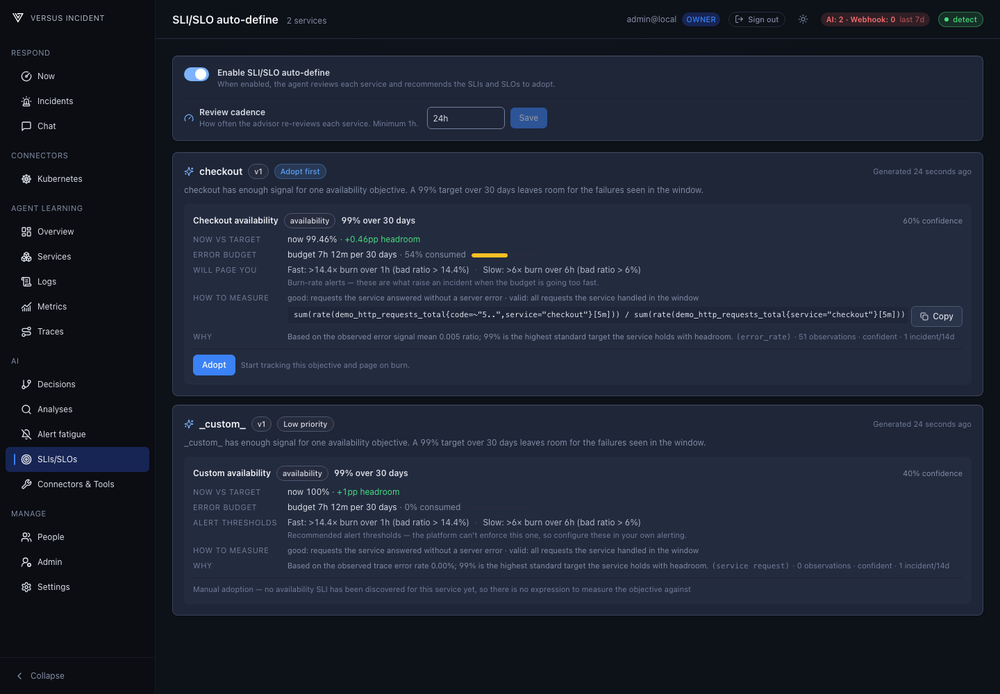

# SLI/SLO

_Enterprise_

## Concept

An **SLI** (service level indicator) is one number that says how healthy a
service is, such as the share of requests that succeed. An **SLO** (service
level objective) is the target for that number, such as "99.9% of requests
succeed over 30 days". The room you have below the target is the **error
budget**.

Versus helps in two ways:

- **It proposes SLIs and SLOs.** On a schedule, an AI advisor reviews what
  Versus has learned about each service (metrics, traces, log patterns and
  recent incidents) and proposes up to five SLIs per service, each with a
  target and the reason for it.
- **It watches the error budget.** With a Prometheus source, Versus derives an
  objective for each service from what it has observed and raises an incident
  when the budget is being spent too fast. This runs whether or not you adopt
  anything.

**Adopting** a proposal replaces the derived target with the one you chose;
burn alerts then use your target. Proposals themselves never page anyone.


## Example

The advisor reviews `payments` and proposes:

| Indicator | Type | Target | Window | Rationale |
|---|---|---|---|---|
| Payments availability | `availability` | 99% | 30 days | About 99.5% of requests succeeded over the last 14 days with no incidents, so 99% leaves headroom. |

You agree and click **Adopt**. A week later a bad deploy makes 20% of payment
requests fail. That spends the month's budget many times faster than it
should, so Versus raises one incident:

```text
Error-budget burn on payments (fast window)
```

## What you see in the UI

Open **AI → SLIs/SLOs** (the page is titled **SLI/SLO auto-define**). Each
service has a card:

| Part | What it shows |
|---|---|
| Header | The service, the recommendation version and when it was generated. The most urgent service is marked **Adopt first**. |
| Summary | One paragraph on the service's health and what to adopt. |
| SLI rows | **Indicator**, **Type** (`availability`, `latency`, `error_rate`, `throughput` or `saturation`), **Target**, **Window** in days, **Rationale** citing the signal it was measured from, and **Confidence**. |
| Now vs target, Error budget | How the service is doing against the objective. **Breaching** when it is below target. |
| How to measure | The query behind the indicator, with **Copy query**. |
| **Adopt** | Replace the auto-derived target with this one; burn alerts use it from then on. Once adopted: **Adopted — the platform is tracking this objective**, with **Revert to auto-derived**, which goes back to the derived target. |

Admins also see **Enable SLI/SLO auto-define** and the review **Cadence** at
the top of the page.



*Recommended SLOs for two services.*

Only `availability` and `latency` SLIs can be adopted, and only once Versus
has found a metric to measure them with. Other SLIs show **Manual adoption**
instead of **Adopt**: copy the query into your own SLO tooling.

## Turn it on

1. Run the Enterprise image with a license key that includes the
   `intelligence` entitlement.
2. Turn AI on with a key in **Admin → AI provider** (see
   [Getting Started](./getting-started.md#5-add-an-ai-key-optional)). Until
   then the enable switch stays greyed out.
3. On the **SLIs/SLOs** page, switch on **Enable SLI/SLO auto-define**. Set the
   **Cadence** if 24 hours does not suit you.
4. For burn alerts, add a [Prometheus source](./metrics/prometheus.md). They run on
   the derived objectives without any adoption.

The first proposals appear after the next review, within one cadence. A service
with too little learned data shows **No recommendations yet**.

## Reference

| Setting | Default | Notes |
|---|---|---|
| Enable SLI/SLO auto-define | off | Admin only. Needs AI on with a key. |
| Cadence | `24h` | How often each service is reviewed. At least `1h`. Takes effect without a restart. |
| SLIs per service | up to 5 | |
| Window | 30 days | Between 1 and 90 days. |

- The advisor sees only summaries: learned baselines, log pattern templates and
  an incident summary, with secrets masked. It never sees raw logs or raw
  metric series.
- Adopting, reverting and settings changes are admin actions and are recorded
  in the audit trail.
- In [High Availability](./ha/overview.md), one replica runs the reviews and
  the burn check, so you are paged once.

## Troubleshooting

| Symptom | Likely cause |
|---|---|
| The page shows the **Enterprise capability** card | No `LICENSE_KEY`, or the key lacks the `intelligence` entitlement. |
| An AI-off banner, or the enable switch is greyed out | AI is off or has no key. Set it in **Admin → AI provider**. |
| **No recommendations yet** | The first review has not run yet, or the service has too little learned data. |
| Cadence is rejected | It must be a duration of at least `1h`, such as `2h` or `24h`. |
| No burn incidents | There is no Prometheus source, so there is nothing to measure the budget with. |
| You cannot see the controls | They are admin only. Viewers and responders still see the proposals. |

## See also

- [Metrics](./metrics/overview.md) · [Traces](./traces.md)
- [AI Detect Mode](../agent/ai-detect-mode.md)
