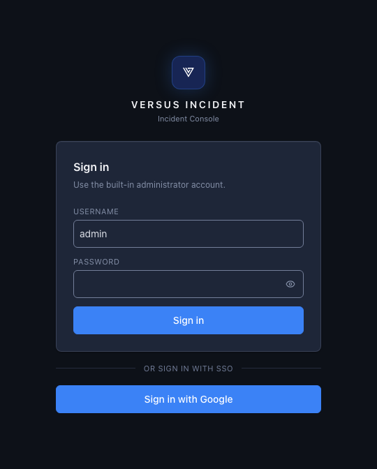
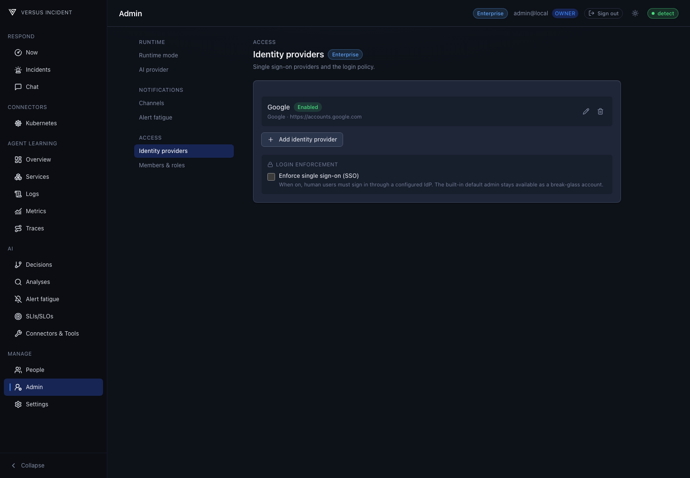

# Single Sign-On (SSO)

_Enterprise_

## Concept

SSO lets your team sign in to Versus with the accounts they already have:
Google Workspace, Microsoft Entra ID, or any OpenID Connect provider such as
Okta, Auth0 or Keycloak. Each provider you add becomes a **Sign in with …**
button on the Versus login screen.

You set it up in the UI. There is nothing to add to a config file and no SSO
secret in the environment. Each provider has a list of allowed email domains,
so only your own people get in, and every new user starts read-only until an
owner gives them more.

## Example

Acme runs Versus Enterprise. The first owner signs in as the built-in `admin`,
adds Google with the allowed domain `acme.com`, and shares the URL.

- `maria@acme.com` clicks **Sign in with Google** and lands in Versus as a
  **viewer**: she can read incidents but cannot change settings.
- The owner promotes Maria to **admin** in **Admin → Members & roles**, then
  disables the built-in `admin` account.
- `someone@gmail.com` tries the same button and is refused, because
  `gmail.com` is not an allowed domain.

## What you see in the UI

- **The login screen** keeps the built-in admin login and, below **Or sign in
  with SSO**, one **Sign in with …** button per enabled provider, labelled with
  the provider's display name.

  

- **Admin → Identity providers** lists every provider with its status
  (**Enabled** or **Disabled**), an **Add identity provider** form, and the
  **Login enforcement** switches once a provider is enabled.

  

- **Admin → Members & roles** lists everyone who has signed in, with their
  email, name, connection and role, and the **Disable default admin** button.

## Turn it on

1. Sign in as the built-in `admin` (see [Getting Started](../getting-started.md)).
2. Open **Admin → Identity providers** and click **Add identity provider**.
   Copy the **Redirect URL (callback)** shown in the form.
3. Register an app at your provider with that redirect URL. Follow the page for
   your provider:

   | Provider | **Provider** in the form | Page |
   |---|---|---|
   | Google Workspace | Google | [Google Workspace](./google.md) |
   | Microsoft Entra ID (Azure AD) | Microsoft Entra (Azure AD) | [Microsoft Entra ID](./azure.md) |
   | Okta, Auth0, Keycloak, any OIDC provider | Generic OIDC (issuer URL) | [Generic OIDC](./oidc.md) |

4. Paste the client ID and secret, set the allowed email domains, tick
   **Enabled** and save.
5. Sign out and test the new button.
6. Promote a real user to **admin** or **owner**, then **Disable default
   admin**.

Versus supports these three provider types. There is no SAML or LDAP option.

## Reference

### URLs

| URL | What it is |
|---|---|
| `https://<your-versus-host>/enterprise/api/sso/<org>/callback` | Redirect (callback) URL. Register it at your provider. Every provider uses the same one. |
| `https://<your-versus-host>/enterprise/api/sso/<org>/login/<connection-id>` | Login URL of one provider: the target of its button. |

`<org>` is the organization in your license key. The form fills in the
callback URL for you, from the address you opened Versus at; copy it from
there.

### Form fields

| Field | What to enter |
|---|---|
| **Provider** | Google, Microsoft Entra (Azure AD) or Generic OIDC (issuer URL). Cannot be changed later. |
| **Connection ID** | A short ID used in the login URL: 1 to 64 characters of `a-z`, `0-9`, `-` and `_`. |
| **Display name** | The text on the **Sign in with …** button. |
| **Directory (tenant) ID** | Microsoft Entra only. |
| **Issuer (IdP discovery URL)** | Generic OIDC only. |
| **Client ID** | From your provider. |
| **Client secret** | From your provider. Stored encrypted; Versus never shows it again. Leave it blank when editing to keep the stored one. |
| **Redirect URL (callback)** | Prefilled. Must match what you registered at the provider. |
| **Scopes** | `email, profile`. `openid` is always added. |
| **Allowed email domains** | For example `acme.com`. **Required:** Versus refuses to save a provider with no domain. Only these domains can sign in. |
| **Enabled** | Shows the provider's button on the login screen. |

### Roles

| Role | Can |
|---|---|
| `viewer` | Read incidents. Every new SSO user starts here. |
| `responder` | Viewer, plus act on incidents. |
| `admin` | Responder, plus manage SSO, roles, runtime mode, AI and channels. |
| `owner` | Everything. The built-in `admin` account is an owner. |

### Login enforcement

Once at least one provider is enabled, an owner or admin can tighten sign-in
in **Admin → Identity providers → Login enforcement**:

| Switch | Effect |
|---|---|
| **Enforce single sign-on (SSO)** | People must sign in through a provider. The built-in `admin` stays available as a break-glass account. |
| **Also require multi-factor sign-in (MFA)** | Sign-in still works, but a session your provider did not report as multi-factor cannot use privileged actions, such as changing settings. The built-in `admin` is exempt. Shown only while SSO is enforced. |

Versus refuses to enforce SSO while no provider is enabled, so you cannot lock
everyone out. Policy changes are recorded in the audit trail.

### Sessions

A sign-in lasts 12 hours. Users can sign out at any time. In
[High Availability](../ha/overview.md), a session works on every replica.

## Troubleshooting

| Symptom | Likely cause |
|---|---|
| **Identity providers** shows the Enterprise card | No `LICENSE_KEY`, or the key failed to verify. |
| **requires the admin role** | You are signed in as viewer or responder. Ask an owner to promote you. |
| The provider rejects the redirect | The redirect URL registered at the provider differs from the one in the form. They must match exactly. |
| You sign in at the provider but Versus refuses you | Your email domain is not in **Allowed email domains**. |
| **Disable default admin** is refused | No other owner or admin exists yet. Promote one first. |
