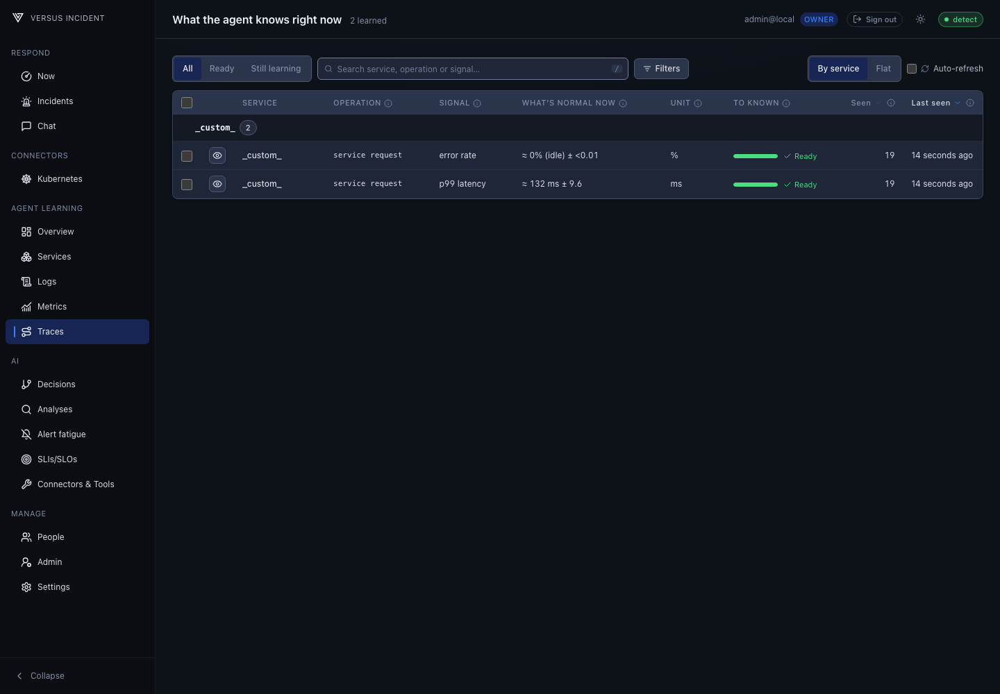

# Traces

_Enterprise_

## Concept

Point Versus at your tracing backend and it finds what to watch: every service
and the operations inside it, such as `POST /checkout`. For each operation it
learns how fast it usually is (p99 latency) and how often it usually fails
(error rate), by time of week. It raises an incident when an operation gets
clearly slower or fails more **and stays that way**, not on one slow request.
You write no TraceQL and set no thresholds.

| Backend | `type` |
|---|---|
| Grafana Tempo | `traces` |
| SigNoz (0.87.0 or later) | `signoz_traces` |


Traces follow the same modes as logs: [training](../agent/training-mode.md)
learns and never alerts, [shadow](../agent/shadow-mode.md) records what it
would have raised, and [detect](../agent/ai-detect-mode.md) raises incidents.

## Example

`checkout` handles `POST /checkout` in about 120 ms with almost no errors.
A payment dependency starts timing out, and for several minutes half of the
`POST /checkout` traces fail and take 800 ms to 3 s. Versus has learned the
operation's normal, sees its error rate and p99 stay far above it, and raises
an incident for `checkout`. `GET /orders` on the same service stays normal and
raises nothing.

## What you see in the UI



| Where | What |
|---|---|
| **Agent Learning → Traces** | Each service and operation with its p99 latency and error rate signals and its source. **Ready** once learned, **Still learning** before. |
| **Incidents** | One incident per operation that stays out of its normal, naming the source. |
| **AI → Decisions**, **Shadow** tab | What the source would have raised, in shadow mode. |
| An incident's **Analyze** button | With an AI key, the AI reads the related spans and explains the cause. |

## Turn it on

```yaml
# config/agent_sources.yaml
sources:
  - name: prod-traces
    type: traces
    enable: true
    options:
      backend: tempo
      address: http://tempo:3200    # Tempo's query API, not the OTLP port
```

Run the Enterprise image with `LICENSE_KEY` and `AGENT_ENABLE=true`. Auth,
limits, SigNoz and every other option are in the
[Traces data source reference](../agent/data-sources/traces.md).

## Try it with Docker Compose

You need Git, Docker with Docker Compose v2, and a Versus Enterprise
license key. Clone the repository and go into it:

```bash
git clone https://github.com/VersusControl/versus-incident.git
cd versus-incident
```

Every command below runs from this `versus-incident` folder, the repository
root.

[`examples/metrics-source/`](https://github.com/VersusControl/versus-incident/tree/main/examples/metrics-source)
runs Versus Enterprise with Prometheus. Its traces overlay,
`docker-compose.traces.yml`, adds Tempo and a `traces` source. The demo traffic
sends spans for `checkout` (`POST /checkout` and `GET /orders`) to Tempo, about
half of them errors during a spike.

```yaml
# examples/metrics-source/config/agent_sources.traces.yaml (the traces source)
  - name: demo-traces
    type: traces
    enable: true
    options:
      backend: tempo
      address: http://tempo:3200
      allow_private_networks: true   # Tempo is on the private Docker network
      query: '{ resource.service.name = "checkout" }'
      page_size: 100
      discovery_interval: 1m
```

The example sets its own `query`, so its targets are listed under the service
`_custom_` with the operation `service request`.

**1. Start the stack** with demo traffic and your license key. Use both Compose
files on every command:

```bash
export LICENSE_KEY=<your license key>
docker compose -f examples/metrics-source/docker-compose.yml \
  -f examples/metrics-source/docker-compose.traces.yml \
  --profile fake-metrics up -d
```

**2. Sign in.** Versus prints the admin password once, on the first start:

```bash
docker compose -f examples/metrics-source/docker-compose.yml \
  -f examples/metrics-source/docker-compose.traces.yml \
  logs versus | grep -A6 "DEFAULT ADMIN CREDENTIALS"
```

Open `http://localhost:3000` and sign in as `admin`.

**3. Let it learn.** Within a minute **Agent Learning → Traces** lists the
`_custom_` targets with their error rate and p99 latency. Wait a few minutes (about 5),
until they are on the **Ready** tab.

**4. Fire a 90-second spike:**

```bash
docker compose -f examples/metrics-source/docker-compose.yml \
  -f examples/metrics-source/docker-compose.traces.yml \
  run --rm metrics-spike
```

About a minute in, an incident appears on the **Incidents** page. The example
starts in detect; start it with `export AGENT_MODE=shadow` to see the result in
**AI → Decisions** on the **Shadow** tab instead. Tempo's search API is on
`http://localhost:3200`.

**Clean up:**

```bash
docker compose -f examples/metrics-source/docker-compose.yml \
  -f examples/metrics-source/docker-compose.traces.yml \
  --profile fake-metrics down -v
```

## Troubleshooting

| Symptom | Likely cause |
|---|---|
| `requires Versus Enterprise` in the logs | `LICENSE_KEY` was not exported before `up -d`, or the key lacks the `intelligence` entitlement. |
| Nothing under **Agent Learning → Traces** | `address` points at the OTLP port (`4317` or `4318`) instead of the query API, or spans carry no service attribute. |
| The spike raised nothing | It ran before the targets were **Ready**, or the agent is in training. |
| Only the base stack started | You left out `-f docker-compose.traces.yml`. Use both files on every command. |

## See also

- [Traces data source reference](../agent/data-sources/traces.md)
- [Metrics](./metrics/overview.md) · [SLI/SLO](./slo.md)
- [AI Analyze Mode](../agent/ai-analyze-mode.md)
