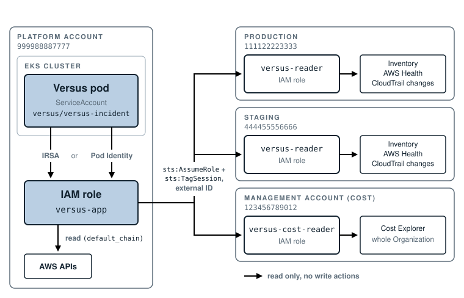
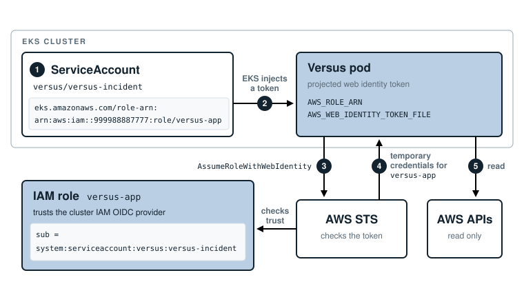
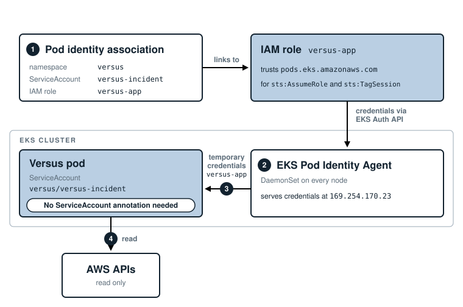
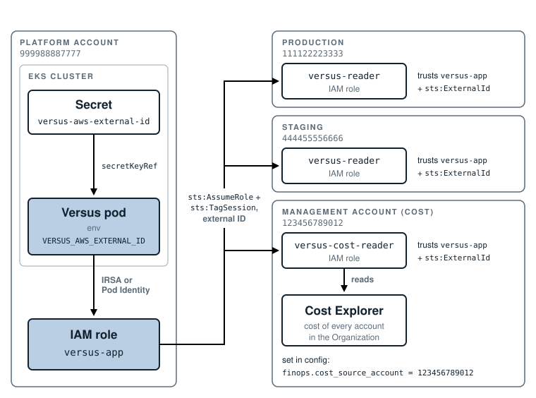

# AWS on EKS: IRSA, Pod Identity and FinOps

Run Versus on EKS and let it read AWS with the pod's own IAM role. There is no
access key to store or rotate. You start with one account, add more accounts
through assume role, then turn on FinOps.



Every file this page uses is in
[`examples/aws/eks`](https://github.com/VersusControl/versus-incident/tree/dev/examples/aws/eks)
on the `dev` branch.

| Name on this page | What it is |
| --- | --- |
| `versus-app` | The IAM role the Versus pod gets, in the account of the EKS cluster |
| `versus-reader` | A read-only role in each other account, assumed by `versus-app` |
| `versus-cost-reader` | A cost-only role in the management (payer) account, for FinOps |
| `999988887777` | The cluster's account (Platform) in the examples |
| `111122223333`, `444455556666` | Production and Staging |
| `123456789012` | The management account |

## Before you start

You need:

- An EKS cluster, and permission to create IAM roles in its account.
- For Path B, nodes on EC2. Pod Identity does not work on Fargate.
- The AWS CLI v2, `kubectl` pointed at the cluster, and Helm 3.8 or newer.
- `envsubst`, from GNU gettext (`brew install gettext` on macOS).
- For Path A, `eksctl`.
- For more accounts, an AWS CLI profile that can create IAM roles in each one.

Check that you are signed in to the cluster's account:

```bash
aws sts get-caller-identity --query Account --output text
```

Expected output: the cluster's account ID, for example `999988887777`.

### Set up the working folder

The files use `${VAR}` placeholders. You fill in one settings file, and
`envsubst` writes the values into the rest.

**1. Copy the example folder.** The chart and the files come from the `dev`
branch:

```bash
git clone -b dev https://github.com/VersusControl/versus-incident.git
cp -R versus-incident/examples/aws/eks ~/versus-aws-eks
cd ~/versus-aws-eks
```

Run every command on this page from `~/versus-aws-eks`.

**2. Fill in the settings.** Copy
[`setup.env.example`](https://github.com/VersusControl/versus-incident/blob/dev/examples/aws/eks/setup.env.example)
and replace every `<...>` value:

```bash
cp setup.env.example setup.env
```

| Setting | Example | Used for |
| --- | --- | --- |
| `AWS_REGION` | `us-east-1` | The cluster's region, and the region Versus reads |
| `CLUSTER_NAME` | `platform` | The EKS cluster |
| `VERSUS_ACCOUNT_ID` | `999988887777` | The cluster's account, where `versus-app` lives |
| `NAMESPACE`, `SERVICE_ACCOUNT` | `versus`, `versus-incident` | Where Versus runs. The trust policies name this ServiceAccount. |
| `CHART` | `~/versus-incident/helm/versus-incident` | The chart in your clone. Use the full path. |
| `PROD_ACCOUNT_ID`, `PROD_PROFILE` | `111122223333`, `production` | Production, and the CLI profile for it |
| `STAGING_ACCOUNT_ID`, `STAGING_PROFILE` | `444455556666`, `staging` | Staging |
| `MGMT_ACCOUNT_ID`, `MGMT_PROFILE` | `123456789012`, `management` | The management account, for FinOps |

The file holds no secrets. Leave the account settings you don't use yet as
they are.

The values files read one region, `AWS_REGION`. To read more, edit
`regions` in `helm/values-*.yaml`, for example `[us-east-1, eu-west-1]`.
Include `us-east-1` to see changes to global services such as IAM and
Route 53.

**3. Load the settings and render the files.** Do the first line again in each
new terminal:

```bash
set -a; . ./setup.env; set +a
mkdir -p rendered
for f in k8s/*.yaml helm/*.yaml; do envsubst < "$f" > "rendered/$(basename "$f")"; done
ls rendered
```

Expected output:

```text
serviceaccount-irsa.yaml          values-finops.yaml                values-single-account.yaml
serviceaccount-pod-identity.yaml  values-finops-organization.yaml   values-multi-account.yaml
```

The IAM policies are filled in as you use them, so they never sit on disk with
your values. If you change `setup.env`, run the `for` line again.

## Choose IRSA or Pod Identity

Both give the Versus pod the `versus-app` role. Versus needs no setting for
either: it finds the credentials EKS gives the pod.

| | IRSA (Path A) | Pod Identity (Path B) |
| --- | --- | --- |
| Set up once per cluster | An IAM OIDC provider | The Pod Identity Agent add-on |
| How the pod gets the role | An annotation on the ServiceAccount | A Pod Identity association, made with the EKS API |
| Trust policy of `versus-app` | Names the cluster's OIDC provider; one cluster per statement | Trusts `pods.eks.amazonaws.com`, limited to one cluster, namespace and ServiceAccount |
| Fargate | Yes | No |
| Other accounts through assume role | Yes | Yes. Each reader role must also allow `sts:TagSession`; the files here do. |

**Recommendation:** use **Pod Identity** on a cluster with EC2 nodes. The
cluster needs no OIDC provider, and the link between the role and the
ServiceAccount lives in EKS, not in an annotation. Use **IRSA** on Fargate,
or when the cluster already uses IRSA.

Do one path, not both. If a pod has both, Versus uses IRSA.

## Path A: IRSA



**1. Turn on the cluster's OIDC provider.**

```bash
eksctl utils associate-iam-oidc-provider --cluster "$CLUSTER_NAME" --region "$AWS_REGION" --approve
```

Expected output ends with `created IAM Open ID Connect provider for cluster
"platform" in "us-east-1"`, or says the provider is already associated. Both
are fine.

**2. Export the provider's address.** The trust policy needs it:

```bash
export OIDC_PROVIDER=$(aws eks describe-cluster --name "$CLUSTER_NAME" --region "$AWS_REGION" \
  --query 'cluster.identity.oidc.issuer' --output text | sed 's|^https://||')
echo "$OIDC_PROVIDER"
```

Expected output: `oidc.eks.us-east-1.amazonaws.com/id/` followed by an ID.

**3. Create `versus-app`.** File:
[`iam/irsa-trust-policy.json`](https://github.com/VersusControl/versus-incident/blob/dev/examples/aws/eks/iam/irsa-trust-policy.json).
It lets only the ServiceAccount `versus/versus-incident` of this cluster use
the role.

```bash
aws iam create-role --role-name versus-app \
  --assume-role-policy-document "$(envsubst < iam/irsa-trust-policy.json)" \
  --query Role.Arn --output text
```

Expected output: `arn:aws:iam::999988887777:role/versus-app`.

**4. Let `versus-app` read the account.** File:
[`iam/versus-reader-policy.json`](https://github.com/VersusControl/versus-incident/blob/dev/examples/aws/eks/iam/versus-reader-policy.json),
the read-only policy. It also denies object, secret, parameter and billing
account reads.

```bash
aws iam put-role-policy --role-name versus-app --policy-name versus-reader \
  --policy-document file://iam/versus-reader-policy.json
```

This prints nothing when it works.

**5. Create the namespace and the ServiceAccount.** File:
[`k8s/serviceaccount-irsa.yaml`](https://github.com/VersusControl/versus-incident/blob/dev/examples/aws/eks/k8s/serviceaccount-irsa.yaml).
The chart doesn't annotate its ServiceAccount, so you create it and the chart
uses yours.

```bash
kubectl create namespace "$NAMESPACE"
kubectl apply -f rendered/serviceaccount-irsa.yaml
```

Expected output:

```text
namespace/versus created
serviceaccount/versus-incident created
```

**6. Install Versus.** File:
[`helm/values-single-account.yaml`](https://github.com/VersusControl/versus-incident/blob/dev/examples/aws/eks/helm/values-single-account.yaml).
It turns on the AWS connector for the cluster's account with
`auth.mode: default_chain`, and sets `serviceAccount.create: false`.

```bash
helm upgrade --install versus-incident "$CHART" --namespace "$NAMESPACE" \
  -f rendered/values-single-account.yaml
kubectl -n "$NAMESPACE" rollout status deploy/versus-incident
```

Expected output: `STATUS: deployed`, then
`deployment "versus-incident" successfully rolled out`.

Go to [Open Versus](#open-versus).

## Path B: Pod Identity



**1. Install the Pod Identity Agent.**

```bash
aws eks create-addon --cluster-name "$CLUSTER_NAME" --region "$AWS_REGION" \
  --addon-name eks-pod-identity-agent --query addon.status --output text
aws eks wait addon-active --cluster-name "$CLUSTER_NAME" --region "$AWS_REGION" \
  --addon-name eks-pod-identity-agent
```

Expected output: `CREATING`, then the wait returns with no output. If the
add-on is already installed, the first command fails with
`ResourceInUseException`; go on.

**2. Create `versus-app`.** File:
[`iam/pod-identity-trust-policy.json`](https://github.com/VersusControl/versus-incident/blob/dev/examples/aws/eks/iam/pod-identity-trust-policy.json).
It trusts `pods.eks.amazonaws.com`, only for this cluster, namespace and
ServiceAccount.

```bash
aws iam create-role --role-name versus-app \
  --assume-role-policy-document "$(envsubst < iam/pod-identity-trust-policy.json)" \
  --query Role.Arn --output text
```

Expected output: `arn:aws:iam::999988887777:role/versus-app`.

**3. Let `versus-app` read the account.** File:
[`iam/versus-reader-policy.json`](https://github.com/VersusControl/versus-incident/blob/dev/examples/aws/eks/iam/versus-reader-policy.json).

```bash
aws iam put-role-policy --role-name versus-app --policy-name versus-reader \
  --policy-document file://iam/versus-reader-policy.json
```

This prints nothing when it works.

**4. Create the namespace and the ServiceAccount.** File:
[`k8s/serviceaccount-pod-identity.yaml`](https://github.com/VersusControl/versus-incident/blob/dev/examples/aws/eks/k8s/serviceaccount-pod-identity.yaml),
with no annotation.

```bash
kubectl create namespace "$NAMESPACE"
kubectl apply -f rendered/serviceaccount-pod-identity.yaml
```

Expected output:

```text
namespace/versus created
serviceaccount/versus-incident created
```

**5. Link the ServiceAccount to `versus-app`.**

```bash
aws eks create-pod-identity-association --cluster-name "$CLUSTER_NAME" --region "$AWS_REGION" \
  --namespace "$NAMESPACE" --service-account "$SERVICE_ACCOUNT" \
  --role-arn "arn:aws:iam::${VERSUS_ACCOUNT_ID}:role/versus-app" \
  --query association.associationId --output text
```

Expected output: an association ID that starts with `a-`.

Keep session tags on, the default. The reader roles in the next section allow
them.

**6. Install Versus.** File:
[`helm/values-single-account.yaml`](https://github.com/VersusControl/versus-incident/blob/dev/examples/aws/eks/helm/values-single-account.yaml),
the same file as Path A.

```bash
helm upgrade --install versus-incident "$CHART" --namespace "$NAMESPACE" \
  -f rendered/values-single-account.yaml
kubectl -n "$NAMESPACE" rollout status deploy/versus-incident
```

Expected output: `STATUS: deployed`, then
`deployment "versus-incident" successfully rolled out`.

## Open Versus

**1. Forward the port.** This holds the terminal; open a second one for the
next step:

```bash
kubectl -n "$NAMESPACE" port-forward svc/versus-incident 3000:3000
```

**2. Sign in** at `http://localhost:3000` with the gateway secret the chart
made:

```bash
kubectl -n "$NAMESPACE" get secret versus-incident-secrets -o jsonpath='{.data.gateway_secret}' | base64 -d; echo
```

**3. Open AWS > Settings.** The account **Platform** shows **First sync**,
then **Connected** with a count such as `22 of 24 readable`. See
[Verify](#verify) for more checks.

## Add more accounts (assume role)

`versus-app` assumes `versus-reader` in each other account. Each reader role
trusts only `versus-app`, and only with the external ID.



**1. Create the external ID** and store it in a Kubernetes Secret. It reaches
the pod as the environment variable `VERSUS_AWS_EXTERNAL_ID`, never in a
config file.

```bash
export VERSUS_AWS_EXTERNAL_ID=$(openssl rand -hex 16)
kubectl -n "$NAMESPACE" create secret generic versus-aws-external-id \
  --from-literal=external_id="$VERSUS_AWS_EXTERNAL_ID"
```

Expected output: `secret/versus-aws-external-id created`.

Treat it like a password. In a new terminal, read it back from the Secret
instead of making a new one:

```bash
export VERSUS_AWS_EXTERNAL_ID=$(kubectl -n "$NAMESPACE" get secret versus-aws-external-id -o jsonpath='{.data.external_id}' | base64 -d)
```

**2. Let `versus-app` assume the reader roles.** File:
[`iam/assume-reader-policy.json`](https://github.com/VersusControl/versus-incident/blob/dev/examples/aws/eks/iam/assume-reader-policy.json).
It names the exact `versus-reader` ARN in Production and Staging. Add a line
for each other account you read.

```bash
aws iam put-role-policy --role-name versus-app --policy-name versus-assume-readers \
  --policy-document "$(envsubst < iam/assume-reader-policy.json)"
```

This prints nothing when it works.

**3. Create `versus-reader` in each account.** Files:
[`iam/reader-trust-policy.json`](https://github.com/VersusControl/versus-incident/blob/dev/examples/aws/eks/iam/reader-trust-policy.json)
and `iam/versus-reader-policy.json`. The trust policy names
`arn:aws:iam::999988887777:role/versus-app` and requires the external ID. It
allows `sts:AssumeRole` and `sts:TagSession`; Pod Identity needs the second.

```bash
for profile in "$PROD_PROFILE" "$STAGING_PROFILE"; do
  aws iam create-role --profile "$profile" --role-name versus-reader \
    --assume-role-policy-document "$(envsubst < iam/reader-trust-policy.json)" \
    --query Role.Arn --output text
  aws iam put-role-policy --profile "$profile" --role-name versus-reader \
    --policy-name versus-reader --policy-document file://iam/versus-reader-policy.json
done
```

Expected output, one line per account:

```text
arn:aws:iam::111122223333:role/versus-reader
arn:aws:iam::444455556666:role/versus-reader
```

> **Using `scripts/aws` instead?** The CloudFormation, Terraform and CLI
> versions of `versus-reader` in
> [`scripts/aws`](https://github.com/VersusControl/versus-incident/tree/dev/scripts/aws)
> trust `sts:AssumeRole` only. They work with IRSA. With Pod Identity, add
> `sts:TagSession` to their trust policy, or use the file above.

**4. Upgrade Versus.** File:
[`helm/values-multi-account.yaml`](https://github.com/VersusControl/versus-incident/blob/dev/examples/aws/eks/helm/values-multi-account.yaml).
It lists Platform with `default_chain`, and Production and Staging with
`assume_role`, `roleArn` and `externalIdEnv: VERSUS_AWS_EXTERNAL_ID`. It also
passes the Secret to the pod through `extraEnv`. Helm replaces lists, so the
file lists Platform again.

```bash
helm upgrade versus-incident "$CHART" --namespace "$NAMESPACE" \
  -f rendered/values-single-account.yaml \
  -f rendered/values-multi-account.yaml
kubectl -n "$NAMESPACE" rollout status deploy/versus-incident
```

Expected output: `Release "versus-incident" has been upgraded`, then
`successfully rolled out`.

**5. Check AWS > Settings.** Platform, Production and Staging each show
**Connected**. If a role can't be assumed, the account shows why; see
[Troubleshooting](#troubleshooting).

To read another account later, add its `versus-reader` ARN to
`iam/assume-reader-policy.json`, create the role there as in step 3, and add
an entry to `helm/values-multi-account.yaml`. Up to 64 accounts.

## Turn on FinOps

The FinOps page shows this month's spend, what moved it, the forecast and
where you can save. It is off by default because Cost Explorer charges for
each request.

**1. Turn on Cost Explorer** in the account that pays the bill: the management
account in an AWS Organization, or each account on its own bill. Open the
[Billing and Cost Management console](https://console.aws.amazon.com/costmanagement/home),
then **Cost Explorer**. AWS can take up to 24 hours to fill in cost data the
first time.

| What it costs | |
| --- | --- |
| Each Cost Explorer request | $0.01, charged by AWS |
| Most Versus spends | `maxPaidRequestsPerDay` requests a day for the whole deployment: 20 by default, so $0.20 a day |

**2. Grant the cost reads.** Pick one:

| | Each account reads its own cost | One bill for the Organization |
| --- | --- | --- |
| Use when | Accounts pay their own bill, or you read only a few | The accounts are in an AWS Organization |
| Cost role | Cost reads added to `versus-app` and each `versus-reader` | `versus-cost-reader` in the management account |
| Values files | `values-finops.yaml` | `values-finops.yaml` + `values-finops-organization.yaml` |

**Each account reads its own cost.** File:
[`iam/cost-reads-policy.json`](https://github.com/VersusControl/versus-incident/blob/dev/examples/aws/eks/iam/cost-reads-policy.json).

```bash
aws iam put-role-policy --role-name versus-app --policy-name versus-cost-reads \
  --policy-document file://iam/cost-reads-policy.json
for profile in "$PROD_PROFILE" "$STAGING_PROFILE"; do
  aws iam put-role-policy --profile "$profile" --role-name versus-reader \
    --policy-name versus-cost-reads --policy-document file://iam/cost-reads-policy.json
done
```

These print nothing when they work.

**One bill for the Organization.** Files:
[`iam/versus-cost-reader-policy.json`](https://github.com/VersusControl/versus-incident/blob/dev/examples/aws/eks/iam/versus-cost-reader-policy.json),
`iam/reader-trust-policy.json` and
[`iam/assume-cost-reader-policy.json`](https://github.com/VersusControl/versus-incident/blob/dev/examples/aws/eks/iam/assume-cost-reader-policy.json).
`versus-cost-reader` allows the cost reads and denies every other action. Its
trust is the same as `versus-reader`.

```bash
aws iam create-role --profile "$MGMT_PROFILE" --role-name versus-cost-reader \
  --assume-role-policy-document "$(envsubst < iam/reader-trust-policy.json)" \
  --query Role.Arn --output text
aws iam put-role-policy --profile "$MGMT_PROFILE" --role-name versus-cost-reader \
  --policy-name versus-cost-reader --policy-document file://iam/versus-cost-reader-policy.json
aws iam put-role-policy --role-name versus-app --policy-name versus-assume-cost-reader \
  --policy-document "$(envsubst < iam/assume-cost-reader-policy.json)"
```

Expected output: `arn:aws:iam::123456789012:role/versus-cost-reader`. The other
two commands print nothing. Member accounts need no cost reads in this setup.

**3. Activate the team tag for billing (optional).** Spend by team uses one tag key,
`team` by default. Tag your resources with it, then activate it as a cost
allocation tag in the paying account, in **Billing > Cost allocation tags**,
or:

```bash
aws ce update-cost-allocation-tags-status --profile "$MGMT_PROFILE" \
  --cost-allocation-tags-status TagKey=team,Status=Active
```

Expected output: JSON with an empty `Errors` list. A tag key appears in Billing only after
AWS has seen it on a resource, which can take up to 24 hours. Until it is
active, FinOps says **Team tag not active in billing**.

**4. Set budgets and the cost source.** Files:
[`helm/values-finops.yaml`](https://github.com/VersusControl/versus-incident/blob/dev/examples/aws/eks/helm/values-finops.yaml)
and
[`helm/values-finops-organization.yaml`](https://github.com/VersusControl/versus-incident/blob/dev/examples/aws/eks/helm/values-finops-organization.yaml).

| Value | In the example | What it does |
| --- | --- | --- |
| `connectors.aws.optionalData.costExplorer` | `true` | Turns on the cost reads |
| `connectors.aws.tags.valueAllowlist` | `[Name, app, service, team, env]` | Tag keys whose values Versus keeps. Must include the team tag key, same case. |
| `connectors.aws.finops.teamTagKey` | `team` | The tag key for spend by team |
| `connectors.aws.finops.maxPaidRequestsPerDay` | `20` | Paid requests a day, for the whole deployment |
| `connectors.aws.finops.refreshTime` | `"09:00"` | Daily refresh, in `report.timezone` |
| `connectors.aws.finops.budgets` | `AWS total`, `Checkout team` | Monthly budgets, `scope: deployment` or `team`. Change the amounts. |
| `connectors.aws.finops.costSourceAccount` | the management account | Organization file only. Reads the cost of every account through it. |
| `connectors.aws.finops.accountGroups` | Production, Non-production | Organization file only. Groups for spend by account group. |

The Organization file lists every account again, plus the management account
with `versus-cost-reader`. `costSourceAccount` must be one of the listed
accounts.

A budget is **over budget** when this month's spend passes it, and **at
risk** when the forecast passes 90% of it.

**5. Upgrade Versus.** Each account reads its own cost:

```bash
helm upgrade versus-incident "$CHART" --namespace "$NAMESPACE" \
  -f rendered/values-single-account.yaml \
  -f rendered/values-multi-account.yaml \
  -f rendered/values-finops.yaml
```

One bill for the Organization:

```bash
helm upgrade versus-incident "$CHART" --namespace "$NAMESPACE" \
  -f rendered/values-single-account.yaml \
  -f rendered/values-multi-account.yaml \
  -f rendered/values-finops.yaml \
  -f rendered/values-finops-organization.yaml
```

With one account only, leave out `values-multi-account.yaml`.

Expected output: `Release "versus-incident" has been upgraded`.

**6. Wait for the data.**

| Step | Wait |
| --- | --- |
| Cost Explorer turned on for the first time | Up to 24 hours before AWS has cost data |
| First read by Versus | As soon as the account's identity check passes. Then once a day after `refreshTime`. |
| A day counts as complete | 24 hours after the day ends (UTC). Until then the page says **Waiting for the first complete day of cost data**. |

Open **AWS > FinOps**. With the Organization file, the page shows the cost of
every linked account. In **AWS > Settings**, the Management account lists its
other services as **Denied**: `versus-cost-reader` reads only cost. That is
expected.

## Verify

### In Versus

| Where | What you should see |
| --- | --- |
| **AWS > Settings** | Each account **Connected**, with a count such as `22 of 24 readable` |
| **AWS > Settings > Connect account** | **Versus principal ARN** shows `arn:aws:sts::999988887777:assumed-role/versus-app/...`: the pod signs in as `versus-app` |
| **AWS > Settings**, Management account | Only cost reads; the other services show **Denied** |
| **AWS > FinOps** | Spend, or **Waiting for the first complete day of cost data** |

Trust policies name the role ARN, `arn:aws:iam::999988887777:role/versus-app`,
not the `sts` session ARN that Settings shows.

### With kubectl

These print names and paths only, never a secret value.

**1. The pod's AWS variables:**

```bash
kubectl -n "$NAMESPACE" get pod -l app.kubernetes.io/instance=versus-incident,app.kubernetes.io/name=versus-incident \
  -o jsonpath='{range .items[0].spec.containers[?(@.name=="versus-incident")].env[*]}{.name}{"\n"}{end}' \
  | grep -E '^(AWS_ROLE_ARN|AWS_WEB_IDENTITY_TOKEN_FILE|AWS_CONTAINER_CREDENTIALS_FULL_URI|AWS_CONTAINER_AUTHORIZATION_TOKEN_FILE|AWS_ACCESS_KEY_ID|VERSUS_AWS_EXTERNAL_ID)$'
```

| Path | Expected names |
| --- | --- |
| IRSA | `AWS_ROLE_ARN`, `AWS_WEB_IDENTITY_TOKEN_FILE` |
| Pod Identity | `AWS_CONTAINER_CREDENTIALS_FULL_URI`, `AWS_CONTAINER_AUTHORIZATION_TOKEN_FILE` |
| With more accounts | Also `VERSUS_AWS_EXTERNAL_ID` |

`AWS_ACCESS_KEY_ID` must not appear. If it does, an access key is set and
Versus uses it before the role.

**2. The token mount:**

```bash
kubectl -n "$NAMESPACE" get pod -l app.kubernetes.io/instance=versus-incident,app.kubernetes.io/name=versus-incident \
  -o jsonpath='{range .items[0].spec.containers[?(@.name=="versus-incident")].volumeMounts[*]}{.mountPath}{"\n"}{end}' \
  | grep 'eks.amazonaws.com'
```

Expected output: `/var/run/secrets/eks.amazonaws.com/serviceaccount` with
IRSA, or `/var/run/secrets/pods.eks.amazonaws.com/serviceaccount` with Pod
Identity.

**3. The external ID Secret,** without its value:

```bash
kubectl -n "$NAMESPACE" describe secret versus-aws-external-id | grep external_id
```

Expected output: `external_id:  32 bytes`.

## Troubleshooting

These messages appear in **AWS > Settings** or on the FinOps page.

| What you see | Cause | Fix |
| --- | --- | --- |
| **The Versus server has no AWS identity** | The pod has no role: the ServiceAccount is missing its annotation (IRSA) or its association (Pod Identity), or the pod started before you added it | Check the ServiceAccount, then `kubectl -n versus rollout restart deploy/versus-incident`. |
| **Connect account** shows a node role as the **Versus principal ARN**, and services show **Denied** | The pod has no IRSA or Pod Identity credentials, so it falls back to the node's instance role, when the node lets pods reach it | Add the annotation or the association, then restart the pod. |
| **Could not reach AWS** with IRSA | The cluster's OIDC provider is not in IAM, or STS is unreachable | Run step 1 of Path A again. Check egress to `sts.<region>.amazonaws.com`. |
| **Could not reach AWS** with Pod Identity | The Pod Identity Agent is not running on the node, or a NetworkPolicy blocks `169.254.170.23` | `kubectl -n kube-system get daemonset eks-pod-identity-agent`. Allow egress to `169.254.170.23` port 80. |
| **The AWS credentials belong to another account** | `VERSUS_ACCOUNT_ID` is not the cluster's account | Set it to the account in `versus-app`'s ARN, render, and upgrade. |
| **The role trust policy refused Versus** | The reader's trust policy doesn't name `versus-app`, `versus-app` lacks `versus-assume-readers`, the external ID differs, or, with Pod Identity, the trust lacks `sts:TagSession` | Recreate the trust from `iam/reader-trust-policy.json` with the external ID from the Secret, and attach `iam/assume-reader-policy.json`. |
| **Trust policy does not allow this ExternalId** | The Secret and the trust policy hold different values | Read the value back from the Secret, then update the trust policy with `aws iam update-assume-role-policy`. |
| **Role not found** | No role at `roleArn` | Check the account ID and role name. |
| Startup error `external_id must reference an environment variable` | A literal external ID in the values | Use `externalIdEnv: VERSUS_AWS_EXTERNAL_ID`, as in the example. |
| *Account* **is missing** *service* **access** | The reader policy lacks that service | Attach `iam/versus-reader-policy.json` again. |
| FinOps shows **Turn on** | Cost reads are off | Add `values-finops.yaml` to the upgrade. |
| **Cost source account not connected** | The management account is not in the accounts list, or its check failed | Use `values-finops-organization.yaml`, and check the Management account in Settings. |
| **Cost Explorer is not available for** *account* | Cost Explorer was never opened in that account | Open it once in the Billing console. |
| **Team tag not active in billing** | The tag is not a cost allocation tag | Activate it, as in FinOps step 3. |
| **No team tag on this cost** | Resources lack the tag, or `team` is not in `valueAllowlist` | Tag the resources, and keep the key in `valueAllowlist`, same case. |
| `helm` fails with `accountId="<...>" is not a 12-digit AWS account ID` | A placeholder in `setup.env` was not replaced | Fill it in, load `setup.env`, and render again. |

The full list is in [AWS Configuration](/agent/aws/configuration#troubleshooting).

## Clean up

**1. Remove Versus from the cluster.**

```bash
helm uninstall versus-incident --namespace "$NAMESPACE"
kubectl delete namespace "$NAMESPACE"
```

The namespace takes the ServiceAccount and the external ID Secret with it.

**2. Remove the Pod Identity association** (Path B only):

```bash
ASSOCIATION_ID=$(aws eks list-pod-identity-associations --cluster-name "$CLUSTER_NAME" --region "$AWS_REGION" \
  --namespace "$NAMESPACE" --service-account "$SERVICE_ACCOUNT" \
  --query 'associations[0].associationId' --output text)
aws eks delete-pod-identity-association --cluster-name "$CLUSTER_NAME" --region "$AWS_REGION" \
  --association-id "$ASSOCIATION_ID"
```

Leave the Pod Identity Agent and the OIDC provider in place if other
workloads use them.

**3. Delete the roles.** Delete each inline policy, then the role. A policy you
never added answers `NoSuchEntity`; go on.

```bash
for policy in versus-reader versus-cost-reads versus-assume-readers versus-assume-cost-reader; do
  aws iam delete-role-policy --role-name versus-app --policy-name "$policy"
done
aws iam delete-role --role-name versus-app

for profile in "$PROD_PROFILE" "$STAGING_PROFILE"; do
  aws iam delete-role-policy --profile "$profile" --role-name versus-reader --policy-name versus-reader
  aws iam delete-role-policy --profile "$profile" --role-name versus-reader --policy-name versus-cost-reads
  aws iam delete-role --profile "$profile" --role-name versus-reader
done

aws iam delete-role-policy --profile "$MGMT_PROFILE" --role-name versus-cost-reader --policy-name versus-cost-reader
aws iam delete-role --profile "$MGMT_PROFILE" --role-name versus-cost-reader
```

Check that `versus-app` is gone (the answer is `NoSuchEntity`):

```bash
aws iam get-role --role-name versus-app
```

**4. Delete the working folder,** including `setup.env` and `rendered/`:

```bash
cd ~ && rm -r ~/versus-aws-eks
```

## Next

- [AWS Configuration](/agent/aws/configuration): every key, the permissions,
  regions and limits.
- [Tag your AWS cost for ownership](/in-development/aws-finops-tagging)
- [Installing with Helm](/configuration/helm)
- [Read EKS with IRSA](/examples/eks-irsa-kubernetes-reader): give the
  Kubernetes connector access to an EKS cluster.
