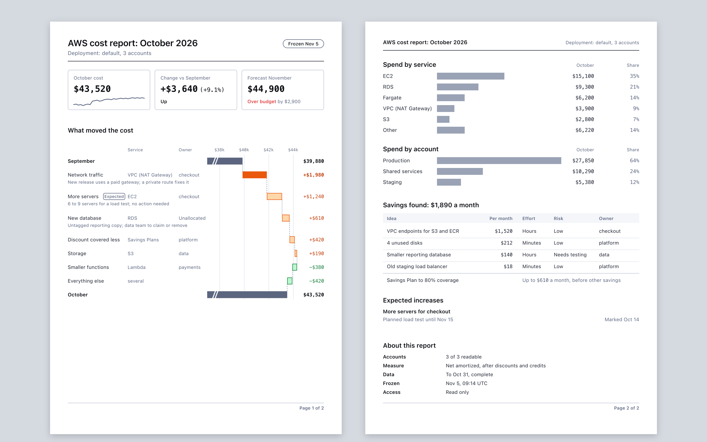
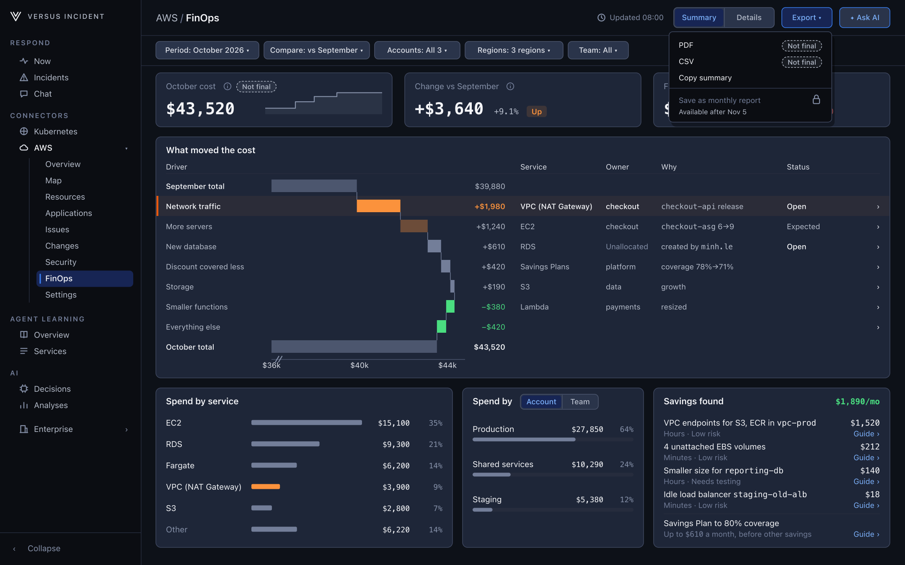

# Read your FinOps report

_In development — not released yet_

**The FinOps report fits a month of AWS cost on two pages: what you spent, what
moved it, and what you can save.** This guide walks through it block by block,
so you can read it, or send it to someone who has never opened Versus.

> **Preview only.** Everything on this page is from the design preview and uses
> sample data. The [AWS FinOps Agent](./aws-finops-agent.md) is not part of a
> release yet. Screens and wording may still change.

## Get the report

On the FinOps page, choose **Export → PDF**. Versus opens a print layout and
your browser's **Save as PDF** dialog.

- It prints on A4 or Letter, always in the light theme.
- It works offline. Nothing is sent to an outside service.
- The header names the deployment, the month and how many accounts it covers.

## Page 1: the answer

### Three cards

| Card | How to read it |
|---|---|
| **Cost** for the month | The total, with a small line that shows when it moved |
| **Change** vs last month | Amount and percent, with **Up**, **Down** or **About the same** (within ±2%) |
| **Forecast** for next month | The expected total. A budget line appears only if you set a budget |

All amounts are **what you actually pay**: after discounts, credits and Savings
Plans spread over their term. They are in your bill's currency, never
converted.

### What moved the cost

This chart starts with last month's total, adds or subtracts one row per cause,
and ends with this month's total. The rows always add up to the change.

- Each row names the cause in plain words (*Network traffic*, *New database*),
  the AWS service and the owner.
- The top three rows have one short sentence on why it happened and what to do.
- **Expected** marks an increase an admin has accepted, for example a planned
  load test. It stays in the chart so the totals still add up.
- Small causes under $50 are grouped as *Everything else*.
- A one-time charge, such as an annual support fee, and credits get their own
  rows. They are never counted as a trend.

## Page 2: the detail

### Spend

**Spend by service** and **spend by account** show amount and share for the
month. **Spend by team** appears when your team tags split the cost. See
[Tag your AWS cost for ownership](./aws-finops-tagging.md).

### Savings found

The total per month and up to five top ideas, each with:

| Column | Meaning |
|---|---|
| **Per month** | The monthly saving |
| **Effort** | *Minutes*, *Hours* or *Days* |
| **Risk** | *None*, *Low* or *Needs testing* |
| **Owner** | Who should act on it |

How the total is counted:

- One action per resource counts, the largest. Other actions on the same
  resource are alternatives and are not added.
- A Savings Plan is shown on its own as *up to $X a month, before other
  savings* and is not added to the total, because it is priced on today's
  usage.

Savings are guides. Versus never applies them for you.

### Expected increases

Each increase marked expected, with its reason and the date it is expected
until. After that date it reopens by itself if the cost is still high.

### About this report

| Row | Tells you |
|---|---|
| **Accounts** | How many accounts the numbers cover, for example *3 of 3 readable* |
| **Measure** | The cost measure used |
| **Data** | The last complete day, and whether the month is *complete* or *not final* |
| **Frozen** or **Generated** | When the numbers were frozen, or when this copy was made |
| **Missing** | Anything Versus could not read, if any |
| **Access** | Always *Read only* |

## Exact and estimated figures

Totals per account, service, team and region are always exact. A few figures
combine more than Cost Explorer can return in one request, for example one
team's share of one service across several accounts. Those are shared out in
proportion and marked **≈**. Their sentences say *likely*.

A missing figure is never printed as $0. If an account could not be read, the
totals say so, for example *2 of 3 accounts*.

## Not final

AWS can still change last month's cost until it closes the bill on the 5th of
the next month. Before then:

- The report header shows **Not final**, and the **Data** row says *not final*.
- You can still export it as a draft.
- **Save as monthly report** stays locked until the 5th.

A day also needs time to settle: it counts as complete 24 hours after it ends.
The report always names the last complete day.

## Frozen monthly reports

From the 5th, an admin can choose **Export → Save as monthly report**. Versus
freezes that month's numbers, sentences and charts.

- A frozen report shows **Frozen** with the date and time in the header and in
  *About this report*.
- Its numbers never shift, even if you open it months later, so it always
  matches what your boss saw.
- Open source keeps frozen reports for 13 months. Longer history is an
  Enterprise feature.

## Other ways to share

| Export | What you get |
|---|---|
| **CSV** | The table you are looking at, with your filters |
| **Copy summary** | A few plain lines to paste into Slack or email |
| **Slack summary** | A monthly picture through your existing Versus report delivery |

Scheduled PDF by email and a branded PDF are planned for Enterprise.
