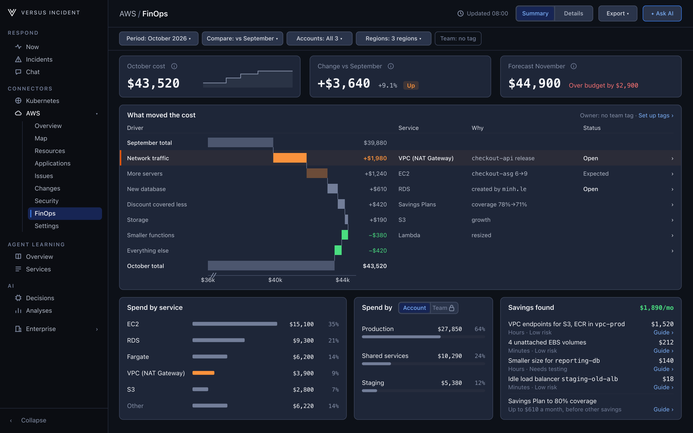
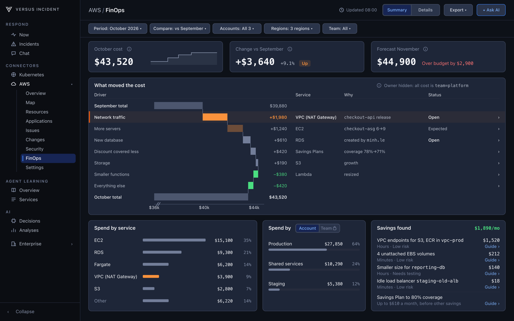
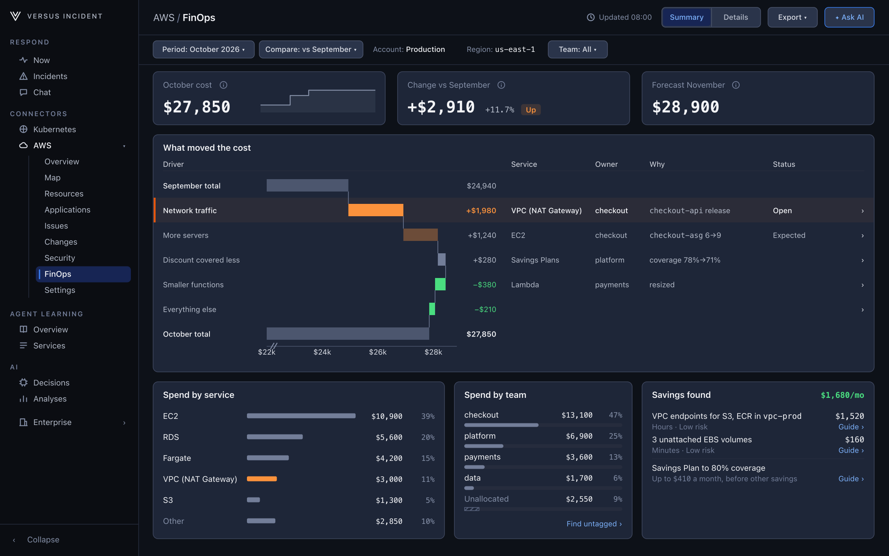

# Tag your AWS cost for ownership

_In development — not released yet_

**Give every dollar an owner with one tag.** The FinOps agent names the team
behind each cost from a single tag. This guide shows how to set it up and what
the page shows until you do.

> **Preview only.** Everything on this page is from the design preview and uses
> sample data. The [AWS FinOps Agent](./aws-finops-agent.md) is not part of a
> release yet. Screens and wording may still change.

## How Versus picks an owner

Versus checks three rules in order. The first one that matches wins, and the
page always says which rule it used.

| Order | Rule | Example |
|---|---|---|
| 1 | The **team tag** on the cost | `team=checkout` on the NAT gateway |
| 2 | The **account owner** from your config | Every cost in the Staging account belongs to `platform` |
| 3 | **Unallocated** | No tag and no account owner |

**Unallocated** is a real row with its own share. It is never hidden, and the
AI never guesses an owner.

The owner of an **increase** is the team with the most cost on that line since
the increase started. If most of it is untagged, the owner is
**Unallocated**.

## Set it up

### 1. Use one tag key

Versus reads **one** tag key for ownership. The default is `team`. Tag your
resources with it, for example `team=checkout`.

To use a different key, set `team_tag_key`:

```yaml
connectors:
  aws:
    finops:
      team_tag_key: team
```

### 2. Activate it as a cost allocation tag

A tag on a resource does not reach your cost data until you activate it in AWS:

1. Open **AWS Billing and Cost Management → Cost allocation tags** in the
   management (payer) account, or in your own account if it is not part of an
   Organization.
2. Select the `team` tag and choose **Activate**.

AWS applies the tag **from that day on**. Earlier cost stays without a team.
Versus checks once a day whether the tag is active. Until it is, the page says
**Team tag not active in billing**.

### 3. Allow Versus to show its values

Versus hides every tag value unless its key is on the tag-value allowlist. The
match is exact and case-sensitive, like AWS tag keys: `Team` does not match
`team`. The default list is `app`, `team`, `env`, `owner` and `cost-center`.

| To see | Add this key |
|---|---|
| Resource names | `Name` |
| The application column | Your app tag key (defaults `app` and `service`) |
| Owners or teams | Your team tag key (`team_tag_key`, default `team`) |

Add keys in AWS Settings or in config:

```yaml
connectors:
  aws:
    tags:
      value_allowlist: [Name, app, service, team, env]
```

### 4. Optional: set an owner per account

For cost with no team tag, you can name an owner for a whole account:

```yaml
connectors:
  aws:
    accounts:
      - account_id: "444455556666"
        display_name: Staging
        owner: platform
        # auth and regions as usual
```

## What the page shows

### No team tag yet



- The **Owner** column is hidden. One line says *Owner not shown: no team tag on
  this cost*, with **Set up tags**.
- **Team** is turned off in **Spend by**, with the reason.
- Every number stays the same. Spend by account still works.

### The same tag on everything



If every cost line has the same team, an Owner column would repeat it on every
row. It is hidden, and one line says *All cost has team=platform*. **Team** is
turned off in **Spend by** until a second team appears.

### Tags on several teams



Once two or more teams own cost, the **Owner** column appears and you can
filter and group by team. Untagged cost shows as **Unallocated** with **Find
untagged** so you can close the gap.

## Good to know

- **One key only.** Versus does not fall back to other tag keys such as `owner`
  or `app`. This keeps the owner predictable.
- **Estimated team figures.** With several accounts, a team's share of one
  service can be an estimate. It is marked **≈** and the text says *likely*.
  Team totals are always exact.
- **Splitting shared cost.** Chargeback rules that split shared cost across
  teams are planned for Enterprise.
