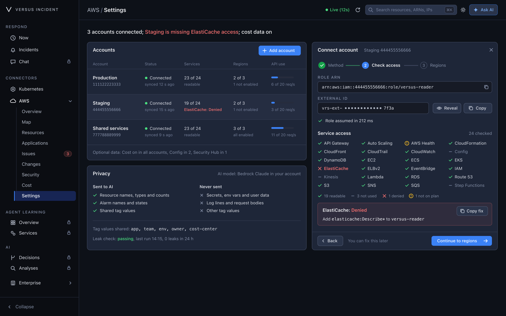

# Connect your AWS account

_In development — not released yet_

Connecting an account lets AWS Harness read its resource metadata. It takes a
few minutes, writes nothing to your account, and shows you exactly what Versus
can read before you save. New to AWS Harness? [See the
screens](/in-development/aws-harness#a-quick-tour) on the preview page first.

## What Versus can read

Versus reads metadata only: names, settings, statuses, links and counts. The
role covers 24 services.

| Group | Service | What Versus reads |
|---|---|---|
| Network | API Gateway | REST APIs, stages and routes |
| Network | CloudFront | distributions and their settings |
| Network | Elastic Load Balancing | load balancers, target groups and listeners |
| Network | Route 53 | hosted zones and health checks |
| Compute | Auto Scaling | groups and their instance counts |
| Compute | EC2 | instances, volumes, network interfaces and security groups |
| Compute | ECS | clusters, services and tasks |
| Compute | EKS | clusters and node groups |
| Compute | Lambda | functions and their configuration |
| Data | DynamoDB | tables and their settings |
| Data | ElastiCache | clusters and replication groups |
| Data | RDS | database instances and clusters |
| Data | S3 | bucket names and security flags, never objects |
| Messaging | EventBridge | event buses and rules |
| Messaging | Kinesis | streams and their settings |
| Messaging | SNS | topics and subscriptions |
| Messaging | SQS | queues and their attributes |
| Operations | AWS Health | events for your account |
| Operations | CloudFormation | stacks and their resources |
| Operations | CloudTrail | recent management events |
| Operations | CloudWatch | alarms and their state |
| Operations | Config | recorders and their status |
| Operations | IAM | roles, without policy documents |
| Operations | Step Functions | state machines |

Four more reads are optional and off by default: **Cost Explorer** (cost and
anomalies, billed per request by AWS), **Security Hub** findings, **Config**
advanced queries, and **Trusted Advisor** checks. Turn them on per account with
`OptionalData` in the template, or `optional_data = true` in Terraform.

## Before you start

- **The Versus server needs its own AWS identity.** An EC2 instance profile, an
  ECS task role, or a shared profile on the machine it runs on, allowed to call
  `sts:AssumeRole`. Without one the panel says **The Versus server has no AWS
  identity** and you cannot connect anything.
- **You need an admin in Versus.** Other roles can view the accounts but not
  change them.
- **Access is read-only.** The wizard calls `sts:AssumeRole` and one smallest
  read per service. Nothing is created, changed or deleted in your account.

## Connect an account



The panel has three steps: choose a method, check access, choose regions.

Five routes end at the same read-only role in your account: CloudFormation,
Terraform, the AWS CLI, an existing role you extend, or AWS Organizations for
every account at once. **Local profile** is the exception — it uses a profile
on the Versus machine and creates no role. Whichever route you take, Versus
assumes one `versus-reader` role per account and reads metadata only.

### Choose a method

| Method | Use it when |
|---|---|
| **CloudFormation quick-create** (Recommended) | You want the role created for you. Opens the console with the Versus template loaded. |
| **Terraform** | You create roles in a pipeline. Copy the module snippet and apply it there. |
| **AWS CLI** | You prefer a terminal, or the role is created by a script. Copy four commands. |
| **Existing role ARN** | You already have a role and will add Versus to its trust policy. |
| **Local profile** | Development on the Versus machine only. Production should use a role. |
| **AWS Organizations** | You want every account in the organization at once. **Enterprise** only. |

When the server has an identity, this step also shows the **Versus principal
ARN** to copy. The template, the Terraform module and the CLI script all need
it.

### Add the External ID

Every connection gets its own External ID, a secret that looks like
`vrs-ext-` followed by 24 characters. It is shown masked — prefix and last four
characters — with **Reveal** and **Copy**. Revealing is audited, and the value
masks itself again after 30 seconds.

The ID exists because `sts:AssumeRole` alone is too loose: any account that
trusts the Versus principal would accept a call from anyone who learns that
ARN. The trust policy checks the principal **and** the exact External ID
together, so a call with the right ARN and the wrong ID is refused before any
permission is evaluated.

- Treat it like a password. Do not put it in tickets, shared shell history, or
  a Terraform state you share more widely than the credentials.
- CloudFormation: paste it into `ExternalId`. Terraform: `external_id`.
- To rotate it, start a new connection and update the role trust policy.

### Check access

Paste the role ARN (it is filled in for you when reconnecting) and select
**Check access**. Versus assumes the role with the External ID, then probes each
service once, so a missing permission never hides the rest.

| Status | What it means |
|---|---|
| **Readable** | The read succeeded and found something. |
| **Not used** | The read succeeded; the account has none of that service. |
| **Denied** | AWS refused the read. The exact permission to add is shown below the grid. |
| **Not on plan** | The account is not subscribed. AWS Health needs a support plan. |
| **Not checked** | AWS throttled or did not answer. Versus retries; this is not a denial and not a zero. |

Each denial gets its own short line — *"Add `elasticache:Describe*` to
versus-reader"* — and **Copy fix** copies the least-privilege statement. Add
those actions to the role, update the stack or apply Terraform, then select
**Check access** again. You can also select **You can fix this later** and
continue; the denied service is named in the accounts table until it is fixed.

### Choose regions

- Only enabled regions can be selected. An opt-in region the account has not
  enabled is marked **Not enabled** and cannot be ticked.
- Regions where resources were found are preselected and say how many.
- The account name is filled from the role ARN, with the account ID below it.
  Change it if you like — it is only a label.

### Connect

Select **Connect account**. Versus saves the connection and starts a health
check. It re-checks each account on `health_check_interval` (5 minutes by
default) and stays within `budgets.max_requests_per_second` (2 by default) per
account and region.

## The template

Both artifacts create the same role, and either is fine:

- [versus-reader.yaml](https://github.com/VersusControl/versus-incident/blob/main/scripts/aws/versus-reader.yaml)
  — CloudFormation.
- [Terraform module](https://github.com/VersusControl/versus-incident/tree/main/scripts/aws/terraform/versus-reader)
  — the [README](https://github.com/VersusControl/versus-incident/blob/main/scripts/aws/README.md)
  covers both.

| Parameter | Terraform | Value |
|---|---|---|
| `VersusPrincipalArn` | `versus_principal_arn` | The exact Versus role ARN from the wizard, `arn:aws:iam::<account-id>:role/<role-name>`. Never the account root. |
| `ExternalId` | `external_id` | The value from the External ID step. |
| `OptionalData` | `optional_data` | `off` / `false` by default; `on` / `true` adds the four optional reads. |

**Never use the account root.** Trusting `arn:aws:iam::123456789012:root` lets
every principal in the Versus account assume the role, not just the Versus
server. Both artifacts reject root and any non-role principal.

Every assume carries the External ID, and the trust policy requires the
principal and the ID to match together — so the connection is re-checked with
that match before Versus reads anything. The template also rejects an ID shorter
than 16 characters or one containing a space. Updating the stack or the
Terraform variables applies a new value to the same role.

The role explicitly cannot:

| Denied | Why |
|---|---|
| `s3:GetObject` | Object bodies are your data, not metadata. |
| `secretsmanager:GetSecretValue` | Secret values are never read. |
| `ssm:GetParameter*` | Parameter values, including `SecureString`, are never read. |
| `kms:Decrypt` | Nothing is decrypted with your keys. |
| `dynamodb:GetItem`, `dynamodb:Query`, `dynamodb:Scan` | Table items are your data; only table settings are read. |
| `lambda:GetFunction` | Function code cannot be downloaded; configuration reads stay allowed. |
| `ec2:GetConsoleOutput` | Console output can contain boot-time secrets. |
| `logs:GetLogEvents` | Log bodies are never read. |

Deny wins over any allow, so a later broader policy cannot override these.
Billing surfaces (`aws-portal:*`, `billing:*`, `invoicing:*`, `payments:*`) are
denied too; cost figures come from Cost Explorer only.

To revoke access, delete the stack or run `terraform destroy`. Removing the
account in Versus stops the reads but leaves the role in place.

## Create the role with the AWS CLI

The script in [scripts/aws/cli/](../../scripts/aws/cli/README.md) creates the same
`versus-reader` role as the template, prints its ARN, and can be re-run to
update the trust in place.

> **Before you run it.** The profile you use must be allowed to create roles and
> put role policies (`iam:CreateRole`, `iam:PutRolePolicy`). The External ID is a
> secret: pass `-` as the second argument so the script prompts for it without
> echo and it never lands in your shell history.

1. **Copy the Versus principal ARN.** On **Choose a method**, copy the
   **Versus principal ARN** — the role ARN, never the account root.
2. **Copy the External ID.** On the External ID step, select **Reveal**, then
   **Copy**. Keep it out of shared files and tickets.
3. **Download the files and run the script.** Take `create-versus-reader.sh`,
   `trust-policy.json`, `permissions-policy.json` and
   `optional-data-policy.json` from the same folder, keep them together, then:

```bash
chmod +x create-versus-reader.sh
./create-versus-reader.sh <versus-principal-role-arn> -
```

The `-` makes the script ask for the External ID without echo, so the secret is
not stored in your shell history.

Add `--optional-data` to include the four optional reads:

```bash
./create-versus-reader.sh <versus-principal-role-arn> <external-id> --optional-data
```

4. **Paste the role ARN back.** The script prints the ARN of the role it
   created, `arn:aws:iam::<account-id>:role/versus-reader`. Paste it into the
   wizard, then select **Check access**.
5. **Verify it yourself before returning to Versus.** Assume the role from the
   same profile to prove the trust and the External ID match:

```bash
aws sts assume-role \
  --role-arn <role-arn> \
  --role-session-name versus-verify \
  --external-id <external-id>
```

A successful result returns `Credentials` with an `AccessKeyId`. If you get
`AccessDenied` and no `Credentials`, the trust policy and the External ID do
not agree — fix the role, not the wizard.

### Without the script

Replace `__VERSUS_PRINCIPAL_ARN__` and `__EXTERNAL_ID__` in `trust-policy.json`
first — the manual commands do not substitute them. Then create the role and
attach its policy:

```bash
aws iam create-role --role-name versus-reader \
  --assume-role-policy-document file://trust-policy.json

aws iam put-role-policy --role-name versus-reader \
  --policy-name versus-reader-metadata-reads \
  --policy-document file://permissions-policy.json
```

For the optional reads, attach the second policy as well:

```bash
aws iam put-role-policy --role-name versus-reader \
  --policy-name versus-reader-optional-data \
  --policy-document file://optional-data-policy.json
```

To remove the role again, delete the policies first, then the role. Delete
`versus-reader-optional-data` too if you attached it:

```bash
aws iam delete-role-policy --role-name versus-reader \
  --policy-name versus-reader-metadata-reads
aws iam delete-role --role-name versus-reader
```

## After you connect

The accounts table has one row per account:

| Column | What it shows |
|---|---|
| **Account** | Name, account ID, and **From config** when the account came from the server config. |
| **Status** | **Connected** with *checked 2 min ago*, or **Disconnected** with *since 14:05*. |
| **Services** | *21 of 24 readable*, and the name of a denied service when there is one. |
| **Regions** | How many selected regions are enabled, *3 of 3*, plus *all enabled* or *2 not enabled*. |
| **API use** | Current reads against the budget, *1 of 2 req/s*. |

- **Recheck** probes every service again and refreshes the row. It does not
  change the connection.
- **Reconnect** appears when an account is disconnected. It opens the wizard at
  the role step with the ARN filled in, so you can correct the trust policy or
  External ID, check access and save.
- **Rename** and **Remove** are offered for accounts added in the wizard.
  Rename changes the label. Remove stops Versus reading the account; it does not
  delete the role.
- **From config** means the account is defined in `connectors.aws.accounts` in
  the server configuration and is read-only in the UI. Edit the file and
  restart. The External ID must come from an environment variable, never
  inline:

```yaml
connectors:
  aws:
    enable: true
    accounts:
      - account_id: "111122223333"
        display_name: Production
        regions: auto
        auth:
          mode: assume_role
          role_arn: arn:aws:iam::111122223333:role/versus-reader
          external_id: ${VERSUS_AWS_EXTERNAL_ID}
```

## When something is wrong

| What you see | What it means | Fix |
|---|---|---|
| **The role trust policy refused Versus** | The trust policy does not allow the Versus principal. | Add the **Versus principal ARN** from the wizard to the role's trust policy. |
| **Trust policy does not allow this ExternalId** | The role trusts a different External ID than this connection. | Copy the External ID from this step into the trust condition (`sts:ExternalId`). |
| **Role not found** | AWS has no role at that ARN, or it is in another account. | Check the account ID and role name in the ARN. |
| `AccessDenied` when the CLI creates the role | The caller lacks `iam:CreateRole` or `iam:PutRolePolicy`. | Use a profile that may create roles and put role policies, or ask an admin to run the script. |
| `EntityAlreadyExists` from the CLI | A role named `versus-reader` already exists in the account. | Re-run the script — it updates the trust policy on the existing role. |
| `ValidationError` on the External ID | The ID is too short or contains a space. | Copy the full External ID from the wizard unchanged. |
| **Session duration not allowed** | The role's maximum session duration is shorter than Versus asks for. | Raise `MaxSessionDuration` on the role to at least 15 minutes. |
| **One service: Denied** | The role is missing that read. | Select **Copy fix**, add the actions, then **Recheck**. |
| **Not checked** | AWS throttled the read. Versus is backing off and retrying. | Nothing — it retries on its own, and it is not counted as a denial. |
| **Disconnected** | Two identity checks in a row failed. | Select **Reconnect**, correct the trust or ID, then **Recheck**. |
| **AWS Health: Not on plan** | The account has no support plan for AWS Health. | Nothing to fix; every other service still works. |
| **AWS connector is off** | The connector is disabled on the server. | Set `connectors.aws.enable: true`, or `VERSUS_CONNECTORS_AWS_ENABLE=true`, then restart. |

The environment variable overrides the config file, and both are read at
startup. While the connector is off, Versus reads nothing.

## Privacy

What the privacy card promises, and what it checks.

If AI is enabled, Versus sends: resource names, types and counts; alarm names
and states; and the values of shared tags. It never sends: secrets, environment
variables and user data; log lines and request bodies; or any other tag value.

Only these tag keys share their values: `Name`, `app`, `service`, `team`, `env`
(`connectors.aws.tags.value_allowlist`). Every other tag value stays in your
account. If AI is off, the card says so and nothing is sent at all.

The **leak check** sends a fixture containing canary secrets through the same
egress path and counts anything that survives. The card shows whether it is
passing, when it last ran and how many leaks were seen in 24 hours — *"Leak
check: passing, last run 14:15, 0 leaks in 24 h"*. A failing line is shown
rather than hidden; treat it as a bug.
