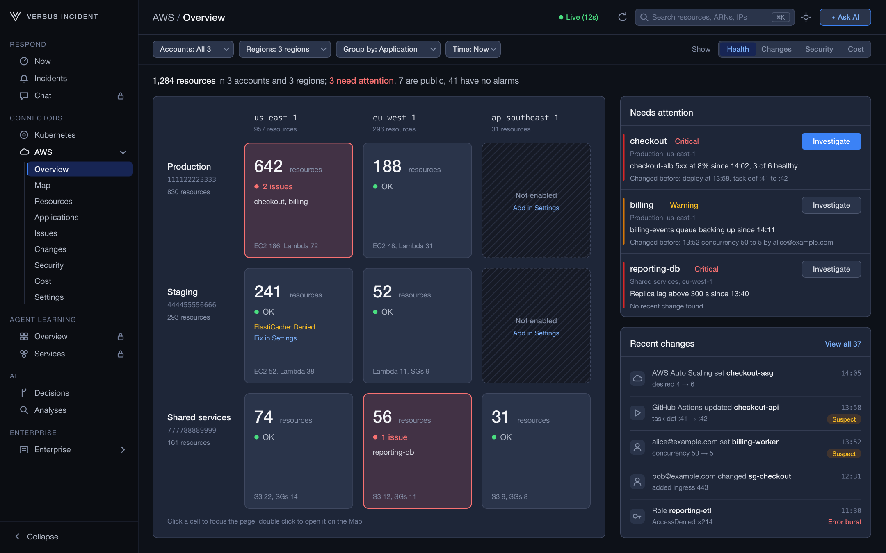
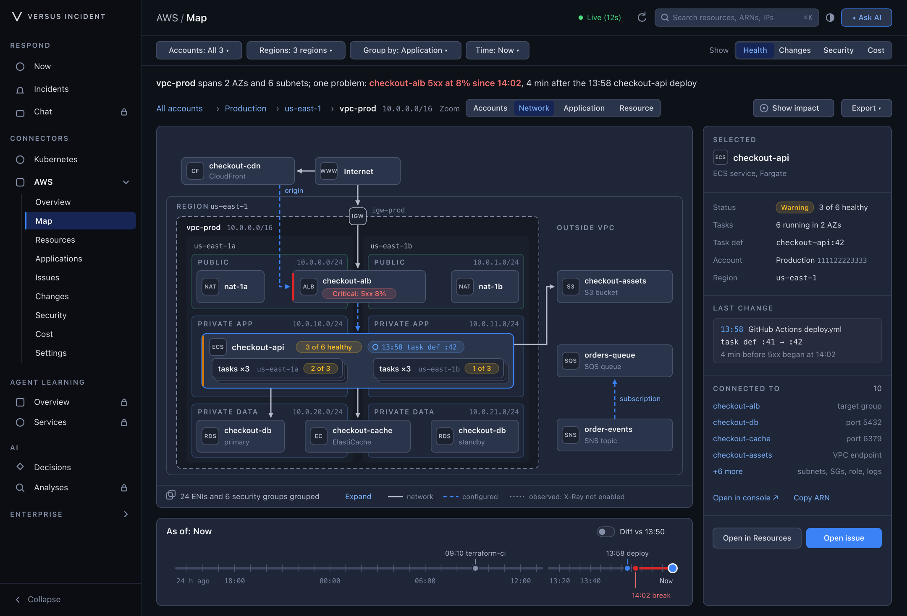
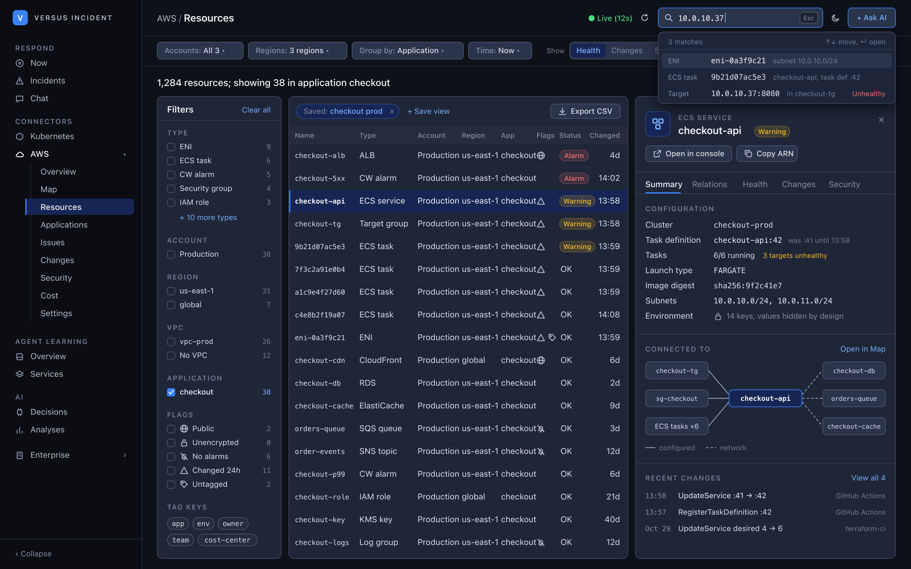
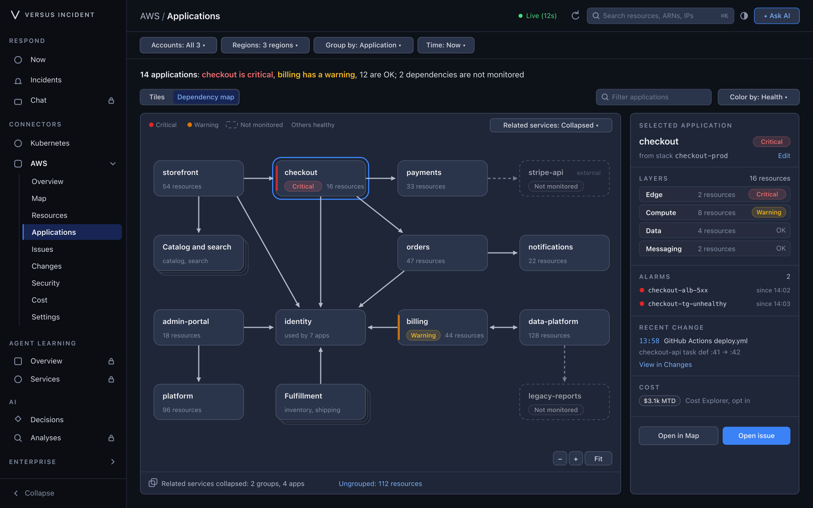
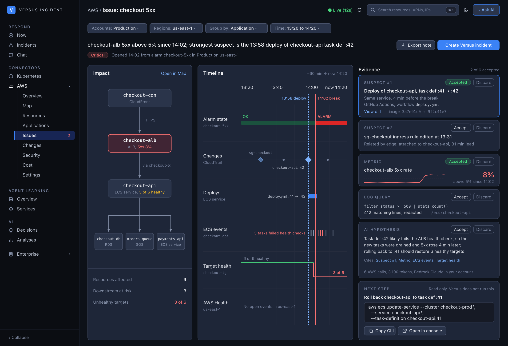
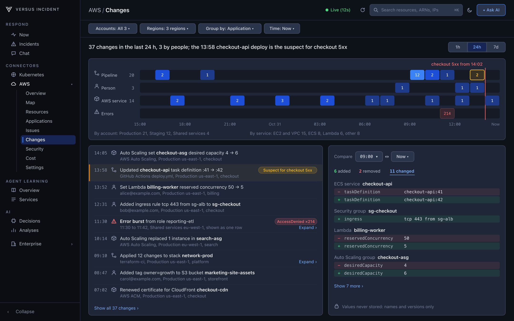
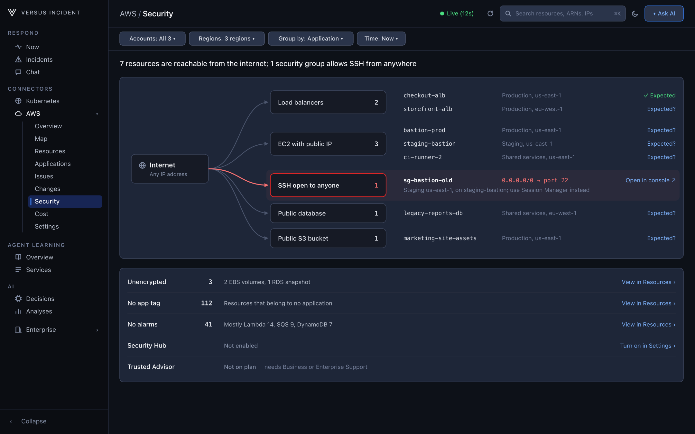
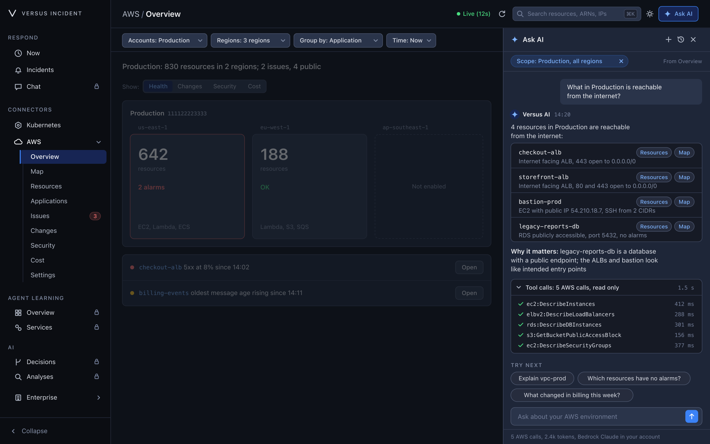
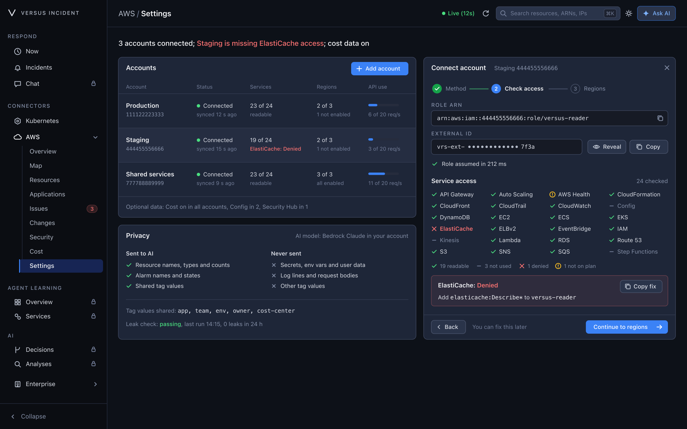

# AWS Harness

_In development — not released yet_

**One place to see what you have in AWS, how it is connected, and why something
broke.** AWS Harness reads your accounts (read-only) and turns them into a
dashboard your team can actually understand: what exists, where it runs, what
depends on what, and what changed just before an issue.

> **Preview only.** Everything on this page is from the design preview and uses
> sample data. AWS Harness is not part of a release yet, so you cannot install
> or enable it today. Screens and wording may still change.

## What it is for

Most teams answer "what is in our AWS?" by opening several consoles and
switching regions. AWS Harness puts the answers on one screen, for every
account and region at once:

- **What do we have, and where?**
- **How is it connected?**
- **Which applications are unhealthy?**
- **What changed before this broke?**
- **What is exposed to the internet?**
- **What is it costing, and what moved?**

## A quick tour

### See everything at a glance

The **Overview** is a grid of accounts (rows) and regions (columns). Each tile
shows how many resources live there and whether anything needs attention.
Regions you have not enabled say so instead of showing a zero.

The **Show** switch recolours the same grid by **Health**, **Changes**,
**Security** or **Cost** — so you can look at the same estate from a different
angle without learning a new page.

On the right, **Needs attention** lists what is broken with the change that
happened just before it, and **Recent changes** shows the latest activity.

### Follow how it is connected

The **Map** draws your environment the way it is actually built: the VPC, its
availability zones, public and private subnets, the internet gateway, and the
regional services outside the VPC (S3, SQS, SNS and so on).

- Click a node to open its details. **Show impact** highlights everything
  downstream, so you can see the blast radius.
- Links are drawn by how they work: network, configuration, or observed.
- The time slider lets you look at the map **as of an earlier moment** and
  compare it with now.
- Big environments are grouped ("ECS tasks ×6") instead of becoming a tangle.
- Export the map to share it with someone outside Versus.

### Find any resource

**Resources** is a searchable list of everything in your accounts. Filter by
type, account, region, VPC, application or tag — or press **⌘K** and search by
name, ARN, ID, IP address or tag.

Selecting a resource opens a panel with its settings, what it connects to, its
health and its recent changes. Configuration is shown by name and count only;
secret values and environment values are never displayed.

### See each application

**Applications** groups resources the way your team thinks about them — from
CloudFormation or CDK stacks, App Registry, or your `app` and `service` tags.

The main view is a dependency map: which application calls which. Anything
Versus cannot observe is drawn faded and marked **Not monitored**, so a missing
link never looks like a healthy one.

### Understand an issue

When something breaks, the issue page shows three things side by side:

1. **What is affected** — the failing resource and everything that depends on it.
2. **A timeline** of the 60 minutes before and after, with alarm changes,
   deployments and health events on separate rows.
3. **Evidence** — the changes that most likely led to it, the metric, the log
   match count and, if AI is enabled, a summary with links to the evidence.

Each piece of evidence can be **kept or dismissed**, and the result exports as
an incident note. Suspects are always labelled as suspects and ranked by rule —
Versus does not guess at a single "root cause".

### See what changed

**Changes** shows what happened in the last hour, day or week, written in plain
language: *"GitHub Actions updated ECS service checkout-api: task def :41 →
:42"*. Repeated errors, such as a burst of access denials, collapse into one
row.

Pick two times to see exactly what was added, removed or changed — names and
versions only.

### Check what is exposed

**Security** answers one question: what can the internet reach? It lists
internet-facing load balancers, public IPs, public databases, buckets that allow
public access, and security groups open on admin ports.

Other checks sit underneath: unencrypted resources, resources without
application tags, and resources with no alarms. Findings link back to the
resource, and you can mark one as expected.

### Ask in plain language

**Ask AI** is available on every page and understands what you are looking at.
Ask *"What in Production is reachable from the internet?"* or *"Why did
checkout break?"* and the answer links to the exact resources, map nodes and
timeline events behind it.

You can see which reads were made, how long they took, how many tokens were
used and which model answered.

### Get connected

Connecting an account is three steps: choose how to create the read-only role,
check access with one line per service, then pick regions. Access is checked
service by service, so a missing permission shows up as one clear line with the
exact fix — not as a broken dashboard.

## Safe and simple by design

- **Read-only.** AWS Harness never changes anything in your accounts. Suggested
  next steps are links and commands you run yourself.
- **You can see what it reads.** The role it uses is small and public, with
  data reads explicitly blocked.
- **Metadata only.** Settings, names, statuses, links and counts. Never secret
  values, environment values, object contents or log bodies.
- **Plain about gaps.** A missing permission or an unreadable region is shown
  where the data would be, with the fix. It is never shown as a zero.
- **Runs in your environment.** Self-hosted, and if AI is enabled it uses the
  model you choose.

## Status

AWS Harness is **in development**. There is no release date yet, and this page
describes the design preview. We will announce it in
[Releases](https://github.com/VersusControl/versus-incident/releases) when it is
ready.
