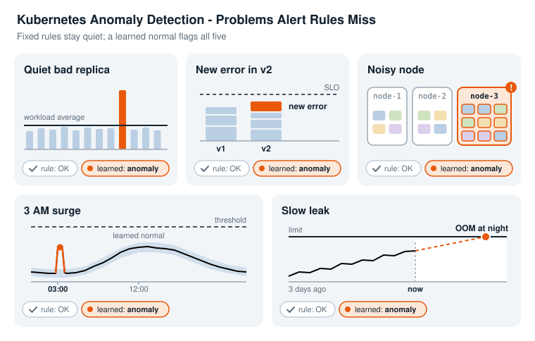
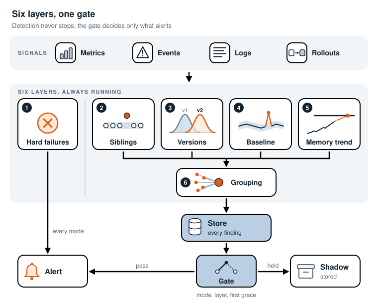
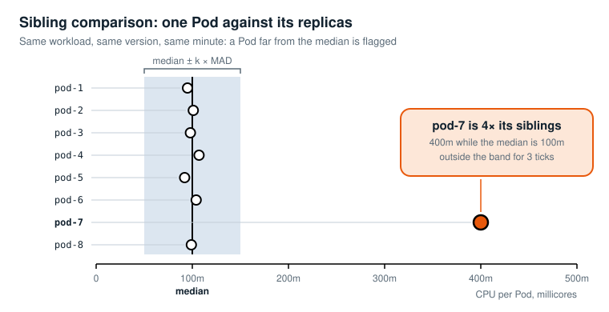
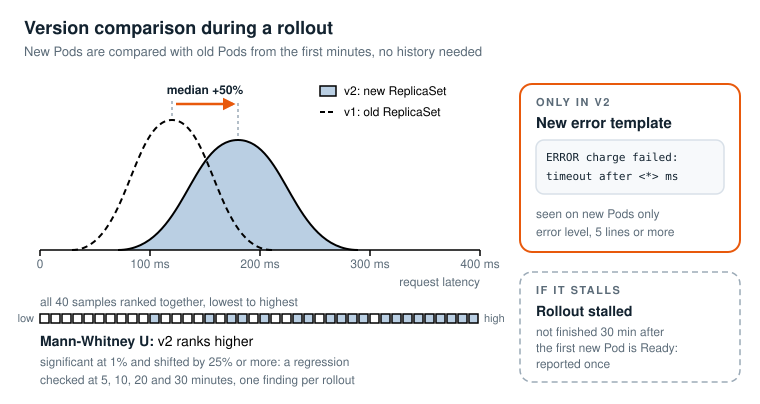
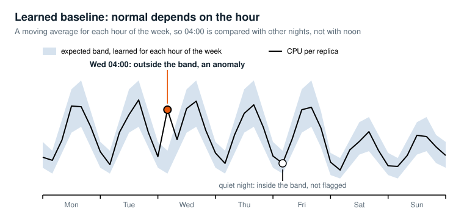
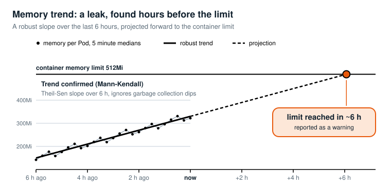
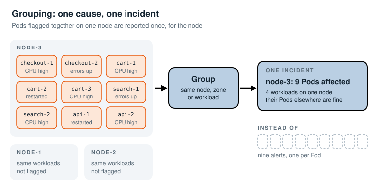
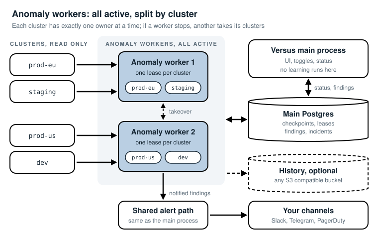
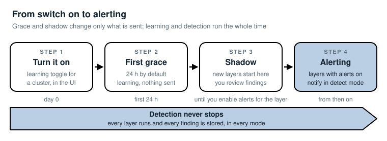

# Kubernetes Anomaly Detection

Recently we decided to add a feature that learns how your Kubernetes
workloads normally behave. We wanted it to catch the problems that alert rules
miss: the slow replica, the quiet regression, the leak that takes a day to
bite. And we wanted all of it to run locally, inside your environment.

> **Enterprise, in development.** This page explains the design.
> Names, defaults and screens may still change.

## What anomaly detection is

Some problems are easy to write a rule for: a Pod restarting, a container
killed for memory. The hard ones look fine to every rule you could write. Five
real-world examples:

- **The quiet bad replica.** 1 of 12 Pods answers 5× slower. The workload's
  average latency moves by a few percent, under any rule you'd write.
- **The release that looks fine.** v2 logs a new error ("charge failed:
  timeout") on about 2% of requests. The total error rate stays inside the
  SLO, so no rule fires.
- **The 3 a.m. surge.** Traffic at 03:00 reaches noon levels. A rule set for
  noon never fires, yet for this hour it is far from normal: a runaway job, a
  retry storm, someone scraping.
- **The noisy node.** 9 Pods from 4 workloads on node-3 are each a little
  slower. Every workload looks fine alone; together they point at one bad
  node.
- **The slow leak.** Memory grows about 2% an hour after a release. It stays
  under the limit for a day or more, until the Pod is OOMKilled at night.

A rule asks "is this number above my line?" Learning asks "is this unusual
for this workload, this version, this hour, on this node?"

**Key takeaway:** anomaly detection catches what no fixed line can, by
comparing each workload with its siblings, its previous version, its own past
and its neighbours on the same node.

## How other tools do it

Most products learn from each series' own past. Some add comparisons between
peers or between versions. A summary of what the vendors publish:

| Tool | Method | What it needs | Where it runs | Kubernetes angle |
|---|---|---|---|---|
| [Datadog anomaly monitors](https://docs.datadoghq.com/monitors/types/anomaly/) | Three families: rolling quantile (basic), robust SARIMA (agile), seasonal-trend decomposition (robust). Hourly, daily or weekly seasonality | At least 3 seasons of history per series | Datadog platform | Per series; no built-in notion of replicas or versions |
| [Datadog outlier detection](https://datadoghq.com/blog/outlier-detection-algorithms-at-datadog) | Compares each host or group member with its peers at the same moment (DBSCAN or median and MAD) | A group of peers | Datadog platform | Fits replicas of one workload |
| [Datadog Watchdog faulty deployment detection](https://docs.datadoghq.com/watchdog/faulty_deployment_detection/) | Compares a new version's errors with earlier versions; flags error types that are new | Version tags on the data | Datadog platform | [Applies to Kubernetes deployments](https://datadoghq.com/blog/watchdog-faulty-kubernetes-deployment). Watchdog's other internals are not published |
| [Grafana Cloud ML](https://grafana.com/docs/grafana-cloud/machine-learning/outlier-detection/) | Outlier detection (DBSCAN for series that move together, MAD against a 24-hour median); forecasting with Prophet | Forecasts train on 90 days by default; [series caps per detector](https://www.infoq.com:443/news/2023/01/grafana-outlier-detection/) | Grafana Cloud | Outliers fit replicas; forecasts need long history |
| [Elastic ML](https://www.elastic.co/docs/explore-analyze/machine-learning/anomaly-detection/anomaly-detection-scale) | Anomaly jobs over time buckets (15 minutes to 1 hour) | A model memory limit per job (1 GB default); [pruning and stopping at the limit](https://www.elastic.co/docs/explore-analyze/machine-learning/anomaly-detection/ml-limitations) | Elastic Stack | Generic; no rollout or replica model |
| [AWS DevOps Guru](https://docs.aws.amazon.com/devops-guru/latest/userguide/how-it-works.html) | An [ensemble of pre-trained statistical detectors](https://aws.amazon.com/blogs/machine-learning/amazon-devops-guru-is-powered-by-pre-trained-ml-models-that-encode-operational-excellence); groups anomalies by time, shared resources and a causal graph | CloudWatch metrics; no per-customer training | AWS | [Grouping related anomalies](https://docs.aws.amazon.com/devops-guru/latest/userguide/concepts.html) is the main value |
| [Kayenta](https://cloud.google.com/blog/products/gcp/introducing-kayenta-an-open-automated-canary-analysis-tool-from-google-and-netflix) (Netflix and Google) | [Canary judge](https://spinnaker.io/docs/guides/user/canary/judge): compares the new version's metrics with the baseline version's using the Mann-Whitney U test | A canary and a baseline running side by side | Open source; [callable from Argo Rollouts](https://argo-rollouts.readthedocs.io/en/latest/analysis/kayenta/) | Built for rollouts |

Two lessons stand out in this research:

- **Most outages follow a change.** Google's SRE material puts it at
  [about 70%](https://oreilly.com/ideas/tenets-of-sre). A detector that goes
  quiet after a deploy hides the most likely failures.
- **Simple statistics hold up.** Published studies found simple methods
  [match or beat deep models on log anomaly benchmarks](https://conf.researchr.org/details/icse-2024/icse-2024-research-track/21/Deep-Learning-or-Classical-Machine-Learning-An-Empirical-Study-on-Log-Based-Anomaly-),
  and that [many time-series anomaly benchmarks overstate deep-model progress](https://arxiv.org/abs/2009.13807v5).

## What we chose

A Kubernetes workload has two references that are better than its own past,
and both work from the first minute:

- **its sibling Pods**, which run the same code with the same traffic now;
- **its previous version**, which runs beside the new one during a rollout.

We build on those, keep a learned baseline for what only history can show,
and add a trend check for leaks. Six layers in total:

| # | Layer | Compares with | Catches | Needs history |
|---|---|---|---|---|
| 1 | Hard failures | Fixed rules | OOMKilled, CrashLoop, failed probes | No |
| 2 | Sibling comparison | Other Pods of the same workload and version, now | One sick Pod, a bad node | No |
| 3 | Version comparison | The previous version's Pods | A bad deploy, within minutes | No |
| 4 | Learned baseline | The workload's own past, per replica | Everything shifting together | Yes |
| 5 | Trend to the limit | The resource limit | Memory leaks, "OOM in about 2 hours" | 1–6 hours |
| 6 | Grouping | Node, zone, workload | "Everything on node X" as one finding | No |

**The methods we chose.** Each layer uses well-known methods: robust statistics
for four layers, plain rules for the other two. Each was picked
because it fits how Kubernetes behaves:

| Layer | Method (algorithm) | In one line | Why this one |
|---|---|---|---|
| Sibling comparison | Median and MAD (modified z-score) | Flags a Pod far from the group's middle value | Robust to the very outlier it is hunting; no parameters to tune per workload. Chosen over DBSCAN and over mean and standard deviation |
| Version comparison | Mann-Whitney U rank test; an exact rate-ratio test for counts; Drain-style log-template mining for new errors | Asks whether the new version's values sit higher than the old one's | Assumes no distribution shape and works on small samples; the same test canary analysis uses |
| Learned baseline | EWMA mean and variance in 168 hour-of-week buckets; an exact Poisson tail for small counts | Compares now with the same hour in past weeks | Streaming, constant memory, no batch training. Chosen over SARIMA and Prophet, which need weeks of stored history and refits |
| Memory trend | Theil-Sen slope plus the Mann-Kendall trend test | Fits a robust slope and projects when memory meets the limit | Ignores garbage-collection sawtooth. Chosen over least squares, which a single spike drags |
| Grouping | Rule-based grouping by node, zone and workload topology | Folds many flagged Pods into one finding | Kubernetes already says where each Pod runs |
| Hard failures | Fixed rules | OOMKilled, crash loops and failed probes alert as before | They need no learning |

**Why no deep learning or model training.** The research above points one
way: simple methods match or beat deep models on log benchmarks, and many
time-series benchmarks overstate deep-model progress. So every layer is
deterministic and streaming: no model files, no labels, no batch training.
Every verdict keeps the numbers that produced it, so it can be explained.

### 1. Hard failures

OOMKilled containers, crash loops and failed probes need no learning. They
alert as they do today, in every mode, even when anomaly detection is off.

### 2. Sibling comparison: median and MAD

Pods of the same workload and the same version should look alike. At each
tick, Versus finds the middle value across the group and how far Pods usually
spread from it. A Pod far outside that spread, for three ticks in a row, is
flagged. It works on CPU, memory, error-line rate and warning events per Pod.

**How the method works.** Take the middle value (the median), then the middle
of how far each Pod is from it (the median absolute deviation, MAD). That is
the yardstick. Unlike the standard deviation, one wild Pod can't stretch it.

Why it fits Kubernetes: it needs no history, it ignores autoscaling (adding
replicas does not change what one replica looks like), and it isolates the one
bad Pod that an average hides.

Guards keep it honest:

- Needs at least 4 Ready Pods of one version, each older than 5 minutes.
  With fewer, a **replacement** Pod is compared with the workload's previous
  Pods instead.
- If more than 30% of the group deviates, it is not one bad Pod. Nothing is
  flagged per Pod, and grouping checks for a shared node or zone.
- Workloads that differ on purpose (a database primary and its replicas) learn
  their usual spread and are skipped when it stays above 25%.
- Near-idle CPU is not compared; differences there are noise.

> **The maths:** modified z-score `0.6745 × (value − median) / max(MAD, 5% of median, floor)`, flagged at 3.5 or more with a shift of at least 30%.

### 3. Version comparison during rollouts: Mann-Whitney U

When a rollout starts, Versus compares the new Pods with the old ones, signal
by signal: CPU, memory, error-line rate, restarts and warning events, and log
templates. It checks at 5, 10, 20 and 30 minutes after the first new Pod is
Ready, and reports **one finding per rollout** listing every regressed signal
with both sides' numbers.

**How the method works.** Mann-Whitney U ranks all old and new samples
together. If the new ones mostly take the high ranks, the version shifted; no
bell curve is assumed. Counts such as error lines and events use an exact
rate-ratio test instead. For new errors, log lines are reduced to templates
with the variable parts masked, so a template seen only on new Pods stands out.

- **A new error.** A log template that appears at error level on new Pods and
  never on old ones is reported with scrubbed sample lines.
- **Single replica.** It still works: the old Pod's last 30 minutes are
  compared with the new Pod's first minutes.
- **Not enough data** gives the verdict "not enough data yet", never "healthy".
- **Stalled rollout.** A rollout not finished 30 minutes after its first new
  Pod was Ready is reported once as stalled, with the comparison so far. On
  the cluster we sampled, 17 Deployments stayed half-rolled-out for the
  whole sampling window.

Why it fits Kubernetes: the rollout is when to compare hardest, and both
versions are running side by side. This is the same idea as canary analysis,
applied to every rollout without setting up a canary. Versus only reports; it
never pauses or rolls back.

> **The maths:** Mann-Whitney U for CPU and memory (p < 0.01 and a shift of at least 25%); an exact rate-ratio test for error lines and events (p < 0.01 and at least 2×); at least 20 samples per side.

### 4. Learned baseline by time of week: EWMA

Some problems move every Pod at once: a traffic surge, a failing dependency.
Siblings and versions cannot see those, so Versus keeps a learned baseline per
workload. It learns a moving average and spread for each hour of the week, so
Monday morning is compared with past Monday mornings.

**How the method works.** An exponentially weighted moving average (EWMA):
each new value nudges the average by a small weight, and old data fades. There
is one average, with its spread, per hour of the week. Nothing is stored but
the averages, so there is no training run and no history to replay.

It learns **per-replica** values (the median and 90th percentile across Pods),
never the workload total, so autoscaling does not trigger it. It needs time:
weekly patterns take about three weeks to settle.

> **The maths:** exponentially weighted mean and variance in 168 hour-of-week buckets; flagged at `|z| ≥ 3` for 3 ticks. Small counts use an exact Poisson tail test instead of a z-score.

### 5. Memory trend to the limit: Theil-Sen and Mann-Kendall

A moving average follows a slow leak upward and learns it as normal. So
Versus asks a different question: is memory rising **steadily**, and when will
it reach the container's limit?

**How the method works.** Theil-Sen takes the slope between every pair of
points and keeps the median, so a spike or a garbage-collection drop barely
moves it. Mann-Kendall counts rises against falls across those pairs to
confirm the trend is real, not noise.

- Within 24 hours: a warning. Within 2 hours: urgent.
- The same slope on each new Pod after restarts is reported once as a leak
  pattern for the workload.
- No limit set: the finding uses the request, or "doubled in 6 hours", and
  says no limit is set.
- CPU at 90% of its limit or more for 15 minutes is reported as "at CPU limit,
  likely throttled".

Why it fits Kubernetes: Pods have explicit limits, and an OOMKill at the limit
is the outcome you want to see coming.

> **The maths:** 5-minute medians over 6 hours; a Theil-Sen slope with a Mann-Kendall trend test, both resistant to garbage-collection sawtooth; time to limit = (limit − current) ÷ slope.

### 6. Grouping by node, zone and workload

Before anything is reported, flagged Pods are grouped:

| Pattern | Becomes |
|---|---|
| 3 or more flagged Pods from 2 or more workloads on one node, while those workloads are fine elsewhere | One finding for the **node** |
| The same across the nodes of one zone | One finding for the **zone** |
| Several signals flagged on one workload | One finding for the **workload** |
| A rollout in progress | Folded into the rollout's finding |

Why it fits Kubernetes: a noisy neighbour or a bad node shows up as twelve
sick Pods. You want one finding that names the node.

## What it cannot see

The Kubernetes metrics API reports CPU and memory only. Without Prometheus or
a trace source, request latency and error rate are not visible; error lines
from logs and probe-failure events stand in for them. Network, disk and
throttling counters are not read.

## How we built it

### It runs locally, in its own process

Anomaly detection runs in a **separate worker process** from the same image.
The main process keeps serving the UI and API; the worker reads the clusters,
runs the six layers and sends findings. A log burst or a slow cluster costs
the worker's CPU and memory, never the main process's.

Nothing leaves your cluster for training. Learning happens in the worker, in
your environment.

**High availability is active-active, split by cluster.** Run one worker, or
two or more for HA and capacity. Every replica is equal; each cluster is owned
by exactly one replica at a time.

- When a replica joins or leaves, only about 1/N of the clusters move.
- A replica that is stopped writes a final checkpoint and hands over at once.
- A replica that crashes loses its clusters after about 90 seconds. The new
  owner loads the last checkpoint: at most 15 minutes of learning is lost, and
  sibling and version comparison work again from the first tick.
- A finding is sent **exactly once**, even across a failover.
- One cluster is never split between replicas, so its API server is read by
  one worker only.

### Small checkpoints, optional history

Learned state — templates, baselines, spreads, trend windows, rollouts in
progress — is saved as a compressed **checkpoint in your Versus database**
every 15 minutes, at handover and at shutdown. At full capacity a checkpoint
is about 22 MB compressed. There is nothing extra to configure, and it is
backed up with everything else. The worker needs Postgres as the main storage.

**History is optional.** You can point the worker at an S3-compatible bucket
(AWS S3, MinIO and others). It stores numbers and names only — per-Pod values,
expected bands, template counts, findings — never log text, as compressed JSON
lines that tools like DuckDB or `jq` can read.

| | Without history (default) | With history |
|---|---|---|
| Detection and incidents | Works fully | The same verdicts |
| Setup | Nothing | A bucket and access to it |
| Baseline learned an incident as normal | Reset it and wait about 3 weeks; other layers are unaffected | Rebuild it from history, without the bad window, in minutes |
| Checkpoint lost | Learning starts from zero | Rebuilt from history |
| Data outside your database | None | Workload, Pod and node names, values and counts |
| Extra things that can fail | None | The store; history then has gaps, detection is unaffected |

**Key takeaway:** history buys faster recovery and a way to look back. It is
never needed for detection.

### Detection never stops

Detection and alerting are separate decisions:

- **Every layer runs and every finding is stored**, in every agent mode.
- **A first grace period** (24 hours by default) follows when a cluster is
  turned on. Its findings are recorded, not sent.
- **New layers start in shadow.** Findings are stored and reviewable but not
  sent until you add the layer to the cluster's list of alerting layers. A
  layer that is noisy on your install can go back to shadow without stopping.
- **An alert fires only** when the agent is in detect mode, the layer is
  enabled for alerts, the grace period is over, and no other data source
  already alerted on the same problem.
- If a problem is still active when alerting turns on, it is sent once, noting
  when it started.

Every finding, sent or shadow, is listed on the cluster's Kubernetes agent tab
with its reason and the numbers on both sides. That list is where you review a
layer before trusting it.

### One toggle per cluster

Anomaly detection is switched on per cluster from the existing learning
toggles on the Kubernetes agent tab. A change takes effect within a minute,
with no restart. Next to the toggle, one status line says what is happening:

- "Anomaly detection is off"
- "Waiting for a learning worker"
- "Learning · 212 of 331 workloads · first grace ends in 18 h"
- "Detecting · 3 findings today (2 shadow)"
- "Needs Enterprise"

Tuning, when you want it, lives in an optional per-cluster block of the
connector configuration. Defaults apply without it, and the UI shows the
effective settings.

### Design principles

- **Explainable in one sentence.** Every verdict carries its numbers, for example "Pod
  `checkout-7f9` uses 2.4× the memory of its 5 siblings", not a score from a
  black box.
- **No per-workload tuning.** Median and MAD need no parameters per workload;
  workloads that differ on purpose are detected and skipped automatically.
- **Read-only.** The worker lists Pods, metrics and events and reads logs. It
  never changes your cluster or acts on a rollout.
- **No raw data egress.** Learning is local. History, if enabled, holds
  numbers and names, never log text. If AI is enabled, only an already decided
  finding is sent to the model you configured, for a summary.
- **Bounded memory.** Every input is capped — Pods and workloads per cluster,
  templates, log bytes per stream — and anything dropped is counted and shown
  in the status, never silently lost.

## Status

Kubernetes anomaly detection is **in development** for Versus Enterprise.
There is no release date yet. We will announce it in
[Releases](https://github.com/VersusControl/versus-incident/releases) when it
is ready.
