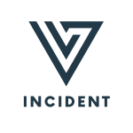
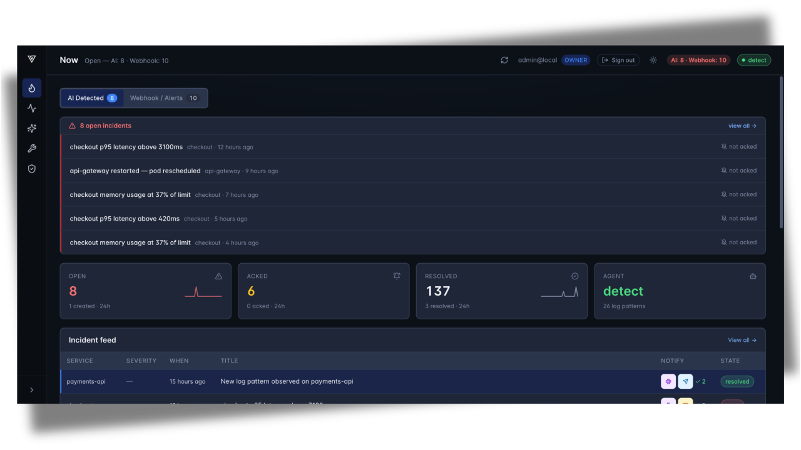
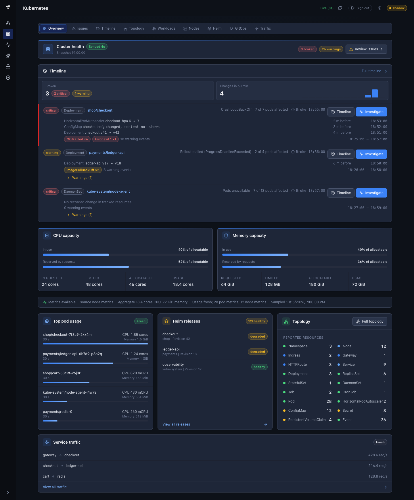
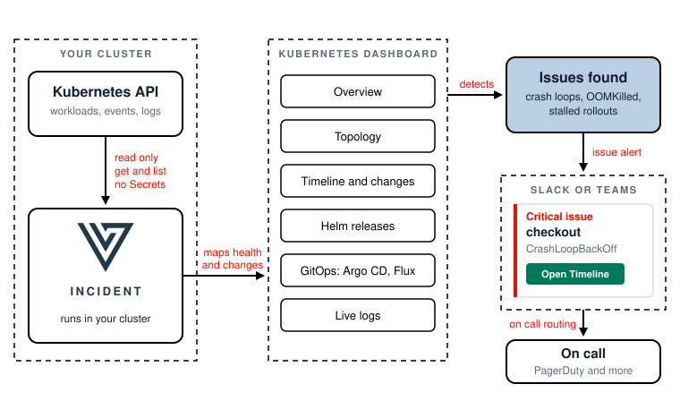
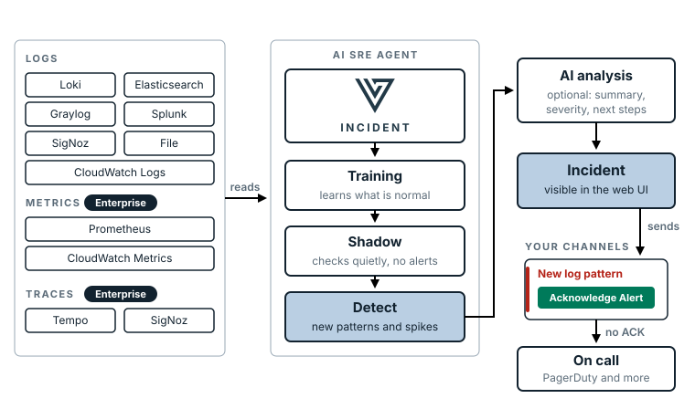
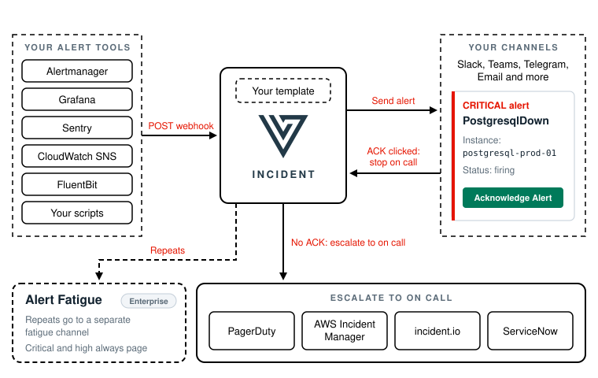

<h1 align="center" style="border-bottom: none">
  
</h1>

  
  

  You don't have to monitor your systems alone. Versus Incident will keep track of your services, applications, and systems, detect new or unexpected problems, and provide your team with the evidence needed to investigate.

  <i>Auto-detecting incidents in your system</i>
  

  <i>Auto-detecting issues in Kubernetes</i>
    
  

## How Versus Works

Versus finds problems in three ways.

1. **AIOps for Kubernetes.** Versus reads your cluster read-only, maps its
   workloads, changes and health, and detects issues on its own. Each issue is
   linked to the logs and changes around it.
2. **AI SRE Agent.** Versus connects to your logs, metrics and
   traces, learns what normal looks like, and raises an incident
   when something new or unexpected appears. No alert rules to write.
3. **Webhook alerts.** The alert tools you already run (Alertmanager, Grafana,
   Sentry, CloudWatch SNS, FluentBit, or your own scripts) POST to Versus. Versus
   applies your template, sends the alert to every channel you enable, and
   escalates to on-call if nobody acknowledges it. Repeated noise is quieted by
   [Alert Fatigue](/enterprise/alert-fatigue) (_Enterprise_).

## Features

### AIOps for Kubernetes

See your cluster's health, capacity, workloads, recent changes, Helm releases
and GitOps status in one place. Versus lists broken workloads as issues, puts
the changes and crashes around each break on a timeline, and can alert your
channels when a new issue appears. It never changes anything in the cluster.

[AIOps Kubernetes Quickstart](/agent/kubernetes/quickstart)

### AI SRE Agent

Point the agent at your logs and let it learn your normal patterns in training
mode. In detect mode it opens an incident only when a new or unusual error shows
up, and sends it to your channels and on-call. Metrics and traces sources are _Enterprise_.

[AIOps SRE Quickstart](/agent/quickstart)

### Webhook alerts

Send alerts from any tool that can POST a webhook. Versus formats each alert
with your own template, fans it out to your channels, and escalates it to
on-call when it is not acknowledged in time.

[Webhook Quickstart](/webhook/quickstart)

### More features

- **[DevOps Agent Chat](/agent/devops-agent):** ask questions about your
  systems in the Versus UI; answers cite the evidence from read-only tools.
- **[Notification channels](/agent/channels):** Slack, Microsoft Teams,
  Telegram, Viber, Email and Lark.
- **[On-call](/oncall/on-call-introduction):** escalate through AWS Incident
  Manager, PagerDuty, ServiceNow or incident.io.
- **[Custom templates](/webhook/template-syntax):** write your own alert
  messages with Go templates.
- **[PostgreSQL storage](/configuration/postgres-storage):** keep incidents and
  agent state in PostgreSQL instead of local files.
- **Enterprise:** [Single Sign-On](/enterprise/sso/overview),
  [High Availability](/enterprise/ha/overview) and
  [SLI/SLO auto-define](/enterprise/slo) (_Enterprise_).

## Roadmap

See [ROADMAP.md](https://github.com/VersusControl/versus-incident/blob/main/ROADMAP.md) for the full list of shipped features, work
in progress, and planned phases (more log sources, metrics, traces,
cross-signal correlation).

## Support The Project

[GitHub Sponsors](https://github.com/sponsors/versuscontrol) · see [SPONSORS.md](https://github.com/VersusControl/versus-incident/blob/main/SPONSORS.md)

## Contributing

Contributions are welcome. Please read [CONTRIBUTING.md](https://github.com/VersusControl/versus-incident/blob/main/CONTRIBUTING.md)
for development setup, coding standards, and the PR process, and review
the [CODE_OF_CONDUCT.md](https://github.com/VersusControl/versus-incident/blob/main/CODE_OF_CONDUCT.md) and [SECURITY.md](https://github.com/VersusControl/versus-incident/blob/main/SECURITY.md)
before reporting vulnerabilities.

Project governance is documented in [GOVERNANCE.md](https://github.com/VersusControl/versus-incident/blob/main/GOVERNANCE.md).

## License

Distributed under the MIT License. See [LICENSE](https://github.com/VersusControl/versus-incident/blob/main/LICENSE) for more information.
