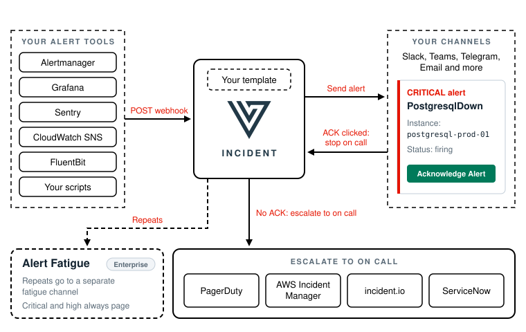
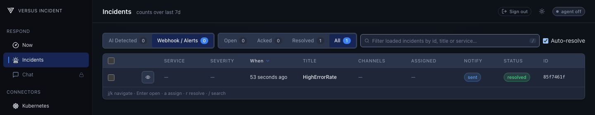
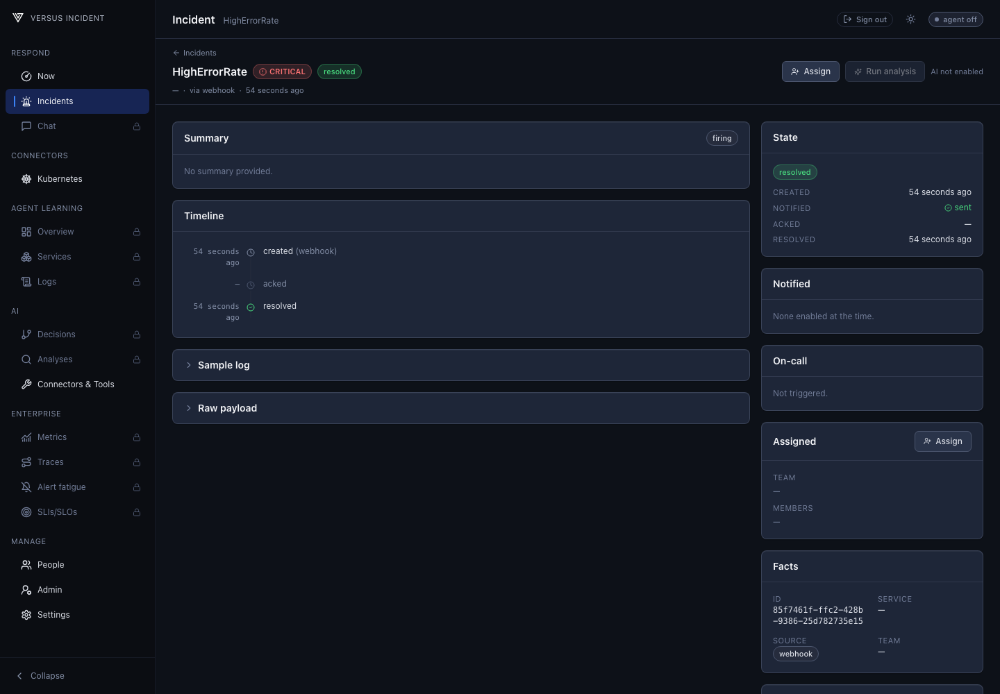
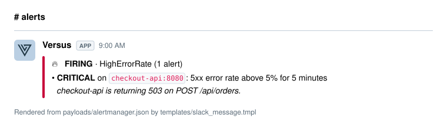
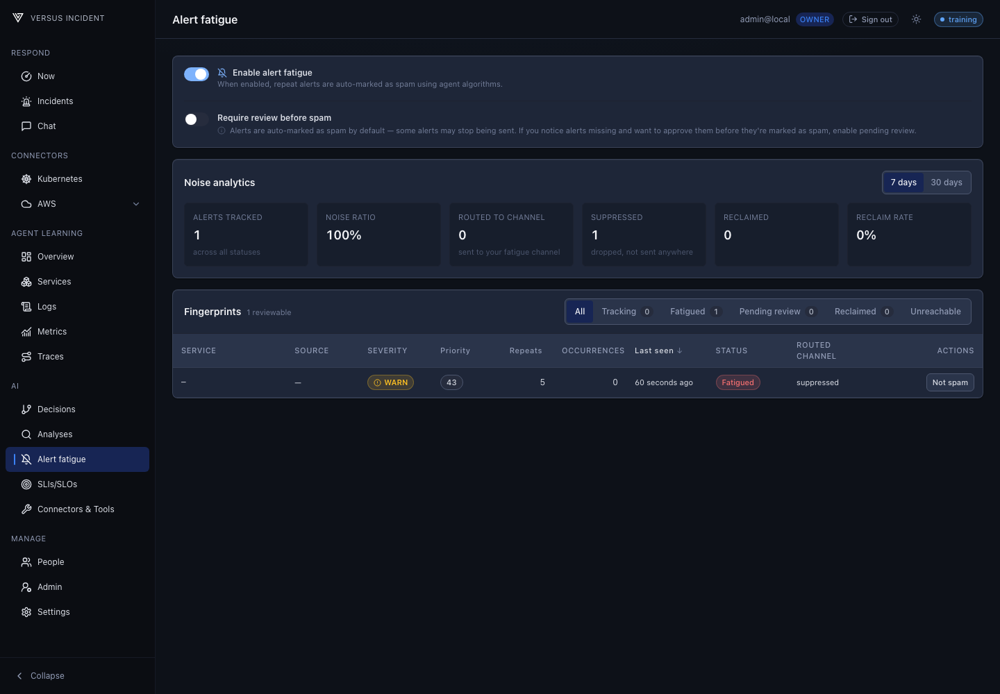

# Webhook Quickstart

Run Versus with Docker Compose and send it a sample Alertmanager alert. You
will see the alert in the Versus UI and in Slack, change the Slack message with
your own template, and optionally let a real Prometheus and Alertmanager send
it.



## Before you start

You need Git, Docker with Docker Compose v2, and `curl`. Check:

```bash
docker compose version
```

Slack is optional: without it you still see every alert in the Versus UI.

## 1. Start the stack

Clone the repository and go into the quickstart folder:

```bash
git clone https://github.com/VersusControl/versus-incident.git
cd versus-incident/examples/quickstart/webhook
```

Every command on this page runs from that folder,
`versus-incident/examples/quickstart/webhook`. If you open a new terminal, `cd`
into it first.

The stack runs on your machine and uses the OSS image:

| Service | Address | What it is |
| --- | --- | --- |
| Versus | `http://localhost:3000` | The UI. The webhook URL alerts are sent to is `http://localhost:3000/api/incidents`. |
| Redis | not exposed | Used by Versus. |
| Prometheus | `http://localhost:9090` | Optional, step 6. |
| Alertmanager | `http://localhost:9093` | Optional, step 6. |

All ports listen on your machine only. Open the UI at `http://localhost:3000`.

Start the stack:

```bash
docker compose up -d
```

Check that the services are up. The **STATUS** column of `versus` and `redis`
reads `Up …`, with `(healthy)` after a few seconds:

```bash
docker compose ps
```

## 2. Send a sample Alertmanager alert

The example folder has a sample alert in `payloads/alertmanager.json`: a
critical `HighErrorRate` alert for `checkout-api`. Send it the way
Alertmanager would:

```bash
curl -X POST http://localhost:3000/api/incidents \
  -H 'Content-Type: application/json' \
  -d @payloads/alertmanager.json
```

What you'll see: `{"incident_id":"<id>","notify_status":"none","status":"Incident created"}`,
with HTTP status 201. `notify_status` is `none` because no channel is on yet.

## 3. See the alert in the UI

Browse to `http://localhost:3000`, enter the gateway secret `change-me`, and
open **Incidents**.

The page opens on the **AI Detected** tab. Pick the **Webhook / Alerts** tab,
then the **All** filter. Webhook alerts are notifications, so Versus files them
as resolved right away and they do not show under **Open**. To keep them open
instead, clear the **Auto-resolve** checkbox on the same page.



*The sample alert on the Webhook / Alerts tab.*

Open `HighErrorRate` to see the incident: severity **CRITICAL**, status
**resolved**, source **webhook**, and the alert body under **Raw payload**.



*The incident page for the sample alert.*

The quickstart prints every alert body it receives, which helps when you
write templates:

```bash
docker compose logs versus
```

## 4. Get the alert in Slack (optional)

You need a Slack bot token (`xoxb-…`) and a channel ID. See
[Slack](/agent/channels/slack#get-the-credentials) for how to get them. Invite
the bot to the channel first (`/invite @your-bot`).

Export the three variables and recreate Versus:

```bash
export SLACK_ENABLE=true
export SLACK_TOKEN=xoxb-...
export SLACK_CHANNEL_ID=C0123456789
docker compose up -d versus
```

Send the alert again:

```bash
curl -X POST http://localhost:3000/api/incidents \
  -H 'Content-Type: application/json' \
  -d @payloads/alertmanager.json
```

What you'll see in the channel, formatted by `templates/slack_message.tmpl`:

```text
🔥 *FIRING* · HighErrorRate (1 alert)
• *CRITICAL* on `checkout-api:8080`: 5xx error rate above 5% for 5 minutes
  _checkout-api is returning 503 on POST /api/orders._
```



*An illustration of the Slack message from the sample template.*

If the token or channel is wrong, the curl still gets HTTP 201 and the
incident is stored. The response shows `"notify_status":"failed"` and
`"notify_error":"slack: failed to post standard message: invalid_auth"`. The
same error is on the incident's **Notified** card, so Alertmanager does not
retry it.

## 5. Edit the template and resend

The `templates/` folder is mounted into Versus, and the template is read for
every alert. Edits apply to the next alert, with no restart.

Open `templates/slack_message.tmpl` and change the first line that is not a
comment, the one starting with `{{ $icon }}`. For example, add a `[checkout]`
tag before the alert name:

```text
{{ $icon }} *{{ upper .status }}* · [checkout] {{ .commonLabels.alertname }} ({{ len .alerts }} alert{{ if gt (len .alerts) 1 }}s{{ end }})
```

Save the file and send the same curl again:

```bash
curl -X POST http://localhost:3000/api/incidents \
  -H 'Content-Type: application/json' \
  -d @payloads/alertmanager.json
```

The new message shows your change:

![The same Slack message after the template edit: the first line now reads FIRING · [checkout] HighErrorRate (1 alert)](../docs/images/quickstart-webhook-slack-edited.svg)

*An illustration of the Slack message after the template edit.*

The JSON body of the alert is the template's data: `.status`, `.alerts`,
`.commonLabels` and the rest. See [Template Syntax](/webhook/template-syntax)
and [Advanced Template Tips](/webhook/advanced-template-tips).

## 6. Let Alertmanager send it (optional)

Instead of `curl`, start Prometheus and Alertmanager with a demo rule that
always fires:

```bash
docker compose --profile alertmanager up -d
```

About 20 to 30 seconds later, a `QuickstartDemoAlert` (severity `warning`) arrives
in Versus. Find it under **Incidents** on the **Webhook / Alerts** tab with
the **All** filter, and in Slack if
you set it up. Alertmanager sends it again every 5 minutes while it fires.

To point your own Alertmanager at Versus, add a webhook receiver with the URL
`http://<versus-host>:3000/api/incidents`. The example's
`alertmanager/alertmanager.yml` shows a complete one. For Sentry, Fluent Bit
and AWS SNS, see [Send Alerts from Your Tools](/webhook/send-alerts).

Stop the demo alert:

```bash
docker compose --profile alertmanager stop prometheus alertmanager
```

## 7. Turn on on-call acknowledgment (optional)

With on-call turned on, the Slack message gets an **Acknowledge Alert** button. If
nobody presses it within 3 minutes, Versus pages your on-call tool. The
quickstart is set up for PagerDuty and needs an Events API v2 routing key:

```bash
export ONCALL_ENABLE=true
export PAGERDUTY_ROUTING_KEY=<your Events API v2 routing key>
docker compose up -d versus
```

Keep the Slack variables from step 4 exported in the same terminal. To set
up PagerDuty, or to use another on-call tool, see
[On-Call](/oncall/on-call-introduction) and
[Integration: PagerDuty](/oncall/how-to-integration-pagerduty).

## 8. Quiet repeats with Alert Fatigue (_Enterprise_)

[Alert Fatigue](/enterprise/alert-fatigue) is _Enterprise_. It spots an alert
that keeps repeating and stops it from interrupting on-call. This step runs the
Enterprise image with Postgres, and needs a license key. See
[Running the Enterprise Agent](/enterprise/getting-started) for how to get one.

**1. Start the Enterprise stack.** The overlay file swaps in the Enterprise
image and adds Postgres:

```bash
export LICENSE_KEY=<your license key>
docker compose -f docker-compose.yml -f docker-compose.enterprise.yml up -d
```

Do not commit the key to a file.

**2. Sign in as admin.** Print the generated admin password:

```bash
docker compose -f docker-compose.yml -f docker-compose.enterprise.yml logs versus | grep -i password
```

Browse to `http://localhost:3000` (use `localhost`, not `127.0.0.1`: turning
the feature on from `127.0.0.1` fails with `CSRF validation failed`) and sign
in as `admin` with that password.

**3. Turn it on.** Open **AI → Alert fatigue** and switch on **Enable alert
fatigue**.

**4. Send a warning alert 5 times.** `payloads/alertmanager-warning.json` is a
warning `DiskSpaceLow` alert:

```bash
for i in 1 2 3 4 5; do
  curl -s -X POST http://localhost:3000/api/incidents \
    -H 'Content-Type: application/json' \
    -d @payloads/alertmanager-warning.json
done
```

What you'll see: refresh the **Alert fatigue** screen. The **Fingerprints**
table has one row: severity **WARN**, **Repeats** 5, status **Fatigued**, and
routed channel **suppressed**. **Service** and **Source** show `—`, and the
table does not show the alert name. Select **Details** on the row to see the
alert's content.



*The repeated warning alert on the Alert fatigue screen.*

Critical and high alerts always reach on-call and are never quieted. Without
`LICENSE_KEY` the Enterprise image runs in community mode and the screen stays
locked.

## Check it works

- **Incidents**, on the **Webhook / Alerts** tab with the **All** filter,
  lists `HighErrorRate`.
- With Slack set up, the message changes after the template edit, with no
  restart.

## Troubleshooting

| What you see | Fix |
| --- | --- |
| `curl: (7) Failed to connect` | Versus is not up yet. Run `docker compose ps` and wait for `healthy`, then `docker compose logs versus`. |
| curl warns that it couldn't read `payloads/alertmanager.json` | Run the curl from the `versus-incident/examples/quickstart/webhook` folder, where `payloads/` is. |
| **Incidents** looks empty | The page opens on **AI Detected**, and the alert is filed as resolved. Pick the **Webhook / Alerts** tab, then **All**. |
| HTTP 500 | The incident could not be stored. Read `docker compose logs versus` for the error. |
| `CSRF validation failed` when turning on Alert fatigue | You opened the UI at `127.0.0.1`. Open `http://localhost:3000` instead and try again. |
| The response shows `"notify_status":"failed"` with a Slack error, such as `invalid_auth` | Check `SLACK_TOKEN` and `SLACK_CHANNEL_ID`, and that the bot is in the channel. Export them again and run `docker compose up -d versus`. |
| Slack message did not change after the edit | Check you saved `templates/slack_message.tmpl` in the example folder, then send the alert again. Read `docker compose logs versus` for errors. |
| **Alert fatigue** screen is locked | `LICENSE_KEY` was not exported before `up -d`. Export it and run the Enterprise `up -d` command again. |

## Clean up

```bash
docker compose --profile alertmanager down -v
```

After the Enterprise step, use:

```bash
docker compose -f docker-compose.yml -f docker-compose.enterprise.yml --profile alertmanager down -v
```

`-v` also deletes the volumes, including the stored incidents.

## Next steps

| Goal | Where to go |
| --- | --- |
| Send alerts from Alertmanager, Sentry, Fluent Bit or AWS SNS | [Send Alerts from Your Tools](/webhook/send-alerts) |
| Write your own templates | [Template Syntax](/webhook/template-syntax), [Advanced Template Tips](/webhook/advanced-template-tips) |
| Send to another channel | [Notification Channels](/agent/channels) |
| Escalate to on-call | [On-Call](/oncall/on-call-introduction) |
| Detect incidents from logs, not just alerts | [AIOps SRE Quickstart](/agent/quickstart) |
